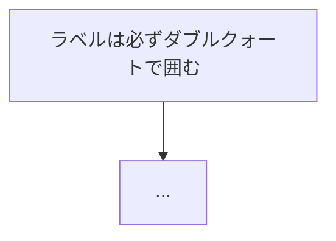

# ページの雛形

解説資料の体裁。そのままコピーして中身を差し替える。
`<出力先>` は SKILL.md §0 でユーザーに確認したディレクトリ（例: `docs/catch-up/`）。
リンクは**同じディレクトリ内の相対パス**（`./`）で書くので、出力先がどこでもこの雛形はそのまま使える。

以下の例は「CSV 出力」というテーマの資料を書いた場合のサンプル。
ファイル名・パス・コミットハッシュはすべて置き換える前提のダミーである。

---

## A. 目次ページ（`NN_0_テーマ_全体像と読む順番.md`）

````markdown
# 13_0. CSV 出力 — 全体像と読む順番

← 全体の目次 [00_はじめに-読む順番.md](./00_はじめに-読む順番.md)

次 → [そもそも CSV とは](./13_1_CSV出力_そもそもCSVとは.md)

---

> **このページの前提**
>
> - 対象コミット: `5277d1c`。**行番号はこの時点のもの**です。ずれていたら関数名で探してください。
>   （git 管理下でないリポジトリなら「対象日: 2026-09-17 時点」と書く）
> - 引用しているコードは**実物をそのまま貼っています**。省略した部分には `...` と書いてあります。
> - 前に読んでおくとラクなページ: [03_...](./03_....md)。読んでいなくても最後まで読めるように、
>   必要な用語はその都度この分冊の中で説明します。

この解説のゴールは、**「〜したいとき、どのファイルの何行目をさわればいいか、
そして何が壊れるか」が分かる状態**です。

---

## いちばん先に知っておくこと：<この分冊の山場を 1 つだけ先出し>

<AA 図か mermaid で 1 枚>

---

## 分冊の一覧

| # | ページ | 何が書いてあるか | 目安 |
|---|---|---|---|
| 0 | **このページ** | 扱うファイルの一覧と、全体の流れ | 4 分 |
| 1 | [そもそも CSV とは](./13_1_....md) | ... | 8 分 |

節番号（`## 1.` 〜 `## 10.`）は**分冊をまたいで通し**です。
文中で「§6.3 を見てください」と書いてあるときは、`13_6` のページを開いてください。

---

## 0. この分冊で扱うファイル

### 主役

| ファイル | 行数 | 役割 | テスト |
|---|---|---|---|

### 脇役

| ファイル | 役割 | このページで扱う場所 |
|---|---|---|

---

## 1. 全体の流れ


````

---

## B. 本文ページ（`NN_M_テーマ_小見出し.md`）

````markdown
# 13_4. フロント側 — `csv.ts` を 1 行ずつ

← 目次 [13_0 全体像と読む順番](./13_0_....md)

← 前 [8 列の設計](./13_3_....md)　／　次 → [バックエンド側 `csv_rows`](./13_5_....md)

> **このページは分冊です。** 全体像は [13_0](./13_0_....md)。
> 対象コミット: `5277d1c`。**行番号はこの時点のもの**です。
> 対象ファイルは `src/utils/csv.ts`（全 70 行）。**全文をこのページで扱います。**

---

## 4.1 <節見出しは「読者の疑問」の形にする>

```ts
// src/utils/csv.ts:11
import type { CheckResult } from '../types'
```

`import type` は「**型だけ**を持ってくる」という書き方です。<その場で説明する>

### ここに 1 つ落とし穴があります

<読者が「バグでは？」と思う所は必ず節を立てる>

```
  ┌──────────────┐              ┌──────────────┐
  │ 画面の表示      │    ボタン     │ CSV の中身     │
  └──────────────┘  ────→       └──────────────┘
```

---

## 4.6 このコードのテスト

<守っているテストのファイルと個数。無いなら「無い」と書く>

---

## 理解度チェック

<details>
<summary><b>Q1.</b> <このページの山場を問う></summary>

**A.** ... → §4.2
</details>

<details>
<summary><b>Q2.</b> ...</summary>

**A.** ...
</details>

<details>
<summary><b>Q3.</b> <知らないとハマる落とし穴を問う></summary>

**A.** ...
</details>

---

## 次にどこを読むか

| 知りたいこと | 行き先 |
|---|---|

---

← 前 [8 列の設計](./13_3_....md)　／　次 → [バックエンド側 `csv_rows`](./13_5_....md)

← 目次 [13_0 全体像と読む順番](./13_0_....md)
````

---

## C. 「直すときの手引き」ページ（分冊の最終ページ）

変更パターンごとの早見表を置く。分冊の最後、または独立した「仕様を変えたときのテスト早見表」ページとして書く。

```markdown
| やりたい変更 | 触る場所 | 通すテスト | 気をつけること |
|---|---|---|---|
| 段の名前を変える | `src/pipeline.py:240` `:252` | `tests/test_phase_timer.py` | フロントの `JobPhase` も直さないと画面が止まる |
```

---

## D. 全体目次（`00_はじめに-読む順番.md`）

出力先にまだ無ければ新規作成する。既にあれば、そこに新しい分冊を追記する。

```markdown
# 00. はじめに — 読む順番

この資料群は、<対象> を初めて読む人向けの解説です。

## 読む順番（コース）

| コース | 読むページ | 合計の目安 |
|---|---|---|
| まず全体をつかむ | 01 → 02 → 03 | 20 分 |
| CSV 出力を直したい | [13_0](./13_0_....md) → 13_1 … 13_10 | 65 分 |

## ファイルの一覧

| ファイル | 何が書いてあるか | 目安 |
|---|---|---|
| [13_0 CSV出力 全体像](./13_0_....md) | 扱うファイルと全体の流れ | 4 分 |

## 分冊について

1 ファイル 200〜300 行に収まるよう分けています。`13_0` のような `_0` は目次ページです。
節番号（§）は分冊をまたいで通しです。
```
