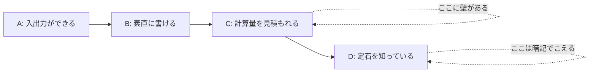
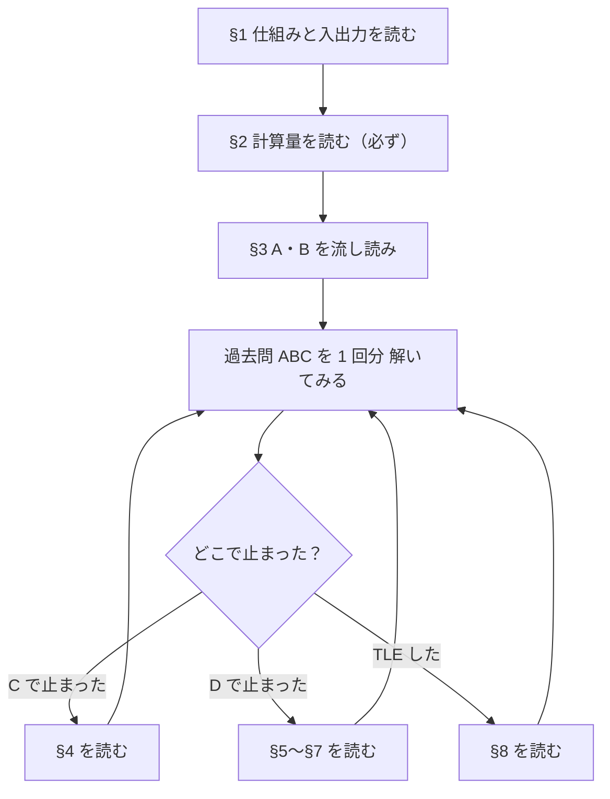

# 01_0. AtCoder A〜D 攻略 — 全体像と読む順番

← 全体の目次 [00 はじめに](./00_はじめに-読む順番.md)

次 → [§1-1 コンテストの仕組み](./01_1_1_コンテストの仕組み_提出とジャッジ結果の読み方.md)

---

> **このページの前提**
>
> - 対象日: **2026-09-17 時点**の AtCoder の仕様で書いています。コンテストの形式・使える言語の
>   バージョンは運営の告知で変わるので、細かい数字は本番前に公式で確認してください。
> - この資料には**解説の題材になる既存コードがありません**（`AtCoder/` は空でした）。
>   そのため貼ってあるコードは全部**書き下ろしのサンプル**で、`ファイル名:行番号` の引用形式は使いません。
>   代わりに、**そのまま提出できる完成形**を貼ります。写して動かすところから始められます。
> - 読者の想定: **開発経験はあるが、競技プログラミング（競プロ）は初めて**。
>   プログラミング用語は説明しませんが、**競プロ固有の言葉は全部その場で説明します**。
> - 言語は **Python** です。

この資料のゴールは、**「問題文を読んで 5 分以内に『これは何をする問題か』を判定し、
手が止まらずに書き始められる状態」** です。A〜D 帯で必要なのは発想の天才性ではなく、
**引き出しの数と、制約から解法を逆算する手順**です。

---

## いちばん先に知っておくこと：勝負は「書く前」に決まっている

開発の仕事だと、だいたいの処理は「素直に書けば動く」。競プロが違うのはここです。

```
  ふつうの開発                        競プロ
  ┌────────────────────┐            ┌────────────────────┐
  │ 仕様を読む           │            │ 問題文を読む         │
  │        ↓            │            │        ↓            │
  │ 素直に書く           │            │ ★制約を見る★        │  ← ここを飛ばすと
  │        ↓            │            │        ↓            │     全部ムダになる
  │ 動く                │            │ 間に合う解法を選ぶ    │
  └────────────────────┘            │        ↓            │
                                    │ 書く → 2秒以内なら AC │
                                    └────────────────────┘
```

「素直に書く」と、A・B は通ります。C から先は**素直に書くと必ず間に合わない**ように
問題が作られています。だから C 以降では、**書き始める前に「何回ループが回るか」を見積もる**。
この 1 手順を習慣にするだけで、C の正答率がはっきり変わります。

詳しくは §2（計算量）でやります。**この資料でいちばん大事なのは §2 です。**

---

## A〜D は、それぞれ何を測っている問題か

AtCoder Beginner Contest（以下 **ABC**）の A から D は、難易度が一直線に上がるというより、
**問われている能力が違います**。

| 問題 | 配点の目安 | 問われているもの | 必要な知識 |
|---|---|---|---|
| **A** | 100 点 | 入力を受け取って出力できるか | 標準入力・`if` |
| **B** | 200 点 | 素直に書き下せるか（実装力） | `for` ループ・配列・文字列 |
| **C** | 300 点 | **間に合う書き方を選べるか** | 全探索・累積和・ソート・二分探索 |
| **D** | 400 点 | **定石アルゴリズムを持っているか** | DP・グラフ（BFS/DFS）・数学（約数・mod） |

配点は回によって変わります（D が 350 点や 400 点など）。目安として見てください。



**壁は 2 つあります。**

1. **B → C の壁**＝「見積もりの壁」。書けるけど間に合わない、を自力で判定できるか。
2. **C → D の壁**＝「知識の壁」。DP や BFS を**知らないと一生思いつかない**。逆に言えば、
   知っていれば書けます。D 帯の大半は**暗記でこえられます**。

開発経験がある人は A・B はほぼ素通りできます。この資料は §1〜§3 を軽く流して、
**§2（計算量）と §4〜§7（C・D の定石）に時間を使う**構成にしてあります。

---

## 「覚えなければならないこと」の全体地図

この資料で扱う道具を 1 枚にすると、こうなります。Dまでで必要なのはこれで全部です。

```
┌─ 土台（§1・§2）──────────────────────────────────┐
│  標準入力の受け取り方 6 パターン                        │
│  計算量の見積もり（2秒で何回まわせるか）                  │
│  制約 → 解法の逆算表   ← いちばん大事                   │
└───────────────────────────────────────────────┘
          │
┌─ A・B（§3）──────────┐   ┌─ C（§4）────────────────┐
│ 二重ループ全探索        │   │ 累積和・いもす法           │
│ bit 全探索             │   │ ソート＋貪欲               │
│ 文字列操作の定石        │   │ 二分探索（bisect）         │
│ 0-indexed / 境界の罠   │   │ しゃくとり法               │
└──────────────────────┘   │ Counter / defaultdict     │
                            └──────────────────────────┘
┌─ D（§5・§6・§7）────────────────────────────────┐
│ DP           : ナップサック・経路数・区間・bitDP       │
│ グラフ        : BFS（最短路）・DFS・Union-Find        │
│ 数学          : 約数列挙・素数（エラトステネス）        │
│                GCD/LCM・mod 10^9+7・組合せ           │
└───────────────────────────────────────────────┘
┌─ Python 固有（§8）──────────────────────────────┐
│ input() の高速化 / 再帰上限 / in list の罠          │
│ [[0]*W]*H の罠 / 浮動小数の誤差 / 提出前チェック      │
└───────────────────────────────────────────────┘
```

この箱の中身を「見た瞬間に手が動く」状態にするのが目標です。**理解するだけでは足りず、
書けるようにする**必要があります。読むだけでなく、各ページのコードを写経してください。

---

## 分冊の一覧

| # | ページ | 何が書いてあるか | 目安 |
|---|---|---|---|
| 0 | **このページ** | A〜D の位置づけ、覚えることの全体地図 | 5 分 |
| 1-1 | [§1-1 コンテストの仕組み](./01_1_1_コンテストの仕組み_提出とジャッジ結果の読み方.md) | ABC の進み方とペナルティ、AC/WA/TLE/RE の意味、CPython と PyPy | 7 分 |
| 1-2 | [§1-2 入力の受け取り方](./01_1_2_入力の受け取り方_6パターンとその違い.md) | 6 パターンの暗記と、**違いは何か／なぜ `N` を使わない回があるのか** | 11 分 |
| 1-3 | [§1-3 テンプレ・出力・ルール](./01_1_3_汎用テンプレと出力と手元実行のルール.md) | **どの形式でも読めるテンプレ**、出力の罠、**手元で試すのはルール上いいのか** | 9 分 |
| 2 | [§2 計算量](./01_2_計算量_制約から解法を逆算する.md) | **この資料の山場。** 2 秒で回せる回数、制約 → 解法の逆算表 | 12 分 |
| 3 | [§3 A・B 全探索の型](./01_3_AB問題_全探索の型.md) | A・B で落とすパターン、二重ループ全探索、bit 全探索 | 14 分 |
| 4-1 | [§4-1 累積和・ソート・貪欲](./01_4_1_C問題_累積和とソートと貪欲.md) | 累積和・いもす法・2次元累積和、ソート、貪欲が効く型 | 11 分 |
| 4-2 | [§4-2 二分探索・しゃくとり・数え上げ](./01_4_2_C問題_二分探索としゃくとりと数え上げ.md) | `bisect`、答えの二分探索、しゃくとり法、`Counter`/`defaultdict` | 12 分 |
| 5 | [§5 DP](./01_5_D問題その1_DP.md) | DP の型、ナップサック、経路数、区間、bit DP | 16 分 |
| 6 | [§6 グラフ](./01_6_D問題その2_グラフ_BFS_DFS_UnionFind.md) | 隣接リスト、BFS 最短路、DFS、グリッド探索、Union-Find | 16 分 |
| 7 | [§7 数学](./01_7_D問題その3_数学_約数と素数とmod.md) | 約数列挙、エラトステネス、GCD/LCM、mod と逆元、組合せ | 14 分 |
| 8 | [§8 Python 落とし穴](./01_8_Python落とし穴と提出前チェックリスト.md) | 速度の罠、デバッグ手順、提出前チェック、**覚えることリスト早見表** | 12 分 |

節番号（`## 1.` 〜 `## 8.`）は**分冊をまたいで通し**です。
文中で「§4.3 を見てください」と書いてあるときは `01_4_1` を、「§4.4」なら `01_4_2` を開いてください。
**ハイフンの `§4-1` はファイル、ドットの `§4.4` は節**を指します
（→ [00 はじめに](./00_はじめに-読む順番.md) の「リンクの呼び方」）。

---

## 0. この資料の使い方（おすすめの進め方）



**読んでから解くのではなく、解いてから該当ページに戻る**のが効率的です。
一度も詰まっていないアルゴリズムは、読んでも身につきません。

練習は AtCoder 公式の「過去問」か、有志の練習サイト（AtCoder Problems など）で、
**ABC の C 問題だけを 10 問連続で解く**といった横断的なやり方が効きます。
同じ引き出しを繰り返し開けることになるので、定着が早いです。

---

## 理解度チェック

<details>
<summary><b>Q1.</b> B までは解けるのに C で必ず詰まる人が、いちばん先に読むべきなのはどのページ？</summary>

**A.** §2（[§2 計算量](./01_2_計算量_制約から解法を逆算する.md)）。
B → C の壁は知識の壁ではなく「間に合うかどうかを書く前に判定できるか」の壁だから。
C の多くは、素直な二重ループが通らないようにわざと制約が設定されている。→ §2
</details>

<details>
<summary><b>Q2.</b> D 問題が「才能ではなく暗記でこえられる」と書いたのはなぜ？</summary>

**A.** ABC の D 帯で出るのは DP・BFS/DFS・Union-Find・約数/素数/mod といった、
**種類が限られた定石**だから。知らなければ何時間考えても出てこないが、
知っていれば問題文を読んだ瞬間に「これはナップサック」と判定できる。→ §5〜§7
</details>

<details>
<summary><b>Q3.</b> この資料のコードに `ファイル名:行番号` の引用が付いていないのはなぜ？ 読むときに何に気をつける？</summary>

**A.** 題材になる既存のリポジトリコードが無く、全部が書き下ろしのサンプルだから。
気をつけることは、**貼ってあるコードは「読む」のではなく「写して動かす」もの**だという点。
手元で実行してサンプル入力を通すまでが 1 セット。→ このページ冒頭の前提ブロック
</details>

---

## 次にどこを読むか

| 知りたいこと | 行き先 |
|---|---|
| そもそもコンテストってどう参加するの | [§1-1 コンテストの仕組み](./01_1_1_コンテストの仕組み_提出とジャッジ結果の読み方.md) |
| Python で入力をどう受け取るの | [§1.4 入力 6 パターン](./01_1_2_入力の受け取り方_6パターンとその違い.md) |
| なぜ C が解けないのか | [§2 計算量](./01_2_計算量_制約から解法を逆算する.md) |
| D の定石を一気に入れたい | [§5 DP](./01_5_D問題その1_DP.md) → [§6 グラフ](./01_6_D問題その2_グラフ_BFS_DFS_UnionFind.md) → [§7 数学](./01_7_D問題その3_数学_約数と素数とmod.md) |
| 覚えることを一覧で見たい | [§8.7 覚えることリスト早見表](./01_8_Python落とし穴と提出前チェックリスト.md) |

---

次 → [§1-1 コンテストの仕組み](./01_1_1_コンテストの仕組み_提出とジャッジ結果の読み方.md)

← 全体の目次 [00 はじめに](./00_はじめに-読む順番.md)
