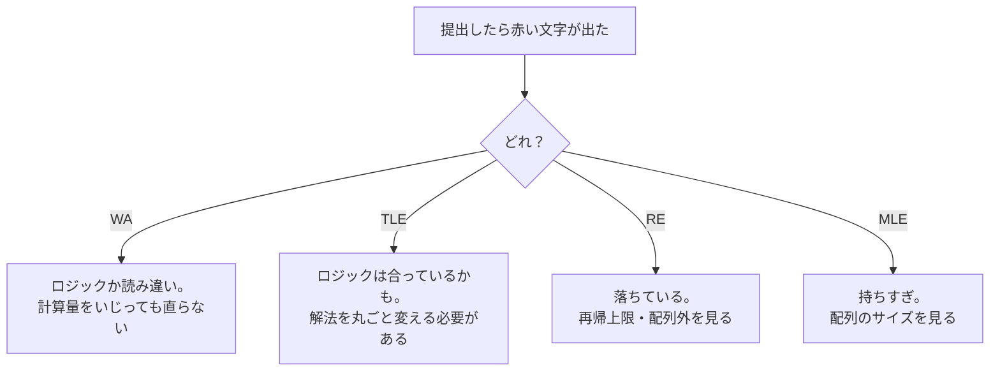

# 01_1_1. コンテストの仕組み — 提出とジャッジ結果の読み方

← 目次 [01_0 全体像と読む順番](./01_0_AtCoder攻略_全体像と読む順番.md)

← 前 [01_0 全体像と読む順番](./01_0_AtCoder攻略_全体像と読む順番.md)　／　次 → [§1-2 入力の受け取り方](./01_1_2_入力の受け取り方_6パターンとその違い.md)

> **このページは分冊です。** 全体像は [01_0](./01_0_AtCoder攻略_全体像と読む順番.md)。
> 対象日: **2026-09-17 時点**。コンテスト形式・言語バージョンは運営の告知で変わります。
> コードはすべて書き下ろしのサンプルで、**そのまま提出できる完成形**です。
> §1 は分量が多いので前半・後半に分けています。
> **入力の受け取り方（§1.4 以降）は [01_1_2](./01_1_2_入力の受け取り方_6パターンとその違い.md) と [01_1_3](./01_1_3_汎用テンプレと出力と手元実行のルール.md)**。

---

## 1.1 ABC（AtCoder Beginner Contest）はこう進む

毎週土曜または日曜の夜、**100 分**のコンテストです。問題は A から G あたりまで並んでいて、
**後ろほど難しく、配点が高い**。A〜D はその前半 4 問にあたります。

進み方はこうです。

```
 21:00 開始 → A: 書く→提出→AC ／ B: 提出→WA→直す→提出→AC ／ C: …
 22:40 終了。「得点」と「最後に AC した時刻（＋ペナルティ）」で順位が決まる
```

ここで**開発の感覚と違う**のが 2 つあります。

### 提出は何回でもできる。ただしペナルティが付く

間違った提出（WA）をしても失格にはなりません。直して出し直せます。
ただし、**最終的に AC した問題については、それまでの誤答 1 回につき 5 分**が
順位計算用の時刻に加算されます。これを**ペナルティ**と呼びます。

- AC できなかった問題の誤答は、ペナルティになりません（0 点なので関係ない）
- つまり**「解けそうにない問題は何回出してもタダ」「解ける問題こそ慎重に」**

初心者がいちばん損をするのは、**A や B を雑に出して WA を積む**パターンです。
A で 2 回 WA すると 10 分のペナルティ。これは C を 1 問解く価値に匹敵することがあります。

### 順位は「点数 → 時刻」の 2 段階で決まる

まず合計点が高い人が上。**同点なら、最後に AC した時刻（＋ペナルティ）が早い人が上**です。
だから A〜D を全部解いたなら、**早く解くほど順位が上がる**。

### レーティング（色）との関係

AtCoder には参加するたびに更新される**レーティング**があり、値によって色がつきます
（灰 → 茶 → 緑 → 水 → 青 …）。ABC は初級者向けのレーティング対象コンテストです。

A〜D を安定して全部取れるようになると、おおむね**茶色から緑色**の帯に入ってきます。
「A〜D を毎回確実に」は、初心者の当面のゴールとして非常に良い目標設定です。
（E 以降に手を出すより、**D までの取りこぼしを 0 にする**ほうがレーティングは上がります。）

---

## 1.2 ジャッジ結果の読み方 — WA / TLE / RE は「別々の病気」

提出すると、用意された**テストケース全部**に対してプログラムが走ります。
**1 つでも落ちたら不正解**です。表示される略号の意味と、そのときに何を疑うかがこれです。

| 略号 | 正式名 | 意味 | まず疑うこと |
|---|---|---|---|
| **AC** | Accepted | 全部通った。正解 | — |
| **WA** | Wrong Answer | 答えが違う | 境界（N=1、最大値）、問題文の読み違い、出力形式 |
| **TLE** | Time Limit Exceeded | 時間切れ（通常 **2 秒**） | 計算量が足りない → [§2 計算量](./01_2_計算量_制約から解法を逆算する.md) |
| **RE** | Runtime Error | 実行時エラー | 配列外参照、0 除算、**再帰の深さ超過** → [§8.2 再帰の深さ](./01_8_Python落とし穴と提出前チェックリスト.md) |
| **MLE** | Memory Limit Exceeded | メモリ超過（通常 1024 MB） | 巨大な 2 次元配列 |
| **CE** | Compilation Error | コンパイルエラー | Python なら構文エラー。提出言語の選び間違い |

**この 4 つ（WA / TLE / RE / MLE）は原因が全然違います。** 混ぜて考えないでください。


初心者がよくやるのは、**TLE なのにロジックを疑って直し続ける**こと。TLE は
「答えは合っているかもしれないが速さが足りない」というサインで、細かい高速化では届きません。
**解法そのものを変える**必要があります（§2）。

### 「何番目のテストケースで落ちたか」は見える

提出結果の詳細ページでテストケースごとの結果が見られます。「最初は AC で途中から WA」なら
**境界条件**、「全部 WA」なら**問題文の読み違いか出力形式ミス**の可能性が高いです。

---

## 1.3 Python は 2 種類ある（CPython と PyPy）

提出画面で言語を選ぶとき、Python には複数の選択肢が出ます。
バージョン表記は時期によって変わりますが、大きく次の 2 種類です。

| 選択肢 | 特徴 | 向いている場面 |
|---|---|---|
| **Python (CPython)** | ふつうの Python。ライブラリが全部使える。**遅い** | ライブラリ依存のコード、再帰を使うコード |
| **Python (PyPy)** | JIT コンパイラ付き。**単純なループが桁違いに速い**（数倍〜十数倍） | 重いループを回すコード |

使い分けの指針は、**基本は PyPy**／**深い再帰を使うときだけ CPython**（PyPy は再帰が遅い）。
`numpy` などは PyPy だと遅くなることがあります。「TLE したらまず PyPy で出し直す」は
有効な最初の一手ですが、**通るのは境界線上のときだけ**で、オーダーが足りなければ無駄です。

---

---

## 理解度チェック

<details>
<summary><b>Q1.</b> C 問題に 3 回提出して全部 WA、結局解けずに終了した。ペナルティは何分？</summary>

**A.** **0 分**。ペナルティは「最終的に AC した問題」の誤答回数にだけ付く。
解けなかった問題の誤答は順位に影響しない。だから終盤の「解けるか分からない問題」には
どんどん投げてよく、逆に**確実に解ける A・B での WA がいちばん高くつく**。→ §1.1
</details>

<details>
<summary><b>Q2.</b> 提出したら TLE が出た。「ループの中の `if` を減らす」「変数名を短くする」で直る？</summary>

**A.** 直らない。TLE は**計算量のオーダーが足りない**サイン。定数倍の改善では
10 倍くらいしか縮まないが、TLE しているときはたいてい 1000 倍以上足りない。
やることは解法を丸ごと変えること（例: 二重ループ O(N²) → 二分探索 O(N log N)）。
唯一の例外は「PyPy に変えて出し直す」で、これは境界線上のときだけ効く。→ §1.2 / §1.3
</details>

<details>
<summary><b>Q3.</b> 提出結果で「最初の数ケースは AC、途中から WA」だった。何を疑う？</summary>

**A.** **境界条件**。テストケースは小さいものから並んでいることが多く、
前半が通って後半で落ちるのは「N が大きいとき」「値が最大のとき」「同じ値が並ぶとき」に
壊れている可能性が高い。全ケース WA なら、そもそも問題文の読み違いか出力形式ミスを疑う。→ §1.2
</details>

---

## 次にどこを読むか

| 知りたいこと | 行き先 |
|---|---|
| Python で入力をどう受け取るのか | [§1-2 入力の受け取り方](./01_1_2_入力の受け取り方_6パターンとその違い.md) |
| 手元で試すのはルール上いいのか | [§1.8 手元実行とルール](./01_1_3_汎用テンプレと出力と手元実行のルール.md) |
| なぜ C で TLE するのか | [§2 計算量](./01_2_計算量_制約から解法を逆算する.md) |
| RE（再帰の深さ超過）の直し方 | [§8.2 再帰の深さ](./01_8_Python落とし穴と提出前チェックリスト.md) |

---

← 前 [01_0 全体像と読む順番](./01_0_AtCoder攻略_全体像と読む順番.md)　／　次 → [§1-2 入力の受け取り方](./01_1_2_入力の受け取り方_6パターンとその違い.md)

← 目次 [01_0 全体像と読む順番](./01_0_AtCoder攻略_全体像と読む順番.md)
