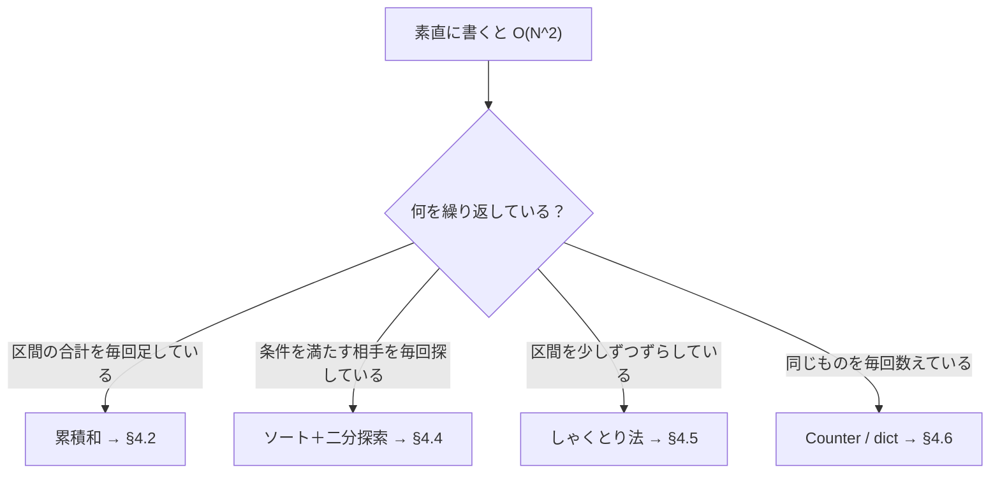

# 01_4_1. C 問題（前半） — 累積和・いもす法・ソート・貪欲

← 目次 [01_0 全体像と読む順番](./01_0_AtCoder攻略_全体像と読む順番.md)

← 前 [§3 A・B 全探索の型](./01_3_AB問題_全探索の型.md)　／　次 → [§4-2 二分探索・しゃくとり・数え上げ](./01_4_2_C問題_二分探索としゃくとりと数え上げ.md)

> **このページは分冊です。** 全体像は [01_0](./01_0_AtCoder攻略_全体像と読む順番.md)。
> 対象日: **2026-09-17 時点**。コードは書き下ろしのサンプルで、そのまま提出できる形です。
> 前提: [§2 計算量](./01_2_計算量_制約から解法を逆算する.md)。「O(N²) は無理、O(N log N) なら通る」が分かっていること。
> §4 は分量が多いので前半・後半に分けています。**後半は [01_4_2](./01_4_2_C問題_二分探索としゃくとりと数え上げ.md)**。

---

## 4.1 C 問題の正体は「O(N²) を O(N log N) か O(N) に落とす」

C で出てくる問題は、**素直に書けば二重ループになるもの**がほとんどです。
そして制約は `N ≤ 2×10^5` あたりに置かれていて、二重ループは通りません。

§4 の道具は、**二重ループを潰すための 4 本**です。



**「毎回やり直しているもの」を見つけて、前の結果を使い回す。** これが全部に共通する発想です。
このページでは §4.2（累積和）と §4.3（ソート・貪欲）を扱います。

---

## 4.2 累積和 — 区間の合計を O(1) で出す

「`A[l]` から `A[r]` までの合計」をたくさん聞かれる問題。素直にやると 1 回 O(N)、
Q 回聞かれて O(NQ) で死にます。

**先に「先頭からの合計」を作っておく**と、引き算 1 回で答えが出ます。

```
  A       =      [ 3,  1,  4,  1,  5 ]
  S(累積和) = [0,  3,  4,  8,  9, 14 ]
              ↑                      S[i] = A[0] + ... + A[i-1]
              先頭に 0 を置くのがコツ

  A[1] + A[2] + A[3] = S[4] - S[1] = 9 - 3 = 6
```

```python
N = int(input())
A = list(map(int, input().split()))

# 累積和を作る（長さ N+1。S[0] = 0）
S = [0] * (N + 1)
for i in range(N):
    S[i + 1] = S[i] + A[i]

# 0-indexed で A[l..r]（r を含む）の合計
l, r = 1, 3
print(S[r + 1] - S[l])
```

`itertools.accumulate` を使うともっと短く書けます。

```python
from itertools import accumulate
S = [0] + list(accumulate(A))
```

**先頭に 0 を置く**のが最大のコツです。置かないと `l == 0` のときに場合分けが要ります。
作るのに O(N)、以後 1 回の質問が O(1)。合計 O(N + Q) になります。

### いもす法 — 区間に一斉に足す

逆に「区間 `[l, r]` に一律 +1 する」操作が M 回来て、最後の各要素の値を知りたい場合。
毎回ループすると O(NM)。**差分だけ記録して、最後に累積和を取る**と O(N + M) です。

```python
N, M = map(int, input().split())
imos = [0] * (N + 1)
for _ in range(M):
    l, r = map(int, input().split())   # 1-indexed、r を含む区間
    imos[l - 1] += 1
    imos[r] -= 1                       # 区間の「次」で戻す

# 累積和を取ると、各位置の値になる
now = 0
ans = []
for i in range(N):
    now += imos[i]
    ans.append(now)
print(*ans)
```

```
   区間 [1,3] に +1、[2,4] に +1（1-indexed）

   imos: +1  +1  .   .  -1  -1        ← 開始で +1、終了の次で -1
   累積:  1   2   2   2   1   0
          ↑ これが各位置の最終的な値
```

「区間に一斉に足す」「ある時間帯に何人いたか」系はこれです。
配列を `N+1` の長さで取るのは、`r` が N のときに `imos[r]` が範囲外にならないようにするためです。

### 2 次元の累積和

グリッドの長方形領域の合計を聞かれたら、2 次元版を作ります。

```python
# H×W のグリッド G に対する累積和 S（(H+1)×(W+1)）
S = [[0] * (W + 1) for _ in range(H + 1)]
for i in range(H):
    for j in range(W):
        S[i + 1][j + 1] = S[i][j + 1] + S[i + 1][j] - S[i][j] + G[i][j]

# 左上 (r1,c1) 〜 右下 (r2,c2)（どちらも含む、0-indexed）の合計
total = S[r2 + 1][c2 + 1] - S[r1][c2 + 1] - S[r2 + 1][c1] + S[r1][c1]
```

`- S[i][j]` と `+ S[r1][c1]` は、**2 回引いた部分を足し戻している**（包除）ためです。

```
   ┌───────┬───────┐
   │   A   │   B   │      求めたいのは D
   ├───────┼───────┤      D = 全体 - (A+B) - (A+C) + A
   │   C   │   D   │
   └───────┴───────┘
```

---

## 4.3 ソートしてから考える

ソートは `O(N log N)` で、N = 2×10^5 でも余裕です。**迷ったらとりあえずソート**は
実際に有効な方針で、ソートすると「隣同士だけ見ればよくなる」問題が多くあります。

```python
A.sort()                          # 昇順、元のリストを書き換える
A.sort(reverse=True)              # 降順
B = sorted(A)                     # 元を残して新しいリストを作る

# タプルのリストを 2 番目の要素でソート
P = [(1, 5), (2, 3), (3, 9)]
P.sort(key=lambda x: x[1])        # → [(2,3), (1,5), (3,9)]

# 2 番目で昇順、同点なら 1 番目で降順
P.sort(key=lambda x: (x[1], -x[0]))
```

`key=lambda x: ...` は「各要素をこの値に変換して、その値で並べる」という指定です。
**タプルを返せば多段ソート**になり、数値なら `-` を付けるだけでその項目を降順にできます。

`sort` は**安定ソート**（同じキーの要素の順序が保たれる）なので、
「まず B でソート、次に A でソート」と 2 回に分けても意図どおりになります。

### 元の位置を覚えたままソートする

「ソートしたあとで、それが元の何番目だったか」が必要になることがよくあります。
値だけソートすると位置が失われるので、**位置とペアにして**ソートします。

```python
P = sorted((A[i], i) for i in range(N))   # (値, 元の位置) の組で昇順
for value, idx in P:
    ...
```

### 貪欲法（greedy）

「ソートして、前から順に得なほうを取る」という解き方を**貪欲法**と呼びます。

```python
# 例: N 個の品物から K 個選んで、価値の合計を最大にする
N, K = map(int, input().split())
A = list(map(int, input().split()))
A.sort(reverse=True)
print(sum(A[:K]))
```

貪欲は**正しいときは一瞬で書けるが、間違っているときに気づきにくい**のが危険なところです。
「その場で得な選択を続けて、本当に全体最適になるか」を **小さい反例で確かめてから**書いてください。

```
   反例の作り方: N=2 か N=3 の小さい入力を手で作り、
                 全パターンを紙で数えて、貪欲の答えと一致するか見る
```

反例が作れてしまう場合は、**DP（§5）が必要なサイン**です。
たとえば「容量制限つきで価値を最大化」（ナップサック）は貪欲では解けません。

### 貪欲が効く典型パターン

| 問題の形 | ソートの仕方 |
|---|---|
| K 個選んで合計最大 | 降順にして上から K 個 |
| 区間をできるだけ多く選ぶ（重複なし） | **終了時刻の昇順**にして、取れるものを前から取る |
| コインで支払う枚数を最小に | 大きい額面から（額面が互いに割り切れる場合のみ正しい） |
| ペアにして差の合計を最小に | 昇順にして隣同士で組む |

「区間スケジューリング」（2 行目）は**開始時刻ではなく終了時刻でソートする**のが肝です。
開始時刻でソートすると最適になりません。この 1 点だけで解ける C・D がときどき出ます。

---

## 理解度チェック

<details>
<summary><b>Q1.</b> 累積和 `S` の長さを N ではなく N+1 にして `S[0] = 0` を置くのはなぜ？</summary>

**A.** 区間 `[l, r]` の和を `S[r+1] - S[l]` という**一つの式**で書けるようにするため。
`S` を長さ N（`S[i]` が A[0..i] の和）にすると、`l == 0` のときだけ引き算の相手が無く、
場合分けが必要になる。先頭の 0 は「何も足していない状態」を表す番兵。→ §4.2
</details>

<details>
<summary><b>Q2.</b> 「重ならないように区間をできるだけ多く選ぶ」問題。開始時刻でソートしたら WA した。なぜ？</summary>

**A.** 区間スケジューリングは**終了時刻の昇順**でソートするのが正解。開始が早くても
終了が遅い長い区間を先に取ると、後ろが潰れて損をする。終了が早い順に取れば、
残りの時間を最大化できるので最適になる。→ §4.3
</details>

<details>
<summary><b>Q3.</b> 「区間 [l,r] に +1 する」操作が 10^5 回来る。素直に `for i in range(l, r+1): A[i] += 1` と書くと何が起きる？</summary>

**A.** 1 回の操作が最大 O(N) なので、全体 **O(NM) = 10^10** で TLE。
いもす法（開始で +1、終了の次で -1 を記録して、最後に 1 回だけ累積和）にすると
**O(N + M)** に落ちる。「区間に一斉に足す」を見たら反射的にこれ。→ §4.2
</details>

---

## 次にどこを読むか

| 知りたいこと | 行き先 |
|---|---|
| 二分探索・しゃくとり法・数え上げ | [§4-2 二分探索・しゃくとり・数え上げ](./01_4_2_C問題_二分探索としゃくとりと数え上げ.md) |
| 貪欲で反例が作れてしまった | [§5 DP](./01_5_D問題その1_DP.md) |
| 計算量の見積もり方を忘れた | [§2 計算量](./01_2_計算量_制約から解法を逆算する.md) |

---

← 前 [§3 A・B 全探索の型](./01_3_AB問題_全探索の型.md)　／　次 → [§4-2 二分探索・しゃくとり・数え上げ](./01_4_2_C問題_二分探索としゃくとりと数え上げ.md)

← 目次 [01_0 全体像と読む順番](./01_0_AtCoder攻略_全体像と読む順番.md)
