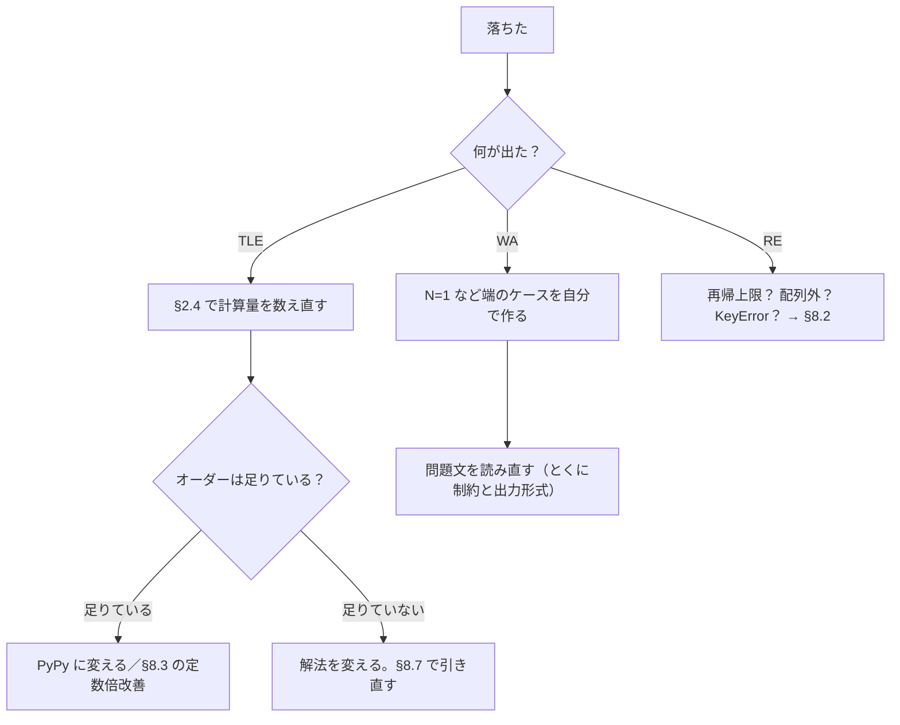

# 01_8. Python の落とし穴と、提出前チェックリスト

← 目次 [01_0 全体像と読む順番](./01_0_AtCoder攻略_全体像と読む順番.md)

← 前 [§7 数学](./01_7_D問題その3_数学_約数と素数とmod.md)　／　次 → （最終ページ）

> **このページは分冊です。** 全体像は [01_0](./01_0_AtCoder攻略_全体像と読む順番.md)。
> 対象日: **2026-09-17 時点**。コードは書き下ろしのサンプルで、そのまま提出できる形です。
> ここは**ロジックが合っているのに落ちる**ケースだけを集めています。§8.7 は全体の早見表です。

---

## 8.1 まず貼るテンプレート

コンテスト中、ファイルを作ったら**最初にこれを貼る**と決めておくとラクです。

```python
import sys
input = sys.stdin.readline
sys.setrecursionlimit(10 ** 6)

def main():
    N = int(input())
    A = list(map(int, input().split()))
    print(sum(A))

main()
```

3 行それぞれに理由があります。

| 行 | 理由 |
|---|---|
| `input = sys.stdin.readline` | 組み込みの `input()` は 1 行ごとに余計な処理をして**遅い**。10^5 行読むと差が出る |
| `sys.setrecursionlimit(10**6)` | Python の再帰上限は既定で約 1000。深い再帰で RE する（§8.2） |
| `def main(): ... main()` | **関数の中は変数アクセスが速い**。グローバルより実測で数割速いことがある |

> **`sys.stdin.readline` には落とし穴が 1 つあります。** 行末の改行 `\n` が残ります。
> 数値なら `int()` が無視してくれるので問題ありませんが、**文字列として使うときは必ず
> `.rstrip()` を付けてください**。付け忘れると `S == "abc"` が偽になって WA します。

```python
S = input().rstrip()        # 文字列を読むときは必ずこれ
```

---

## 8.2 RE の最頻出原因は「再帰の深さ」

Python の再帰呼び出しの深さは、既定で **1000 程度**です。
N = 10^5 の一本道グラフを DFS すると、それだけで `RecursionError` → **RE** になります。

```python
import sys
sys.setrecursionlimit(10 ** 6)     # 上限を上げる
```

ただしこれは万能ではありません。

- **PyPy では再帰そのものが遅く**、深いとメモリ不足で落ちることがある
- 上限を上げても、実際のスタックが足りずにプロセスごと落ちることがある

**いちばん安全なのは、再帰を使わずスタックで書くこと**です（→ [§6.4 DFS](./01_6_D問題その2_グラフ_BFS_DFS_UnionFind.md)）。
DFS は `list` + `pop()`、BFS は `deque` + `popleft()` で、どちらも再帰なしで書けます。

### RE のその他の原因

| 原因 | 見つけ方 |
|---|---|
| 配列外参照（`IndexError`） | 添字の範囲。`N` ではなく `N+1` で確保すべき場所が多い |
| `KeyError` | 素の `dict` に `d[k] += 1`。`defaultdict` を使う（§4.6） |
| 0 除算 | 分母が 0 になる入力（N=1 など）を自分で試す |
| `int()` に空文字 | 入力の読み方が問題の形式と合っていない（§1.4） |

---

## 8.3 遅い書き方・速い書き方

`in` の話（§2.6）以外で、実戦で効く差はこれです。

| 遅い | 速い | 効果 |
|---|---|---|
| `print` を N 回呼ぶ | `print('\n'.join(map(str, ans)))` | 出力が多いと**桁違い**。10^5 行で数秒違う |
| `s += "x"` を N 回 | リストに `append` して最後に `''.join` | O(N²) → O(N) |
| `A.pop(0)` / `A.insert(0, x)` | `collections.deque` | O(N) → O(1) |
| グローバル変数でループ | `main()` 関数の中でループ | 数割 |
| `for i in range(len(A)): A[i]` | `for a in A:` | 数割 |
| CPython で提出 | **PyPy で提出** | 単純ループで数倍〜十数倍 |

出力をまとめる書き方は覚えておいてください。

```python
ans = []
for ...:
    ans.append(x)
print('\n'.join(map(str, ans)))      # 1 回で出す
```

**ただし、これらは全部「定数倍」の改善です。** 計算量のオーダーが足りていない TLE は
これでは直りません（§2.7）。まずオーダーを疑ってください。

---

## 8.4 浮動小数点数（float）を信じない

```python
print(0.1 + 0.2 == 0.3)        # False
```

float は 2 進小数なので、10 進の小数を正確に表せません。さらに**約 15〜16 桁**しか精度が無く、
10^18 級の整数を経由させると壊れます。競プロでの原則はこれです。

```
   割り算で float を経由しない。整数のまま計算する。
```

| やりたいこと | ✗ 危ない | ○ 安全 |
|---|---|---|
| 切り捨て除算 | `int(A / B)` | `A // B` |
| 切り上げ除算 | `math.ceil(A / B)` | `-(-A // B)` |
| 平方根の比較 | `i <= N ** 0.5` | `i * i <= N` |
| 大小比較（分数） | `a / b < c / d` | `a * d < c * b`（b, d > 0 のとき） |

答え自体が小数の問題では「絶対誤差または相対誤差が 10^-6 以下なら正解」と
書かれていることが多いので、その場合は `print(ans)` でも通ります。
心配なら `print(f"{ans:.10f}")` のように桁数を明示して出します。

---

## 8.5 その他の Python 固有の罠

### 負の添字はエラーにならない

```python
A = [1, 2, 3]
print(A[-1])     # 3。エラーではなく末尾が返る
```

`dp[i-1]` で `i=0` のとき、`dp[-1]` は**最後の要素**を読みます。エラーが出ないまま
デタラメな値で計算が進むので、**いちばん見つけにくいバグ**です。
DP（§5）とグリッド探索（§6.5）では、必ず範囲チェックを先に書いてください。

### `//` の丸め方向

```python
print(-7 // 2)        # -4（小さいほうへ）
print(int(-7 / 2))    # -3（0 のほうへ）
```

問題文の「切り捨て」がどちらを指すか、負の数が出る問題では確認してください。

### `sort` と `sorted` の違い

`A.sort()` は **`None` を返して A を書き換え**、`sorted(A)` は**新しいリストを返す**。
`A = A.sort()` と書くと A が `None` になり、次の行で `TypeError` → RE します。

---

## 8.6 `[[0] * W] * H` の罠（2 回目。それくらい出る）

```python
dp = [[0] * 3] * 2     # ✗
dp[0][0] = 9
print(dp)              # [[9, 0, 0], [9, 0, 0]]  ← 両方変わる
```

```
   [[0]*3] * 2 の中身

   dp ─┬─→ ┌───────────┐
       │    │ [0, 0, 0] │   ← 同じリストが 1 個しかない
       └─→ └───────────┘

   [[0]*3 for _ in range(2)] の中身

   dp ─┬─→ [0, 0, 0]       ← 別々のリストが 2 個
       └─→ [0, 0, 0]
```

```python
dp = [[0] * 3 for _ in range(2)]     # ○ これで作る
```

1 次元（`[0] * N`）なら問題ありません。**中身がリストのときだけ**起きます。
`[[]] * N` で隣接リストを作るのも同じ理由でアウトです（§6.2）。

---

## 8.7 覚えることリスト早見表（この資料の総まとめ）

| 見たもの | 反射的にやること | 詳細 |
|---|---|---|
| 制約 `N ≤ 20` 前後 | bit 全探索 O(2^N) | [§3.4 bit 全探索](./01_3_AB問題_全探索の型.md) |
| 制約 `N ≤ 10` | 順列全探索 `permutations` | [§3.5 順列全探索](./01_3_AB問題_全探索の型.md) |
| 制約 `N ≤ 2000` | 二重ループ O(N²) を許す | [§2.4 制約→解法の逆算表](./01_2_計算量_制約から解法を逆算する.md) |
| 制約 `N ≤ 2×10^5` | **二重ループ禁止**。ソート／二分探索／累積和 | [§2.4 制約→解法の逆算表](./01_2_計算量_制約から解法を逆算する.md) |
| 制約 `N ≤ 10^9` 以上 | O(√N) か O(log N)。約数・数式 | [§7.1 約数列挙](./01_7_D問題その3_数学_約数と素数とmod.md) |
| 「区間の合計」を何度も聞かれる | 累積和（先頭に 0 を置く） | [§4.2 累積和・いもす法](./01_4_1_C問題_累積和とソートと貪欲.md) |
| 「区間に一斉に足す」 | いもす法 | [§4.2 累積和・いもす法](./01_4_1_C問題_累積和とソートと貪欲.md) |
| 相手を探す二重ループ | ソート＋`bisect` | [§4.4 二分探索](./01_4_2_C問題_二分探索としゃくとりと数え上げ.md) |
| 「最大値を最小化」 | 答えを二分探索（めぐる式） | [§4.4 二分探索](./01_4_2_C問題_二分探索としゃくとりと数え上げ.md) |
| 連続部分列の個数・最大長 | しゃくとり法 | [§4.5 しゃくとり法](./01_4_2_C問題_二分探索としゃくとりと数え上げ.md) |
| 個数を数える | `Counter` / `defaultdict(int)` | [§4.6 数え上げ](./01_4_2_C問題_二分探索としゃくとりと数え上げ.md) |
| 「重ならない区間を最大個数」 | **終了時刻**でソートして貪欲 | [§4.3 ソートと貪欲](./01_4_1_C問題_累積和とソートと貪欲.md) |
| 「選び方で最大／最小」＋貪欲の反例あり | DP（ナップサック） | [§5.3 ナップサック](./01_5_D問題その1_DP.md) |
| 「何通り」＋ mod 指定 | 経路数 DP、そのつど `% MOD` | [§5.4 経路数 DP](./01_5_D問題その1_DP.md) |
| 「最短で何回」＋辺の重み 1 | BFS（`deque`） | [§6.3 BFS](./01_6_D問題その2_グラフ_BFS_DFS_UnionFind.md) |
| 迷路・グリッド | 4 方向テーブル＋BFS | [§6.5 グリッド探索](./01_6_D問題その2_グラフ_BFS_DFS_UnionFind.md) |
| 「同じグループか」「辺を足していく」 | Union-Find | [§6.6 Union-Find](./01_6_D問題その2_グラフ_BFS_DFS_UnionFind.md) |
| 「〜で割った余りを出力」 | `MOD` をコピペ、`pow(a, MOD-2, MOD)` | [§7.4 mod と逆元](./01_7_D問題その3_数学_約数と素数とmod.md) |
| nCr が必要 | 階乗＋逆元テーブル | [§7.4 mod と逆元](./01_7_D問題その3_数学_約数と素数とmod.md) |

---

## 8.8 提出前チェックリスト（1 分）

```
□ 出力の文字列を問題文からコピペしたか（Yes / No / YES / -1）
□ MOD は 10^9+7 か 998244353 か、問題文と一致しているか
□ N = 1、A が全部同じ、答えが 0 のケースを試したか
□ 1-indexed / 0-indexed を取り違えていないか
□ 二次元配列を [[0]*W]*H で作っていないか
□ リストへの in をループの中で使っていないか
□ 計算量を数えたか（§2.4 の表に照らす）
□ 言語は PyPy を選んだか（深い再帰を使うなら CPython）
```

### TLE / WA / RE が出たときの手順



---

## 理解度チェック

<details>
<summary><b>Q1.</b> `input = sys.stdin.readline` を貼ったあと、文字列 S を読んで比較したら必ず偽になる。なぜ？</summary>

**A.** `sys.stdin.readline` は**行末の改行 `\n` を残す**ため、`S` が `"abc\n"` になっている。
組み込みの `input()` は改行を落とすので、この差でハマる。
`S = input().rstrip()` とする。数値は `int()` が空白と改行を無視するので影響しない。→ §8.1
</details>

<details>
<summary><b>Q2.</b> TLE が出た。`print` をまとめて `'\n'.join` にしたら通ることがあるのはどんなとき？ 通らないのはどんなとき？</summary>

**A.** 通るのは、**オーダーは足りていて出力行数が多い**とき（10^5 行の出力など）。
通らないのは**計算量のオーダーが足りていない**とき。定数倍の改善は数倍〜十数倍が限界で、
O(N²) と O(N log N) の差（N=2×10^5 で 1 万倍以上）は埋まらない。→ §8.3 / §2.7
</details>

<details>
<summary><b>Q3.</b> DP の遷移で `dp[i-1]` を i=0 でも実行してしまった。Python では何が起きる？ どう気づく？</summary>

**A.** `dp[-1]` は**末尾の要素**を返すので、**例外が出ずに間違った値で計算が進む**。
TLE も RE も出ず、WA だけが出るので原因が分かりにくい。
気づく手段は、**N=1 など最小の入力を手で計算して突き合わせる**こと。
書くときは `if i > 0:` のガードを最初から入れる。→ §8.5 / §5.2
</details>

---

## 次にどこを読むか

| 知りたいこと | 行き先 |
|---|---|
| 覚えることの全体像をもう一度 | [§8.7 覚えることリスト早見表](#87-覚えることリスト早見表この資料の総まとめ) |
| 計算量の逆算表 | [§2.4 制約→解法の逆算表](./01_2_計算量_制約から解法を逆算する.md) |
| D の定石を引き直す | [§5 DP](./01_5_D問題その1_DP.md) ／ [§6 グラフ](./01_6_D問題その2_グラフ_BFS_DFS_UnionFind.md) ／ [§7 数学](./01_7_D問題その3_数学_約数と素数とmod.md) |
| 次に何をすればいいか | [00 はじめに](./00_はじめに-読む順番.md) の「練習メニュー」 |

---

← 前 [§7 数学](./01_7_D問題その3_数学_約数と素数とmod.md)　／　次 → （最終ページ）

← 目次 [01_0 全体像と読む順番](./01_0_AtCoder攻略_全体像と読む順番.md)
