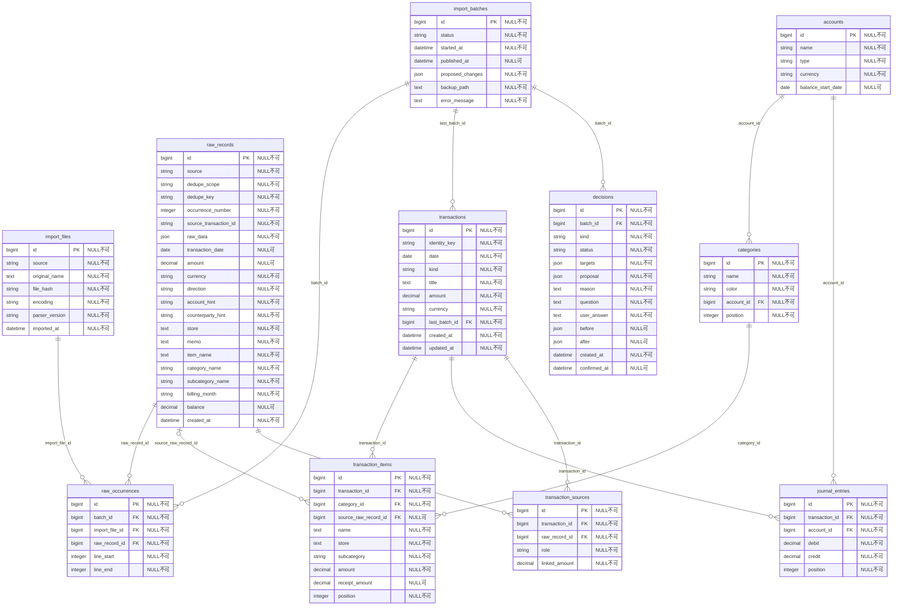

# 家計DBの全列定義

実装モデルから生成した全11テーブル。FKは別の表のIDを保存する列。transactions.identity_keyは取引のIDを更新後も維持するため、設計図に追加した固定キー。

idは各表の主キー。金額はDecimalField。JSONは元行の全列や確認案など可変構造を保持する。

ユーザーが許可した「不明」は収入・支出で同じ表示カテゴリを使用する。仕訳の勘定は費用「不明」と収益「不明（収入）」を区別し、カテゴリ名から収支の向きを推測しない。追加の列は不要。

主な制約：元行キーの一意性、元行取得元の一意性、勘定・カテゴリ名の一意性、仕訳の借方・貸方が非負で、両方が正数にならないこと。両方0は0円の開始残高に限り確定処理で許可すること。取引全体の貸借一致・内訳一致・二重使用は確定処理でまとめて検証する。
