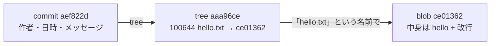
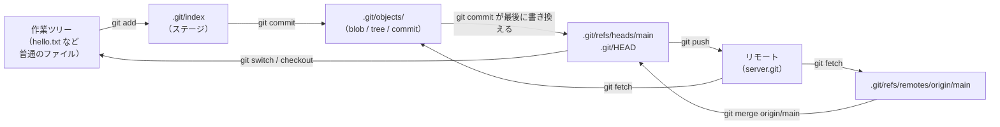

# 01_0. Git を `.git` から読む — 全体像と読む順番

← 全体の目次 [00_はじめに-読む順番.md](./00_はじめに-読む順番.md)

次 → [Git の世界観 — 4種類のオブジェクト](./01_1_Gitの世界観_4種類のオブジェクト.md)

---

> **このページの前提**
>
> - 対象日: **2026-09-17**。検証環境は **git 2.50.1 (Apple Git-155) / macOS**。
>   バージョンが違うと `git init` が作るファイルの数などが変わります。
> - 引用しているコマンド出力・ファイル内容は**実物をそのまま貼っています**。省略箇所は `...` です。
>   読者は開発者を想定し、たとえ話より「なぜそう設計されているか」に紙面を割いています。

この資料のゴールは、**`git pull` が失敗したときに `.git` の中を見て原因を特定できる状態**です。

---

## いちばん先に知っておくこと：`.git` は 4 つのものしか持っていない

```
  .git/
  ├── objects/                    ← ① 中身（不変・追記のみ）
  │     aa/a96ced...  ce/013625...    ファイル内容もディレクトリ構造もコミットも全部ここ。
  │                                   ファイル名 = 中身の SHA-1（→ 直後の 2 節で解説）。
  │
  ├── refs/heads/main             ← ② 名札（可変・41 バイトのテキスト）
  │   refs/heads/feature/login        中身は 40 桁のハッシュ + 改行だけ。
  │   refs/tags/v1.0                  「main」という名前はパスのほうが持っている。
  │   refs/remotes/origin/main        ブランチを切る = このファイルを 1 個作る。
  │
  ├── HEAD                        ← ③ 今どこにいるか（21 バイト・1 行）
  │                                   中身は "ref: refs/heads/main"。
  │                                   ② のどれを指しているかを書いた転送指示。
  │
  └── index                       ← ④ 次のコミットの下書き（バイナリ・1 個だけ）
                                      作業ツリーと objects の間に挟まる中間状態。
```

`refs/` 自体はただのディレクトリで、中身を持っているのはその下のファイルです。
`HEAD` は `refs/` の中ではなく `.git` 直下にあり、形式も 40 桁ハッシュではありません。
（`config` や `hooks/` もありますが、これらは設定と拡張ポイントであって履歴データではないので
別枠です。[§2.2](./01_2_git-init_空のgitを1行ずつ.md) で扱います。）

この 4 つの区別が付けば、あとは全部この上に乗っています。

| コマンド | ① objects | ② refs | ③ HEAD | ④ index | 作業ツリー |
|---|---|---|---|---|---|
| `git add` | 書き足す | — | — | 書き換える | — |
| `git commit` | 書き足す | ③ が指すものを進める | — | — | — |
| `git branch x` | — | **1 個増やすだけ** | — | — | — |
| `git switch x` | — | — | 書き換える | 合わせる | 合わせる |
| `git fetch` | 書き足す | `refs/remotes/` 以下だけ | — | — | — |
| `git merge` / `pull` | 書き足す | ③ が指すものを進める | — | 合わせる | 合わせる |

---

## ① `objects/` の中身 — 入っているのは 4 種類だけ

「ファイルもディレクトリもコミットも全部ここ」と書いたので、先に中身の地図を出します。
実バイト列・ハッシュの手計算・落とし穴は [§1](./01_1_Gitの世界観_4種類のオブジェクト.md) でやるので、
ここでは**種類と役割分担**だけ掴んでください。

| 種類 | 対応するもの | 持っている情報 | **持っていない情報** |
|---|---|---|---|
| **blob** | ファイルの中身 | バイト列だけ | **ファイル名**・更新日時・置き場所 |
| **tree** | ディレクトリ 1 段分 | 「モード + 名前 + 子のハッシュ」の並び | 中身そのもの（blob のハッシュを指すだけ） |
| **commit** | ある時点のスナップショット 1 個 | 根の tree 1 個 + 親コミット + 作者 + 日時 + メッセージ | **差分**（どのファイルを変えたか） |
| **tag** | 注釈付きタグ（`git tag -a`） | 指す先 + タグ名 + 署名者 + メッセージ | — |

`git log` も `git diff` も `git checkout` も、**この 4 種類を読んで表示を組み立てているだけ**です。

### 実物：`hello.txt` 1 個を 1 回コミットすると 3 個できる

```console
$ find .git/objects -type f
.git/objects/ce/013625030ba8dba906f756967f9e9ca394464a   ← blob   （hello.txt の中身）
.git/objects/aa/a96ced2d9a1c8e72c56b253a0e2fe78393feb7   ← tree   （リポジトリ直下の一覧）
.git/objects/ae/f822d7070fcc3133b890df8beee1272a784c9b   ← commit （上の tree を指す）
```



ここで効いてくるのが**役割分担**です。

- **blob は名前を知りません。**「hello.txt」という名前を持っているのは tree のほうです。
  だから中身が同じファイルが 2 つあっても blob は 1 個で済み、**リネームは blob を増やしません**。
- **commit は差分を知りません。**持っているのは「そのときの全体像（根の tree）」と「親」だけです。
  `git show` が差分を出せるのは、親の tree と自分の tree を**その場で比較している**からです。
- **tree は入れ子になります。**`src/api/main.py` を 1 文字直すと、blob 1 個に加えて
  `api` → `src` → 根 の tree が全部作り直されます（= 小さな変更でも objects は数個増える）。

### どのオブジェクトも同じ形式で保存されている

```
   ┌────────────────────────────────────────────────┐
   │ 種類 + 空白 + バイト数 + NUL + 中身              │  ← これを zlib 圧縮して保存
   │ 例: "blob 6\0hello\n"                          │  ← ファイル名 = このバイト列の SHA-1
   └────────────────────────────────────────────────┘
```

`blob` の部分が `tree` / `commit` / `tag` に変わるだけで、**4 種類とも同じ形**です。
zlib 圧縮されているので `cat` では読めず、覗くには `git cat-file`（[§0.2](#02-この資料でよく使う中身を覗くコマンド)）を使います。

```console
$ git cat-file -t ce013625   # 種類
blob
$ git cat-file -p ce013625   # 中身
hello
```

そして「ファイル名 = 中身の SHA-1」という命名こそが、①を**不変**にしている仕掛けです。次の節で見ます。

---

## なぜ「ファイル名 = 中身の SHA-1」だと書き換わらないのか

①の `objects/` だけ「不変」と書いたので、先にここを説明します。Git のほぼ全部の性質がここから出ます。

### ハッシュは「中身から計算した値」であって、Git が採番したものではない

`hello\n` を保存すると `ce013625...` という名前のファイルができます。これは空き番号ではなく
**中身を SHA-1 に通した結果**で、手で計算しても一致します。

```console
$ printf 'blob 6\0hello\n' | shasum
ce013625030ba8dba906f756967f9e9ca394464a  -
```

### だから「中身を変える」と、名前と中身が矛盾する

`ce013625...` の中身を `hello` から `bye` に書き換えたとします。

```
   ファイル名:  ce013625...  ＝「中身が hello\n であるもの」の意味  ／  実際の中身: bye  ← 食い違う
```

Git は読むときに中身をハッシュにかけ直せるので、これは**破損として検出されます**。
実際に壊してみます。まずオブジェクトファイルは読み取り専用で作られています。

```console
$ ls -l .git/objects/ce/013625030ba8dba906f756967f9e9ca394464a
-r--r--r--@ 1 akito_inoue  wheel  21 Sep 17 16:12 .git/objects/ce/0136...
```

`chmod u+w` して中身を `bye\n` に差し替えてから `git fsck` を走らせます。

```console
$ git fsck
error: b023018cabc396e7692c70bbf5784a93d3f738ab: hash-path mismatch, found at: .git/objects/ce/0136...
missing blob ce013625030ba8dba906f756967f9e9ca394464a
```

**「中身から計算すると `b023018...` なのに `ce013625...` の場所にある」**と怒られ、
本来あるはずの `ce013625...` は `missing blob`（行方不明）扱いになります。
つまり「同じ名前のまま中身を差し替える」はルール上そもそも成立せず、
**Git にとって "変更" は常に「別の名前で新しいファイルを作る」こと**になります。

```
   hello → bye に直すと:   ce013625... "hello\n" ← そのまま残る
                           b023018...  "bye\n"   ← 新しく増える
```

### この性質から出てくる帰結

| 見かけの操作 | 実際に起きていること |
|---|---|
| コミットメッセージを直す（`--amend`） | 別のコミットを新規作成し ② を向け直す。元のコミットは残る |
| rebase で履歴を作り直す | 全コミットを別ハッシュで作り直す。元も残る |
| ブランチを消す | ② のファイルを 1 個消すだけ。① には手を付けない |
| 「間違えて消した」 | ほぼ必ず ① に残っている。名前（②）が外れただけ |

**`.git/objects` は追記専用のログ**です。削除が起きるのは `git gc`（[§9.5](./01_9_困ったときの早見表.md)）
のときだけで、しかも「どの ref からも到達できない」かつ「一定期間が過ぎた」ものに限られます。
復旧手順（[§9.2](./01_9_困ったときの早見表.md)）がほぼ全部「ハッシュを探して名前を付け直す」の形なのは、
この不変性が前提にあるからです。**本当に失われるのは、一度も `git add` していない内容だけです。**

---

## 全体の流れ



注目してほしいのは **`git fetch` の矢印が `refs/heads/main` に届いていない**ことです。
fetch は `refs/remotes/origin/main` までしか動かしません。上の表で `git fetch` の行に
`refs/remotes/` としか書いていないのと同じことで、ここが §7 と §8 の山場です。

---

## 分冊の一覧

| # | ページ | 扱う節 | 何が書いてあるか | 目安 |
|---|---|---|---|---|
| 0 | **このページ** | §0 | `.git` の地図、実験の再現手順 | 5 分 |
| 1 | [Git の世界観 — 4種類のオブジェクト](./01_1_Gitの世界観_4種類のオブジェクト.md) | §1 | blob/tree/commit/tag、ハッシュの手計算 | 11 分 |
| 2 | [git init 前編 — 空の `.git` を1行ずつ](./01_2_git-init_空のgitを1行ずつ.md) | §2.1〜2.4 | 作られるファイル、`HEAD`、`config` | 11 分 |
| 3 | [git init 後編 — hooks と bare](./01_3_git-init_hooksとbareと例外.md) | §2.5〜2.9 | hooks、`info/exclude`、`--bare`、`.git` の例外形 | 8 分 |
| 4 | [git add / git commit](./01_4_add-commit_indexとオブジェクトの増え方.md) | §3 §4 | `.git/index` の正体、オブジェクトの増え方 | 12 分 |
| 5 | [git branch — refs はただのテキスト](./01_5_git-branch_refsはただのテキスト.md) | §5 | branch/switch/削除/復活、detached HEAD、タグ | 12 分 |
| 6 | [git remote add — origin という別名](./01_6_git-remote-add_originという別名.md) | §6 | config の `[remote]`、refspec、上流設定 | 12 分 |
| 7 | [git fetch — 取ってくるだけ](./01_7_git-fetch_取ってくるだけ.md) | §7 | FETCH_HEAD、`--prune` | 11 分 |
| 8 | [git pull — fetch と merge の合わせ技](./01_8_git-pull_fetchとmergeの合わせ技.md) | §8 | ff / マージコミット / コンフリクト中の `.git` / `--rebase` | 15 分 |
| 9 | [困ったときの早見表](./01_9_困ったときの早見表.md) | §9 | ファイル早見表、復旧手順、worktree、`git gc` | 10 分 |

節番号（`## 1.` 〜 `## 9.`）は**分冊をまたいで通し**です。
`git init` を扱う §2 だけは分量の都合で 2 ページに分かれています（§2.1〜2.4 が `01_2`、§2.5〜2.9 が `01_3`）。

---

## 0. この分冊で扱うファイル

解説対象は**あなたのプロジェクトのコード**ではなく **`.git` の中のファイル**です。
以下は `git init` 直後から `pull` まで一通り操作したあとの `.git` 直下の実物です。

```
# myapp/.git/ 直下（ls -1 の実物）
COMMIT_EDITMSG
FETCH_HEAD
HEAD
ORIG_HEAD
config
description
hooks
index
info
logs
objects
refs
```

### 主役

| パス | 中身 | 扱う節 |
|---|---|---|
| `.git/HEAD` | 「今どこにいるか」1 行。`ref: refs/heads/main` | §2.3 §5.2 |
| `.git/config` | このリポジトリだけの設定。remote と branch の対応表 | §2.4 §6.2 |
| `.git/refs/heads/*` | ブランチ。中身は 40 桁のハッシュ 1 行だけ | §5.1 |
| `.git/refs/remotes/origin/*` | 「最後に見たときのリモートの状態」のメモ | §6.4 §7.2 |
| `.git/objects/**` | 全データ。zlib 圧縮された不変ファイル | §1 |
| `.git/index` | ステージ。バイナリ。次のコミットの下書き | §3.2 |
| `.git/FETCH_HEAD` | 直前の fetch が何を取ってきたかのメモ | §7.3 |
| `.git/ORIG_HEAD` | 危険な操作の直前の HEAD。復旧の命綱 | §8.5 |
| `.git/logs/**` | reflog。ref が動いた履歴 | §4.4 §5.6 |

### 脇役

| パス | 役割 | 扱う節 |
|---|---|---|
| `.git/description` | GitWeb 用。ほぼ誰も使わない | §2.5 |
| `.git/hooks/*.sample` | サンプルのまま。`.sample` を外すと動く | §2.6 |
| `.git/info/exclude` | 共有しない `.gitignore` | §2.7 |
| `.git/COMMIT_EDITMSG` | 直前のコミットメッセージの下書き | §4.4 |
| `.git/MERGE_HEAD` 他 | マージ中だけ存在する一時ファイル | §8.4 |
| `.git/packed-refs` | refs をまとめたテキスト | §9.5 |
| `.git/worktrees/**` | `git worktree` 用 | §9.4 |

---

## 0.1 この資料の実験を手元で再現する

全ページの出力は、以下の手順で作った 3 つのリポジトリから採取しています。
写経すると理解が一段深くなるので、余裕があればやってみてください。

```bash
mkdir -p ~/gitlab && cd ~/gitlab
git init --bare server.git                  # 中央リポジトリ（GitHub の代わり）

mkdir myapp && cd myapp                     # 自分の作業リポジトリ
git init
printf 'hello\n' > hello.txt
git add hello.txt && git commit -m "最初のコミット"
git remote add origin ../server.git
git push -u origin main

cd ~/gitlab && git clone server.git bob     # 同僚の作業リポジトリ
```

以降、`myapp` を「自分」、`bob` を「同僚」、`server.git` を「GitHub 上のリポジトリ」として読んでください。
**ハッシュ値は必ずずれます**（コミットに作者名と時刻が入るため。理由は §1.5）。
ハッシュそのものではなく、**どのファイルがどう変わったか**を見てください。

---

## 0.2 この資料でよく使う「中身を覗く」コマンド

`.git/objects` の中は zlib 圧縮されていて `cat` では読めません。読むための道具が要ります。

| コマンド | 何が見えるか |
|---|---|
| `git cat-file -t` / `-p` / `-s <hash>` | オブジェクトの種類 / 中身 / バイト数 |
| `git ls-files -s` / `-u` | `.git/index` の中身 / 未解決（コンフリクト）だけ |
| `git rev-parse <名前>` | 名前 → 40 桁ハッシュの変換 |
| `git reflog` | `.git/logs/HEAD` を読みやすくしたもの |

`cat-file` は「`.git/objects` 専用の `cat`」だと思えば十分です。一覧は [01_9 §9.6](./01_9_困ったときの早見表.md) に。

---

## 理解度チェック

<details>
<summary><b>Q1.</b> <code>git branch feature</code> を実行したとき、<code>.git/objects/</code> にファイルは何個増える？</summary>

**A.** **0 個**。`.git/refs/heads/feature` という 41 バイトのテキストが 1 個増えるだけで、
オブジェクトは 1 バイトも増えない。Git のブランチが「軽い」と言われる理由はこれ。 → §5.1
</details>

<details>
<summary><b>Q2.</b> <code>git fetch</code> したのに <code>git log</code> の先頭が変わらない。バグ？</summary>

**A.** 仕様どおり。fetch が動かすのは `refs/remotes/origin/main` だけで、
`refs/heads/main`（= `git log` が見ている場所）には触らない。 → §7.2
</details>

<details>
<summary><b>Q3.</b> 同じ手順を 2 回やると、コミットのハッシュは同じになる？</summary>

**A.** ならない。コミットオブジェクトに `committer ... 1789606800 +0900` という**時刻**が含まれるため。
逆に blob（ファイル内容）は中身が同じなら必ず同じハッシュになる。 → §1.5
</details>

<details>
<summary><b>Q4.</b> ファイル 1 個だけのリポジトリで最初のコミットをすると、<code>.git/objects/</code> は何個増える？</summary>

**A.** **3 個**（blob 1 + tree 1 + commit 1）。「ファイル 1 個 = オブジェクト 1 個」ではない。
深い階層だと、その階層数ぶん tree が増える。 → §1.2 §1.4
</details>

---

## 次にどこを読むか

| 知りたいこと | 行き先 |
|---|---|
| そもそもコミットとは何なのか | [01_1 §1](./01_1_Gitの世界観_4種類のオブジェクト.md) |
| `git init` は何を作るのか | [01_2 §2](./01_2_git-init_空のgitを1行ずつ.md) |
| ステージって結局何 | [01_4 §3](./01_4_add-commit_indexとオブジェクトの増え方.md) |
| ブランチを消したら復活できるか | [01_5 §5.6](./01_5_git-branch_refsはただのテキスト.md) |
| `origin` の正体 | [01_6 §6](./01_6_git-remote-add_originという別名.md) |
| fetch と pull の違い | [01_7 §7](./01_7_git-fetch_取ってくるだけ.md) |
| 壊したので戻したい | [01_9 §9](./01_9_困ったときの早見表.md) |

---

次 → [Git の世界観 — 4種類のオブジェクト](./01_1_Gitの世界観_4種類のオブジェクト.md)

← 全体の目次 [00_はじめに-読む順番.md](./00_はじめに-読む順番.md)
