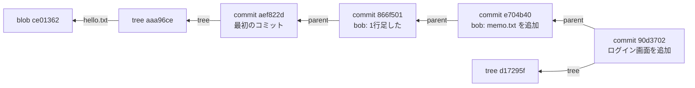

# 01_1. Git の世界観 — `.git/objects` にある4種類のオブジェクト

← 目次 [01_0 全体像と読む順番](./01_0_Git_全体像と読む順番.md)

← 前 [00 はじめに](./00_はじめに-読む順番.md)　／　次 → [git init — 空の `.git` を1行ずつ](./01_2_git-init_空のgitを1行ずつ.md)

> **このページは分冊です。** 全体像は [01_0](./01_0_Git_全体像と読む順番.md)。
> 対象日 2026-09-17 / git 2.50.1。出力はすべて実物です。
> このページを読むと、`git log` を使わずに `.git/objects` だけで履歴をたどれるようになります。

---

## 1.1 前提をひとつ捨てる：Git は差分を保存していない

多くの入門記事が「Git は変更差分を積み上げる」と説明しますが、**データモデルとしては誤り**です。
Git はコミットのたびに**そのときの全ファイルのスナップショット**を保存します。

`git diff` が差分を出すのは、**保存時ではなく表示時に 2 つのスナップショットを比較している**からです。

では容量が爆発しないのか、という疑問には §1.6 で答えます（答え: 重複排除と、
パック時の delta 圧縮という**別レイヤ**で解決している）。

このレイヤ分けが Git の設計の要です。

```
  ┌─────────────────────────────────────────────────────────┐
  │ 論理モデル：  スナップショットの連なり（不変・単純）           │
  │              → 履歴の正しさ・マージ・ハッシュ検証はここで完結   │
  ├─────────────────────────────────────────────────────────┤
  │ 物理モデル：  zlib 圧縮 + delta 圧縮 + パック（可変・最適化）   │
  │              → 容量と速度の都合。論理モデルには一切影響しない    │
  └─────────────────────────────────────────────────────────┘
```

「差分か、スナップショットか」で議論が噛み合わないのは、上下どちらの層の話かがずれているからです。

---

## 1.2 オブジェクトの置き場所と命名規則

`.git/objects/` の実物です。`git init` して 1 コミットしただけの状態です。

```
# myapp/.git/objects/（find の実物）
.git/objects/aa/a96ced2d9a1c8e72c56b253a0e2fe78393feb7
.git/objects/ae/f822d7070fcc3133b890df8beee1272a784c9b
.git/objects/ce/013625030ba8dba906f756967f9e9ca394464a
```

**ディレクトリ名 2 桁 + ファイル名 38 桁 = 40 桁の SHA-1** です。
`aa/a96ce...` は `aaa96ced2d9a1c8e72c56b253a0e2fe78393feb7` というオブジェクトを指します。

2 桁で切ってあるのは、1 ディレクトリにファイルが数万個並ぶと
ファイルシステムの性能が落ちるためです。256 個のサブディレクトリに均等に散ります。

種類は 4 つだけです。

| 種類 | 何を表すか | 中に持つもの |
|---|---|---|
| **blob** | ファイルの中身 | バイト列のみ。**ファイル名を持たない** |
| **tree** | ディレクトリ | 「モード + 名前 + ハッシュ」の並び |
| **commit** | ある時点のスナップショット | tree 1 個 + 親コミット + 作者 + メッセージ |
| **tag** | 注釈付きタグ | 指すオブジェクト + タグ名 + 署名者 + メッセージ |

---

## 1.3 blob — ファイルの中身だけを持つ

`hello.txt`（中身は `hello\n`）を `git add` したあとの実物です。

```console
$ git hash-object hello.txt
ce013625030ba8dba906f756967f9e9ca394464a

$ git cat-file -t ce013625030ba8dba906f756967f9e9ca394464a
blob
$ git cat-file -s ce013625030ba8dba906f756967f9e9ca394464a
6
$ git cat-file -p ce013625030ba8dba906f756967f9e9ca394464a
hello
```

ディスク上の実体を zlib で解くと、こうなっています。

```console
$ python3 -c "
import zlib
d=open('.git/objects/ce/013625030ba8dba906f756967f9e9ca394464a','rb').read()
print(repr(zlib.decompress(d)))
print('圧縮後のファイルサイズ:', len(d), 'バイト')
"
b'blob 6\x00hello\n'
圧縮後のファイルサイズ: 21 バイト
```

**`"blob" + 空白 + バイト数 + NUL + 中身`** という形式です。これがオブジェクトの共通フォーマットで、
種類名だけが `blob` / `tree` / `commit` / `tag` に変わります。

### ハッシュは手で計算できる

ファイル名は「このヘッダ込みのバイト列の SHA-1」です。実際に一致します。

```console
$ printf 'blob 6\0hello\n' | shasum
ce013625030ba8dba906f756967f9e9ca394464a  -
```

`git hash-object` の出力と同じです。つまり**オブジェクト名に恣意性はゼロ**で、
中身が決まればアドレスが決まります（content-addressable storage）。

### 落とし穴：blob はファイル名を知らない

`b'blob 6\x00hello\n'` のどこにも `hello.txt` という文字列がありません。
同じ内容のファイルを 2 つ作ると、blob は**1 個しかできません**。

```console
$ printf 'hello\n' > a.txt; printf 'hello\n' > b.txt
$ git hash-object a.txt
ce013625030ba8dba906f756967f9e9ca394464a
$ git hash-object b.txt
ce013625030ba8dba906f756967f9e9ca394464a
```

だから Git では**ファイルのリネームが「記録」されません**。
`git log --follow` や `git diff -M` が「名前の変更らしきもの」を出すのは、
記録を読んでいるのではなく、**前後の tree を比べて同じ blob を探し当てている**からです。
リネームと同時に中身を大きく変えると追跡が切れるのは、この推測が外れるためです。

---

## 1.4 tree — ディレクトリ 1 段分

コミットが指す tree を見ます。

```console
$ git cat-file -p aaa96ced2d9a1c8e72c56b253a0e2fe78393feb7
100644 blob ce013625030ba8dba906f756967f9e9ca394464a	hello.txt
```

`cat-file -p` は整形して見せているだけで、実体はこうです。

```console
$ python3 -c "
import zlib
d=open('.git/objects/aa/a96ced2d9a1c8e72c56b253a0e2fe78393feb7','rb').read()
print(repr(zlib.decompress(d)))
"
b'tree 37\x00100644 hello.txt\x00\xce\x016%\x03\x0b\xa8\xdb\xa9\x06\xf7V\x96\x7f\x9e\x9c\xa3\x94FJ'
```

`100644 hello.txt\0` の後ろに、**40 桁の文字列ではなく 20 バイトの生バイナリ**でハッシュが入っています。
`\xce\x016%...` は `ce013625...` の生の形です。

先頭の `100644` はモードです。Git が扱うのはこの 4 種類だけです。

| モード | 意味 |
|---|---|
| `100644` | 通常ファイル |
| `100755` | 実行可能ファイル |
| `120000` | シンボリックリンク |
| `040000` | ディレクトリ（= 別の tree） |

パーミッションを細かく保存しないのは意図的です。`644` と `755` の区別以外を持つと、
**同じ内容のチェックアウトが環境ごとに別のハッシュになり得る**ためです。

### 入れ子のディレクトリは tree が tree を指す

`src/api/main.py` を足したときの実物です。

```console
$ git cat-file -p dc39b485360fbc36261aaf83506a61e18ab4ac2c
100644 blob 053d321183d5a5593a8cd10eae6c5311bef924fe	bobfile.txt
100644 blob f68a9d268bec8a70ea300c9f52be98d13e36c8c8	hello.txt
100644 blob cdb8d3e922cb8d0ac83f8b11bd63bdc587c5877a	memo.txt
100644 blob 0d53bbaffee652526a30af7d16cdb56cfcaf47e0	mine.txt
100644 blob 1e968d6e683f6cf2c99d9f25bc1fb393d0fb6ff4	myfile.txt
040000 tree 83659967e11a74255b61e85c251a422cd8c2a9a7	src

$ git cat-file -p 83659967e11a74255b61e85c251a422cd8c2a9a7
040000 tree 5d2978f3676a429cd01b90091a488f1eb110ca1e	api
```

**1 ファイル直しただけでも、そのファイルから根までの tree が全部作り直されます。**
`src/api/main.py` を 1 文字直すと、新しい blob 1 個 + `api` の tree + `src` の tree + 根の tree = 4 個が増えます。

これは無駄に見えますが、**根の tree のハッシュ 1 個を比べるだけで
「プロジェクト全体が同一か」が判定できる**という性質を生みます。
`git status` がモノレポでも速いのはこの性質のおかげです（Merkle tree）。

---

## 1.5 commit — tree に「いつ・誰が・どこから」を付けたもの

```console
$ git cat-file -p aef822d7070fcc3133b890df8beee1272a784c9b
tree aaa96ced2d9a1c8e72c56b253a0e2fe78393feb7
author Akito <akito@example.com> 1789606800 +0900
committer Akito <akito@example.com> 1789606800 +0900

最初のコミット
```

2 個目以降のコミットには `parent` 行が付きます。

```console
$ git cat-file -p 90d3702af1f82bd83330bf8f5594b278b4504d58
tree d17295f6a204cdba18e17f806cac740a56850f49
parent e704b40790420d4afc62dfcb3d144100444e9bba
author Akito <akito@example.com> 1789617600 +0900
committer Akito <akito@example.com> 1789617600 +0900

ログイン画面を追加
```

マージコミットは `parent` が 2 行になります（実物は §8.3）。

コミットが持つ情報はこれだけです。**「どのファイルを変えたか」は持っていません。**
`git show` が差分を出せるのは、`parent` の tree と自分の tree をその場で比較しているからです。

### ここから 3 つの帰結が出る

**① ハッシュは再現しない。**
`author` と `committer` に UNIX 時刻（`1789606800`）が入っているので、
同じファイル・同じメッセージでも 1 秒ずれれば別のハッシュになります。
blob は再現するのに commit は再現しない、の理由がこれです。

**② 履歴は後ろ向きにしかたどれない。**
コミットは親を指しますが、子を指しません。`git log` が
「新しい順」でしか出ないのはこのためです。`main` から親を順にたどっているだけです。

**③ 過去は書き換えられない。**
親のハッシュを中身に含むので、古いコミットを 1 文字直すと
そのハッシュが変わり、それを親に持つ全コミットのハッシュが芋づる式に変わります。
`git rebase` が「ハッシュが変わる」のはこの帰結です（実物は §8.6）。



---

## 1.6 残りの 1 種類（tag）と、容量の話はどこへ行ったか

4 種類目の **tag オブジェクト**は `.git/refs/tags/` と切り離せないので、
refs をまとめて扱う [01_5 §5.8](./01_5_git-branch_refsはただのテキスト.md) で実物を見ます。

§1.1 で保留した「スナップショットなのに容量が膨らまない理由」も、
`git gc` とパックファイルの話になるので [01_9 §9.5](./01_9_困ったときの早見表.md) に置いています。
先に結論だけ書いておくと、**変わっていない blob は前のコミットと同じ実体を共有し、
さらにパック時に delta 圧縮される**、の 2 段構えです。

---

## 理解度チェック

<details>
<summary><b>Q1.</b> ファイル名を <code>a.txt</code> から <code>b.txt</code> に変えただけのコミットでは、blob は何個増える？</summary>

**A.** **0 個**。blob は中身しか持たず、名前は tree が持っている。増えるのは
新しい tree（名前が変わった分）と commit だけ。 → §1.3 §1.4
</details>

<details>
<summary><b>Q2.</b> 同僚と全く同じファイル・同じメッセージでコミットしたのに、ハッシュが違う。なぜ？</summary>

**A.** commit オブジェクトに `author` / `committer` の**名前・メールアドレス・UNIX 時刻**が
含まれるため。tree と blob は一致しているはず（`git cat-file -p <commit>` の `tree` 行を比べれば分かる）。 → §1.5
</details>

<details>
<summary><b>Q3.</b> 深い階層の 1 ファイルを直したコミットを作った。新しくできるオブジェクトはいくつ？</summary>

**A.** **blob 1 個 + そのファイルから根まで各階層の tree + commit 1 個**。
`src/api/main.py` なら blob 1 + tree 3（`api`, `src`, 根）+ commit 1 = 5 個。
ここを知らないと「小さな変更なのに objects が増える」現象が不気味に見える。 → §1.4
</details>

---

## 次にどこを読むか

| 知りたいこと | 行き先 |
|---|---|
| この objects がどう作られ始めるのか | [01_2 §2](./01_2_git-init_空のgitを1行ずつ.md) |
| add と commit で何個増えるのか実測 | [01_4 §3.4](./01_4_add-commit_indexとオブジェクトの増え方.md) |
| ハッシュではなく名前で呼ぶ仕組み | [01_5 §5](./01_5_git-branch_refsはただのテキスト.md) |
| rebase でハッシュが変わる実物 | [01_8 §8.6](./01_8_git-pull_fetchとmergeの合わせ技.md) |

---

← 前 [00 はじめに](./00_はじめに-読む順番.md)　／　次 → [git init — 空の `.git` を1行ずつ](./01_2_git-init_空のgitを1行ずつ.md)

← 目次 [01_0 全体像と読む順番](./01_0_Git_全体像と読む順番.md)
