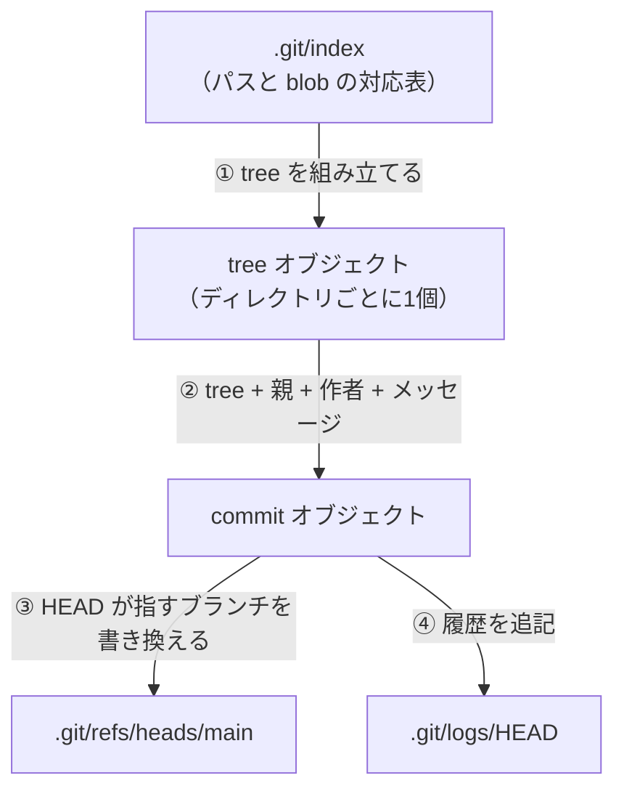

# 01_4. `git add` / `git commit` — `.git/index` とオブジェクトの増え方

← 目次 [01_0 全体像と読む順番](./01_0_Git_全体像と読む順番.md)

← 前 [git init 後編](./01_3_git-init_hooksとbareと例外.md)　／　次 → [git branch — refs はただのテキスト](./01_5_git-branch_refsはただのテキスト.md)

> **このページは分冊です。** 全体像は [01_0](./01_0_Git_全体像と読む順番.md)。
> 対象日 2026-09-17 / git 2.50.1。出力はすべて実物です。
> 読むと `git status` の 2 文字（`AM` など）が `.git` のどの状態を指すか分かります。

---

## 3.1 `git add` は 2 つのことを同時にやる

```
   作業ツリー           .git/objects              .git/index
   a.txt (v1)   ──①──▶ blob 626799f  ──②──▶ "a.txt は 626799f"
                 圧縮して保存            パスとハッシュの対応を記録
```

**① 中身を blob として保存**し、**② その blob を「このパスのもの」として index に登録**します。
「ステージに上げる」と説明されるのは ② ですが、**この時点ですでに `.git/objects` に書き込み済み**です。
実測します（`git init` 直後、objects は 0 個）。

```console
$ find .git/objects -type f | wc -l
       0

$ printf 'v1\n' > a.txt
$ git add a.txt
$ find .git/objects -type f
.git/objects/62/6799f0f85326a8c1fc522db584e86cdfccd51f
```

**`git add` だけで 1 個増えました。** コミットしていないのに、です。

これは実用上重要です。`git add` さえしてあれば、作業ツリーを全部消しても中身は
`.git/objects` から回収できます（`git fsck --lost-found`）。add していないファイルは Git の世界に存在しません。

---

## 3.2 `.git/index` の正体

index はテキストではありません。

```console
$ od -c .git/index | head -3
0000000    D   I   R   C  \0  \0  \0 002  \0  \0  \0 001   j 253   i 235
0000020    $   & 370 306   j 253   i 235   $   & 370 306 001  \0  \0 021
0000040  001 025 025 212  \0  \0 201 244  \0  \0 001 366  \0  \0  \0  \0
```

先頭 4 バイトの `DIRC` は "**dir**ectory **c**ache"（index の旧称）、
次の `\0\0\0\002` がフォーマットバージョン 2、その次の `\0\0\0\001` がエントリ数 1 です。
人間向けに読むには `git ls-files` を使います。

```console
$ git ls-files -s
100644 626799f0f85326a8c1fc522db584e86cdfccd51f 0	a.txt
```

左から **モード / blob のハッシュ / ステージ番号 / パス**です。
ステージ番号が `0` は「確定」の意味で、コンフリクト中だけ 1〜3 が現れます（§8.4）。

### index はハッシュ以外に stat 情報も持っている

```console
$ git ls-files --debug
a.txt
  ctime: 1789621580:307322409
  mtime: 1789621580:307322409
  dev: 16777233	ino: 18166559
  uid: 502	gid: 0
  size: 3	flags: 0
```

inode 番号・更新時刻・サイズが入っています。これが **`git status` が速い理由**です。

`git status` は全ファイルを開いてハッシュを計算し直したりしません。
まず `stat(2)` を呼び、mtime とサイズが index の記録と一致していれば
**中身を読まずに「変更なし」と判定**します。一致しないファイルだけ実際に読んでハッシュを取ります。

保存しただけで中身が同じでも `git status` が一瞬遅くなることがあるのはこのためです
（mtime が変わって再計算が走り、「やはり同じ」と分かって index の stat が更新される）。

---

## 3.3 なぜ index という中間層があるのか

「作業ツリーから直接コミットすればいいのに」という設計上の疑問には、3 つの答えがあります。

1. **部分コミットができる。** 10 ファイル直しても index に載せた 3 ファイルだけをコミットできる。
   `git add -p` なら hunk 単位。index が無ければ「作業ツリーの今の姿」しかコミットできない
2. **マージの途中経過を置ける。** コンフリクト時、index は 1 パスに 3 エントリ（祖先・自分・相手）を持つ。
   作業ツリーは 1 ファイル 1 内容しか表現できないので、置き場所が要る（§8.4）
3. **`git status` を stat だけで済ませられる。** §3.2 のとおり

代償として「add したのを忘れる」という事故が発生します。これが次の節です。

---

## 3.4 落とし穴：`add` した後に編集すると、index と作業ツリーがずれる

```console
$ printf 'v2\n' > a.txt          # add 済みの a.txt をさらに編集
$ git status --short
AM a.txt
```

`AM` の 2 文字は、**左が index の状態、右が作業ツリーの状態**です。

```
  A M  a.txt
  │ └─ 作業ツリー vs index ：  M = 違う（Modified）
  └─── index vs HEAD    ：  A = 新規追加（Added）
```

実際に中身が食い違っていることを確認できます。

```console
$ git cat-file -p 626799f0f85326a8c1fc522db584e86cdfccd51f
v1
$ cat a.txt
v2
$ find .git/objects -type f | wc -l
       1
```

**`v2` はまだどこにも保存されていません。** この状態でコミットすると `v1` が入ります。

```console
$ git commit -m "v1 をコミット"
$ git cat-file -p HEAD^{tree}
100644 blob 626799f0f85326a8c1fc522db584e86cdfccd51f	a.txt
$ git status --short
 M a.txt
```

コミット後も ` M`（左が空 = index と HEAD は一致、右が M = 作業ツリーだけ違う）が残ります。
「直したはずの修正が入っていない」の典型的な原因がこれで、`git status --short` の
**2 文字を読む**習慣で防げます。`git commit -a` はこの事故を避けるための短縮形です。

---

## 4.1 `git commit` がやること



重要なのは **① の入力が index であって、作業ツリーではない**ことです。§3.4 の事故はここから来ます。

---

## 4.2 実測：commit で 2 個増える

```console
$ git commit -m "最初のコミット"
[main (root-commit) aef822d] 最初のコミット
 1 file changed, 1 insertion(+)
 create mode 100644 hello.txt

$ find .git/objects -type f | sort
.git/objects/aa/a96ced2d9a1c8e72c56b253a0e2fe78393feb7   ← tree（新規）
.git/objects/ae/f822d7070fcc3133b890df8beee1272a784c9b   ← commit（新規）
.git/objects/ce/013625030ba8dba906f756967f9e9ca394464a   ← blob（add のときにできていた）
```

blob は `git add` の時点で存在していたので、commit で増えるのは **tree と commit の 2 個**です
（ディレクトリが深ければ tree はその分増えます。§1.4）。中身も確認します。

```console
$ git cat-file -p aef822d7070fcc3133b890df8beee1272a784c9b
tree aaa96ced2d9a1c8e72c56b253a0e2fe78393feb7
author Akito <akito@example.com> 1789606800 +0900
committer Akito <akito@example.com> 1789606800 +0900

最初のコミット

$ git cat-file -p aaa96ced2d9a1c8e72c56b253a0e2fe78393feb7
100644 blob ce013625030ba8dba906f756967f9e9ca394464a	hello.txt
```

`git ls-files -s`（§3.2）と tree の中身が一致しています。tree は index をそのまま固めたものです。

---

## 4.3 ここで `refs/heads/main` が初めて生まれる

```console
$ cat .git/HEAD
ref: refs/heads/main
$ cat .git/refs/heads/main
aef822d7070fcc3133b890df8beee1272a784c9b
```

[01_2 §2.3](./01_2_git-init_空のgitを1行ずつ.md) で「壊れたリンクを指している」と書いた `HEAD` が、
ここで初めてつながりました。

`git commit` の最後の一手は、**`HEAD` が指しているファイルに新しいハッシュを書き込むこと**です。
`HEAD` が `refs/heads/feature` を指していれば、書き換わるのはそちらです。
**コミットがどのブランチに入るかは、この 1 行だけで決まっています。**

---

## 4.4 同時に書かれる 2 つのファイル

```console
$ cat .git/COMMIT_EDITMSG
最初のコミット

$ cat .git/logs/HEAD
0000000000000000000000000000000000000000 aef822d7070fcc3133b890df8beee1272a784c9b Akito <akito@example.com> 1789606800 +0900	commit (initial): 最初のコミット
```

`COMMIT_EDITMSG` はエディタに渡した下書きの残骸です。
**メッセージを書いたのにエディタを閉じ損ねて失ったとき**の回収場所になります。

`.git/logs/HEAD` が reflog です。左が**移動前**、右が**移動後**のハッシュで、
初回なので左がゼロ 40 個になっています。`logs/refs/heads/main` にも同じ行が書かれます。
reflog は `commit` だけでなく `switch` `merge` `rebase` `reset` でも追記され、
**この 1 ファイルが Git の復旧手段のほぼ全部を支えています**（§5.6、§9.2）。

---

## 4.5 `git commit --amend` は「直す」のではなく「作り直す」

```console
$ git rev-parse HEAD
1ff526a5ae3d6c9d18c4592d3bbcd0168d0d94cb
$ git commit --amend -m "v1 をコミット（メッセージ修正）"
$ git rev-parse HEAD
3c4a40a4a77cf92b46e601d25af63ab2bf639d4e
```

ハッシュが変わりました。§1.5 のとおりコミットオブジェクトは不変で、**書き換えは原理的に不可能**です。
`--amend` は「元の親・tree を引き継いだ**別の**コミットを作り、ブランチをそちらへ向ける」操作です。
元のコミットは消えていません。

```console
$ git cat-file -t 1ff526a5ae3d6c9d18c4592d3bbcd0168d0d94cb
commit
$ git reflog
3c4a40a HEAD@{0}: commit (amend): v1 をコミット（メッセージ修正）
1ff526a HEAD@{1}: commit (initial): v1 をコミット
```

誰からも指されなくなっただけで、`git gc` の対象になるまで残ります。
**だから `--amend` は取り消せます**（`git reset --hard 1ff526a`）。

同じ理屈で「push 済みのコミットを `--amend` すると相手と食い違う」も説明できます。
相手が持っているのは `1ff526a`、こちらは `3c4a40a`。別物なので push は非 fast-forward として拒否されます。

---

## 理解度チェック

<details>
<summary><b>Q1.</b> <code>git add</code> しただけの状態で作業ツリーの全ファイルを <code>rm</code> した。中身は戻せる？</summary>

**A.** 戻せる。`git add` の時点で blob が `.git/objects` に書かれているため。
`git checkout -- .` または `git restore .` で index から書き戻せる。
add していないファイルは Git の世界に存在しないので戻せない。 → §3.1
</details>

<details>
<summary><b>Q2.</b> <code>git status --short</code> が <code>AM a.txt</code> を出した。この状態でコミットすると何が入る？</summary>

**A.** **`git add` した時点の内容**。`M`（右）は「index より後に作業ツリーを編集した」という意味で、
その編集はまだどこにも保存されていない。コミット後も ` M` が残る。 → §3.4
</details>

<details>
<summary><b>Q3.</b> <code>git commit</code> はどのブランチにコミットを入れるか、どうやって決めている？</summary>

**A.** `.git/HEAD` の 1 行だけ。`ref: refs/heads/main` と書いてあれば、
最後にそのファイルへ新しいハッシュを書き込む。ブランチ一覧などは一切見ていない。 → §4.3
</details>

---

## 次にどこを読むか

| 知りたいこと | 行き先 |
|---|---|
| `refs/heads/*` を増やす・消す | [01_5 §5](./01_5_git-branch_refsはただのテキスト.md) |
| reflog で復旧する手順 | [01_5 §5.6](./01_5_git-branch_refsはただのテキスト.md) |
| index のステージ 1〜3 が出る場面 | [01_8 §8.4](./01_8_git-pull_fetchとmergeの合わせ技.md) |
| オブジェクトの中身の形式 | [01_1 §1.3](./01_1_Gitの世界観_4種類のオブジェクト.md) |

---

← 前 [git init 後編](./01_3_git-init_hooksとbareと例外.md)　／　次 → [git branch — refs はただのテキスト](./01_5_git-branch_refsはただのテキスト.md)

← 目次 [01_0 全体像と読む順番](./01_0_Git_全体像と読む順番.md)
