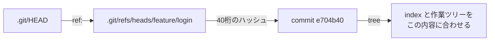

# 01_5. `git branch` — refs は 41 バイトのテキストでしかない

← 目次 [01_0 全体像と読む順番](./01_0_Git_全体像と読む順番.md)

← 前 [git add / git commit](./01_4_add-commit_indexとオブジェクトの増え方.md)　／　次 → [git remote add — origin という別名](./01_6_git-remote-add_originという別名.md)

> **このページは分冊です。** 全体像は [01_0](./01_0_Git_全体像と読む順番.md)。
> 対象日 2026-09-17 / git 2.50.1。出力はすべて実物です。読むと、ブランチを消しても慌てなくなります。

---

## 5.1 `git branch` は 41 バイトのファイルを 1 個作るだけ

`main` が `e704b40` を指している状態でブランチを切ります。

```console
$ git branch feature/login

$ find .git/refs/heads | sort
.git/refs/heads
.git/refs/heads/feature
.git/refs/heads/feature/login
.git/refs/heads/main

$ cat .git/refs/heads/feature/login
e704b40790420d4afc62dfcb3d144100444e9bba
$ cat .git/refs/heads/main
e704b40790420d4afc62dfcb3d144100444e9bba
$ wc -c .git/refs/heads/feature/login
      41 .git/refs/heads/feature/login
```

**40 桁のハッシュ + 改行 = 41 バイト。** これがブランチの実体のすべてで、`.git/objects` は 1 バイトも増えません。

Git のブランチが「安い」のは、**41 バイトのファイル 1 個だから**という単純な理由です。
「ブランチを切りすぎかな」と遠慮する理由は技術的にはひとつもありません。

```
   .git/refs/heads/main          ┐
   .git/refs/heads/feature/login ┤─▶ どちらも e704b40 を指すただのテキスト
                                 ┘
   .git/HEAD → "ref: refs/heads/main"   ← 今どっちにいるか
```

### スラッシュは本物のディレクトリになる

`feature/login` は `refs/heads/feature/` というディレクトリの中の `login` ファイルです。
ここから、初見では意味不明なエラーが出ます。

```console
$ git branch feature
fatal: 'refs/heads/feature/signin' exists; cannot create 'refs/heads/feature'

$ git branch tmp && git branch tmp/x
fatal: cannot lock ref 'refs/heads/tmp/x': 'refs/heads/tmp' exists; cannot create 'refs/heads/tmp/x'
```

**`feature` と `feature/login` は同時に存在できません。**
同じ名前のファイルとディレクトリを作れないからです。
命名規則で `feature/` を接頭辞に使うなら、`feature` 単体は永久に使えません。

---

## 5.2 `git switch` は `.git/HEAD` を書き換えるだけ

```console
$ cat .git/HEAD
ref: refs/heads/main

$ git switch feature/login
Switched to branch 'feature/login'

$ cat .git/HEAD
ref: refs/heads/feature/login
```

`git switch` の本質は `.git/HEAD` の 1 行の書き換えで、副作用として
**index と作業ツリーを移動先のコミットの内容に合わせます**。
「switch できない」と拒否されるのは常にこの同期の段階で、HEAD の書き換え自体は失敗しません。



`git switch -c demo` は「作って移動」を 1 コマンドにしたものです（`git checkout -b` と同じ）。
---

## 5.3 ブランチ上でコミットすると片方だけ進む

```console
$ git switch feature/login
$ printf 'login機能\n' > login.txt
$ git add login.txt && git commit -m "ログイン画面を追加"
[feature/login 90d3702] ログイン画面を追加

$ cat .git/refs/heads/feature/login
90d3702af1f82bd83330bf8f5594b278b4504d58   ← 進んだ
$ cat .git/refs/heads/main
e704b40790420d4afc62dfcb3d144100444e9bba   ← 動いていない
```

[01_4 §4.3](./01_4_add-commit_indexとオブジェクトの増え方.md) のとおり `git commit` は
「`HEAD` が指しているファイル」だけを書き換えます。`main` は誰も触っていないのでそのまま。
**ブランチ機能に特別な仕組みはありません。**

できたコミットの `parent` は `e704b40`、つまり枝分かれ元をそのまま指しています
（`git cat-file -p 90d3702` で確認できます）。

`main` に戻ると、作業ツリーから `login.txt` が消えます。

```console
$ git switch main
$ ls
hello.txt	memo.txt
```

消えたのではなく、`main` が指す tree に `login.txt` が無いだけです。blob も commit も残っています。

---

## 5.4 `.git/logs/` にはブランチ移動も記録される

```console
$ cat .git/logs/HEAD
0000000000000000000000000000000000000000 aef822d... commit (initial): 最初のコミット
aef822d... e704b40... merge origin/main: Fast-forward
e704b40... e704b40... checkout: moving from main to feature/login
e704b40... 90d3702... commit: ログイン画面を追加
90d3702... e704b40... checkout: moving from feature/login to main
```

`checkout: moving from main to feature/login` の行は左右のハッシュが同じで、
**ブランチを変えただけでコミットは動いていない**ことが読み取れます。
`git switch` を使っても reflog の表記は `checkout:` のままです（互換性のため）。

---

## 5.5 detached HEAD — `HEAD` が `ref:` でなくなる状態

```console
$ git switch --detach HEAD~1
HEAD is now at 14cdc05 bob: bobfile 追加

$ cat .git/HEAD
14cdc052dfae223a470286ef8f8e3eca04b304b0
```

`ref: refs/heads/...` ではなく、**ハッシュが直接書かれています**。これが detached HEAD です。

この状態でコミットすると `HEAD` 自身が新しいハッシュに書き換わり、
どのブランチファイルも更新されないので、**そのコミットを指す名前がどこにも存在しません**。
別のブランチへ switch した瞬間、入口は reflog だけになります。
「detached HEAD でコミットしたら消えた」の中身はこれで、消えてはおらず名前が無いだけです。

```console
$ git switch -            # 直前の場所へ戻る
$ cat .git/HEAD
ref: refs/heads/main
```

---

## 5.6 削除と、reflog での復活

```console
$ git branch -d feature/login
error: the branch 'feature/login' is not fully merged
hint: If you are sure you want to delete it, run 'git branch -D feature/login'

$ git branch -D feature/login
Deleted branch feature/login (was 90d3702).

$ find .git/refs/heads | sort
.git/refs/heads
.git/refs/heads/main
```

`-d` は取り込み済みか確認してから消し、`-D` は無条件です。
とはいえ**消えるのは 41 バイトのファイルだけ**で、コミットは無傷（`git cat-file -t 90d3702` → `commit`）。
ハッシュさえ分かれば元に戻せます。

```console
$ git branch feature/login 90d3702af1f82bd83330bf8f5594b278b4504d58
$ cat .git/refs/heads/feature/login
90d3702af1f82bd83330bf8f5594b278b4504d58
```

### ハッシュを覚えていないときは reflog から探す

**注意：`git branch -D` はそのブランチの reflog（`.git/logs/refs/heads/...`）も一緒に消します。**
残るのは `.git/logs/HEAD` のほうなので、こちらから探します。

```console
$ git reflog
47c402e HEAD@{0}: checkout: moving from 14cdc05... to main
...
90d3702 HEAD@{11}: commit: ログイン画面を追加
```

`git reflog` は `.git/logs/HEAD` を整形しているだけです。最終手段は `git fsck --lost-found`（§9.2）。
reflog の既定の保持期間は到達可能なもの 90 日・到達不能なもの 30 日なので、
**消してから 1 か月以内ならたいてい戻せます。**

---

## 5.7 改名は 2 つのファイルを動かす

```console
$ git branch -m feature/login feature/signin
$ find .git/refs/heads | sort
.git/refs/heads
.git/refs/heads/feature
.git/refs/heads/feature/signin
.git/refs/heads/main
```

`refs/heads/` と `.git/logs/refs/heads/` のファイル名が同時に変わり、
**現在のブランチを改名した場合は `.git/HEAD` の中身も書き換わります**。
リモートには伝わらないので、古い名前を消して新しい名前を push し直す必要があります
（`git push origin :old new`）。上流の設定（§6.5）も付け直しです。

---

## 5.8 `refs/tags/` — 4 種類目のオブジェクトはここにいる

[01_1 §1.6](./01_1_Gitの世界観_4種類のオブジェクト.md) で預けた tag オブジェクトです。

```console
$ git tag -a v1.0 -m "最初のリリース"     # 注釈付き
$ git tag v1.0-lw                        # 軽量

$ cat .git/refs/tags/v1.0
76322bd47ce9b93b94a35c76368d59b0b986c3d0
$ git cat-file -t 76322bd47ce9b93b94a35c76368d59b0b986c3d0
tag
$ git cat-file -p 76322bd47ce9b93b94a35c76368d59b0b986c3d0
object 47c402e76780186c8f4ddd926f92b7ebae98b9c7
type commit
tag v1.0
tagger Akito <akito@example.com> 1789635600 +0900

最初のリリース

$ cat .git/refs/tags/v1.0-lw
47c402e76780186c8f4ddd926f92b7ebae98b9c7      ← コミットを直接指している
$ git cat-file -t 47c402e76780186c8f4ddd926f92b7ebae98b9c7
commit
```

**軽量タグはコミットを直接指すだけ**で、tag オブジェクトはできません。
ブランチとの違いは「`git commit` しても動かない」という運用上の約束だけです。
リリースには `-a` を使ってください。タガー・日付・メッセージが残り、GPG 署名も付けられます。

---

## 理解度チェック

<details>
<summary><b>Q1.</b> <code>feature/login</code> というブランチがあるとき、<code>git branch feature</code> が失敗するのはなぜ？</summary>

**A.** refs はファイルなので、`refs/heads/feature` はすでにディレクトリとして存在している。
同名のファイルは作れない。`feature/` を接頭辞に使う運用なら `feature` 単体は永久に使えない。 → §5.1
</details>

<details>
<summary><b>Q2.</b> <code>git branch -D</code> で消したブランチを復活させたい。どこを見る？</summary>

**A.** `git reflog`（= `.git/logs/HEAD`）。ブランチ自身の reflog
（`.git/logs/refs/heads/...`）は `-D` で一緒に消えるので、残っている `HEAD` の reflog から
コミットのハッシュを探し、`git branch <名前> <ハッシュ>` で作り直す。 → §5.6
</details>

<details>
<summary><b>Q3.</b> detached HEAD でコミットしてから別ブランチへ switch した。そのコミットはどうなる？</summary>

**A.** 消えてはいない。どのブランチファイルも指していないだけで、オブジェクトは残っている。
入口は `git reflog`（`.git/logs/HEAD`）のみ。`git branch <名前> <ハッシュ>` で名前を付ければ復活する。 → §5.5
</details>

---

## 次にどこを読むか

| 知りたいこと | 行き先 |
|---|---|
| `refs/remotes/origin/*` は何者か | [01_6 §6.4](./01_6_git-remote-add_originという別名.md) |
| ブランチの「上流」設定 | [01_6 §6.5](./01_6_git-remote-add_originという別名.md) |
| fetch が動かす ref | [01_7 §7.2](./01_7_git-fetch_取ってくるだけ.md) |
| 壊したときの復旧手順まとめ | [01_9 §9.2](./01_9_困ったときの早見表.md) |
| `git gc` で refs が消えた（ように見える） | [01_9 §9.5](./01_9_困ったときの早見表.md) |

---

← 前 [git add / git commit](./01_4_add-commit_indexとオブジェクトの増え方.md)　／　次 → [git remote add — origin という別名](./01_6_git-remote-add_originという別名.md)

← 目次 [01_0 全体像と読む順番](./01_0_Git_全体像と読む順番.md)
