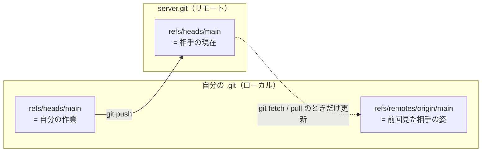

# 01_6. `git remote add` — `origin` は URL に付けた別名でしかない

← 目次 [01_0 全体像と読む順番](./01_0_Git_全体像と読む順番.md)

← 前 [git branch — refs はただのテキスト](./01_5_git-branch_refsはただのテキスト.md)　／　次 → [git fetch — 取ってくるだけ](./01_7_git-fetch_取ってくるだけ.md)

> **このページは分冊です。** 全体像は [01_0](./01_0_Git_全体像と読む順番.md)。
> 対象日 2026-09-17 / git 2.50.1。出力はすべて実物です。
> 実験は `myapp`（自分）と `server.git`（共有リポジトリ = GitHub 相当）の 2 つで行います。
> 読むと、`origin/main` と `main` が別物であることが `.git` のファイルとして見えます。

---

## 6.1 `git remote add` は `.git/config` に 4 行足すだけ

実行前の `.git/config` は `[core]` セクションだけです（[01_2 §2.4](./01_2_git-init_空のgitを1行ずつ.md)）。

```console
$ git remote add origin ../server.git
```

```ini
# 実行後の .git/config（[remote "origin"] が増えた）
[core]
	repositoryformatversion = 0
	...
[remote "origin"]
	url = ../server.git
	fetch = +refs/heads/*:refs/remotes/origin/*
```

**ネットワークアクセスは一切発生しません。** URL が正しいかも確認しないので、
打ち間違えてもこの時点ではエラーが出ず、最初の `fetch` / `push` で初めて失敗します。

```console
$ git remote -v
origin	../server.git (fetch)
origin	../server.git (push)
```

`(fetch)` と `(push)` が並ぶのは、両者に別 URL を設定できるためです
（読み取りは公開 URL、書き込みは SSH、といった使い分けができます）。

### `origin` は予約語ではない

`origin` に特別扱いはありません。`git clone` が既定でこの名前を付けるだけです。

```console
$ git remote rename origin upstream
$ sed -n '/remote/,$p' .git/config
[remote "upstream"]
	url = ../server.git
	fetch = +refs/heads/*:refs/remotes/upstream/*
[branch "main"]
	remote = upstream
	merge = refs/heads/main
```

`fetch` 行も `[branch "main"]` の `remote =` も追従し、`refs/remotes/` 以下のディレクトリごと引っ越します。

```console
$ find .git/refs/remotes | sort
.git/refs/remotes
.git/refs/remotes/upstream
.git/refs/remotes/upstream/HEAD
.git/refs/remotes/upstream/main
```

---

## 6.2 refspec の読み方 — この 1 行が fetch の全仕様

```
   fetch = +refs/heads/*:refs/remotes/origin/*
           │ └─── 相手側 ───┘ └──── 自分側 ────┘
           └ + は「早送りでなくても強制的に上書きする」
```

`<相手側>:<自分側>` のコロン区切りで、**「相手の何を、自分のどこに書くか」**を宣言しています。
この 1 行が `git fetch` の挙動をほぼ全部決めています。

- 相手の `refs/heads/main` → 自分の `refs/remotes/origin/main`
- 相手の `refs/heads/feature/x` → 自分の `refs/remotes/origin/feature/x`

**自分側は `refs/remotes/` 以下であって `refs/heads/` ではありません。**
fetch が自分のブランチを動かさない理由は、この設定にそう書いてあるからです。
`+` は、リモートが `push --force` で巻き戻ったときもこちらの記録を追従させるためのものです
（記録用なので上書きしてよい、という判断）。push 側の refspec は §6.5 の上流設定が代わりを務めます。

---

## 6.3 `git push -u origin main` で何が起きるか

```console
$ git push -u origin main
To ../server.git
 * [new branch]      main -> main
branch 'main' set up to track 'origin/main'.
```

`.git` に 2 つの変化が起きます。

**① `refs/remotes/origin/main` ができた。**

```console
$ find .git/refs -type f | sort
.git/refs/heads/main
.git/refs/remotes/origin/main

$ cat .git/refs/remotes/origin/main
aef822d7070fcc3133b890df8beee1272a784c9b
```

**② `.git/config` に `[branch "main"]` が増えた。**

```ini
[branch "main"]
	remote = origin
	merge = refs/heads/main
```

これが `-u`（`--set-upstream`）の効果です。詳しくは §6.5。

相手側（`server.git`）も見てみます。

```console
$ find server.git/refs -type f | sort
server.git/refs/heads/main
$ cat server.git/refs/heads/main
aef822d7070fcc3133b890df8beee1272a784c9b

$ find server.git/objects -type f | sort
server.git/objects/aa/a96ced2d9a1c8e72c56b253a0e2fe78393feb7
server.git/objects/ae/f822d7070fcc3133b890df8beee1272a784c9b
server.git/objects/ce/013625030ba8dba906f756967f9e9ca394464a
```

**自分の `.git/objects` と同じ 3 個が同じハッシュで置かれています。**
push は「オブジェクトを送って相手の ref を進める」以上のことをしていません。
ハッシュが中身から決まる（[01_1 §1.3](./01_1_Gitの世界観_4種類のオブジェクト.md)）ので、
どちらで計算しても同じ名前になり、突き合わせが成立します。

---

## 6.4 `refs/remotes/origin/*` は「最後に見たときのメモ」

ここが Git の理解で最も詰まりやすい場所です。3 つの ref を並べます。

```
  .git/refs/heads/main            自分のブランチ。自分の commit で進む
  .git/refs/remotes/origin/main   最後に通信したとき相手がどこだったかの記録
  server.git/refs/heads/main      相手の本物。今この瞬間の値は分からない
```



**`origin/main` はローカルのファイルです。** ネットワーク越しの何かではないので、
オフラインでも `git log origin/main` が動きます。ただし見えるのは
**最後に fetch した時点の情報**で、今の GitHub の状態ではありません。
`git branch -a` で全部見ると区別が付きます。

```console
$ git branch -a
  feature/login
* main
  remotes/origin/HEAD -> origin/main
  remotes/origin/main
```

`remotes/origin/HEAD` は clone のときに作られる symbolic ref で、
「このリモートの既定ブランチ」を記録しています。

```console
$ cat bob/.git/refs/remotes/origin/HEAD
ref: refs/remotes/origin/main
```

`git clone` して最初にチェックアウトされるブランチは、これで決まります。

---

## 6.5 上流（upstream）— `[branch "main"]` の 2 行

```ini
[branch "main"]
	remote = origin
	merge = refs/heads/main
```

「`main` にいるとき、引数なしの `git fetch` / `git pull` / `git push` は
**`origin` の `refs/heads/main` を相手にする**」という宣言です。
この 2 行があると `git status` が差分を教えてくれます。

```console
$ git status -sb
## main...origin/main

$ git branch -vv
* main aef822d [origin/main] 最初のコミット
```

同僚が 2 つ push したあとに fetch すると、こう変わります。

```console
$ git status -sb
## main...origin/main [behind 2]
```

`behind 2` は**`refs/heads/main` と `refs/remotes/origin/main` の 2 つのファイルを比べた結果**です。
サーバに問い合わせてはいません。**fetch していなければ、いつまでも「最新です」と表示され続けます。**

上流が無いと `git pull` は相手を決められずに止まります。付け忘れたら後から設定できます。

```bash
git branch --set-upstream-to=origin/main main
```

---

## 6.6 URL の変更・削除

```console
$ git remote set-url origin ../server.git     # URL の差し替え
$ git remote rename origin upstream           # 名前の変更（§6.1）
$ git remote remove origin                    # 削除
```

いずれも `.git/config` の書き換えです。`remove` すると `refs/remotes/origin/` 以下も消えますが、
**`.git/objects` は消えません**。リモートを消しても取得済みのコミットは手元に残ります。
HTTPS から SSH への切り替えも `set-url` 一発です（`git remote set-url origin git@github.com:user/repo.git`）。

---

## 6.7 リモートは複数持てる

fork して作業する場合の典型形です。

```bash
git remote add origin   git@github.com:you/repo.git      # 自分の fork
git remote add upstream git@github.com:orig/repo.git     # 本家
git fetch upstream
git merge upstream/main
```

`.git/config` に `[remote "..."]` が 2 つ並び、`refs/remotes/` の下に `origin/` と `upstream/` ができます。
**名前空間が分かれているだけ**なので、何個増やしても衝突しません。

---

## 理解度チェック

<details>
<summary><b>Q1.</b> <code>git remote add origin &lt;打ち間違えた URL&gt;</code> を実行した。いつエラーになる？</summary>

**A.** このコマンドでは一切エラーにならない。`.git/config` に 4 行書くだけで通信しないため。
最初の `git fetch` / `git push` で初めて失敗する。 → §6.1
</details>

<details>
<summary><b>Q2.</b> 飛行機の中で <code>git log origin/main</code> が動いた。なぜ？</summary>

**A.** `origin/main` は `.git/refs/remotes/origin/main` というローカルファイルだから。
ただし中身は**最後に fetch した時点**の値で、現在のリモートの状態ではない。 → §6.4
</details>

<details>
<summary><b>Q3.</b> <code>git status</code> が「up to date」と言っているのに、GitHub には新しいコミットがある。バグ？</summary>

**A.** 仕様どおり。`status` は `refs/heads/main` と `refs/remotes/origin/main` の
2 ファイルを比べているだけで、サーバには問い合わせない。
`git fetch` するまで `origin/main` は古いまま。 → §6.5
</details>

---

## 次にどこを読むか

| 知りたいこと | 行き先 |
|---|---|
| `origin/main` を最新にする | [01_7 §7.2](./01_7_git-fetch_取ってくるだけ.md) |
| refspec をコマンドラインで指定する | [01_7 §7.5](./01_7_git-fetch_取ってくるだけ.md) |
| fetch のあと自分のブランチに取り込む | [01_8 §8](./01_8_git-pull_fetchとmergeの合わせ技.md) |
| なぜ共有リポジトリは bare なのか | [01_3 §2.8](./01_3_git-init_hooksとbareと例外.md) |

---

← 前 [git branch — refs はただのテキスト](./01_5_git-branch_refsはただのテキスト.md)　／　次 → [git fetch — 取ってくるだけ](./01_7_git-fetch_取ってくるだけ.md)

← 目次 [01_0 全体像と読む順番](./01_0_Git_全体像と読む順番.md)
