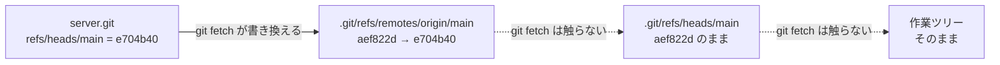

# 01_7. `git fetch` — 取ってくるだけで、何も合流させない

← 目次 [01_0 全体像と読む順番](./01_0_Git_全体像と読む順番.md)

← 前 [git remote add — origin という別名](./01_6_git-remote-add_originという別名.md)　／　次 → [git pull — fetch と merge の合わせ技](./01_8_git-pull_fetchとmergeの合わせ技.md)

> **このページは分冊です。** 全体像は [01_0](./01_0_Git_全体像と読む順番.md)。
> 対象日 2026-09-17 / git 2.50.1。出力はすべて実物です。
> 状況：同僚（`bob`）が `server.git` に 2 つコミットを push した直後の、自分（`myapp`）の側を見ます。
> 読むと、**`git fetch` は何も壊さない**と確信して打てるようになります。

---

## 7.1 fetch がやることは 2 つだけ

```
  ① 相手が持っていて自分が持っていないオブジェクトを .git/objects に足す
  ② refspec に従って refs/remotes/origin/* を書き換える
  ──────────────────────────────────────────────────
  やらないこと：refs/heads/* を動かす／index を触る／作業ツリーを書き換える
```

`git fetch` が**破壊的になり得ない**のはこのためです。
`.git/objects` は追記のみ、`refs/remotes/` は記録用。
自分の作業に関わるファイル（`refs/heads/*`、`index`、作業ツリー）には一切触れません。

「とりあえず `git fetch` しておく」が安全な操作として勧められる根拠がここにあります。

---

## 7.2 fetch の前後で `.git` がどう変わるか

### 実行前

```console
$ cat .git/refs/heads/main
aef822d7070fcc3133b890df8beee1272a784c9b
$ cat .git/refs/remotes/origin/main
aef822d7070fcc3133b890df8beee1272a784c9b

$ ls .git/FETCH_HEAD
ls: .git/FETCH_HEAD: No such file or directory

$ ls
hello.txt
```

同僚はすでに 2 つ push していますが、こちらの `origin/main` は古いままです。
`git status` も「最新です」としか言いません（[01_6 §6.5](./01_6_git-remote-add_originという別名.md)）。

### 実行

```console
$ git fetch origin
From ../server
   aef822d..e704b40  main       -> origin/main
```

出力の `main -> origin/main` が refspec そのものです。
**「相手の `main` を、自分の `origin/main` に書いた」**と読みます。

### 実行後

```console
$ cat .git/refs/heads/main
aef822d7070fcc3133b890df8beee1272a784c9b   ← 動いていない

$ cat .git/refs/remotes/origin/main
e704b40790420d4afc62dfcb3d144100444e9bba   ← 動いた

$ ls
hello.txt                                   ← 作業ツリーも変わらない
$ cat hello.txt
hello                                       ← 同僚が足した行は入っていない
```

**`refs/heads/main` と作業ツリーは 1 バイトも変わっていません。**



差が出たので、`git status` が教えてくれるようになります。

```console
$ git status -sb
## main...origin/main [behind 2]

$ git log --oneline main..origin/main
e704b40 bob: memo.txt を追加
866f501 bob: 1行足した
```

`main..origin/main` は「`origin/main` にあって `main` に無いコミット」という意味です。
**取り込む前に中身を確認できる**のが fetch の実用上の価値です。

---

## 7.3 `.git/FETCH_HEAD` — 直前の fetch の結果メモ

fetch で新しく作られるファイルです。

```console
$ cat .git/FETCH_HEAD
e704b40790420d4afc62dfcb3d144100444e9bba		branch 'main' of ../server
```

「直前の fetch で何を取ってきたか」を記録した一時ファイルで、毎回上書きされます。
`git pull` は内部でこれを読んで merge 対象を決めています（[01_8 §8.1](./01_8_git-pull_fetchとmergeの合わせ技.md)）。

`FETCH_HEAD` はコミットを指す名前として普通に使えます。

```bash
git log FETCH_HEAD          # 取ってきたものを見る
git diff HEAD FETCH_HEAD    # 自分との差分
git merge FETCH_HEAD        # 取り込む
```

---

## 7.4 リモート追跡 ref にも reflog がある

```console
$ cat .git/logs/refs/remotes/origin/main
0000000000000000000000000000000000000000 aef822d... Akito <akito@example.com> 1789606800 +0900	update by push
aef822d... e704b40... Bob <bob@example.com> 1789610400 +0900	fetch origin: fast-forward
```

1 行目は自分が push したとき、2 行目は fetch で進んだときの記録です。
右端に**理由**（`update by push` / `fetch origin: fast-forward`）が書かれます。

「いつの時点の `origin/main` を見ていたか」を後から追えるので、
`origin/main@{1}`（1 つ前の origin/main）のような指定もできます。

---

## 7.5 refspec をコマンドラインで指定する

`git fetch origin main` のようにブランチ名を書くと、**`refs/remotes/` は更新されません**。

```console
$ git fetch origin main
From ../server
 * branch            main       -> FETCH_HEAD

$ cat .git/FETCH_HEAD
14cdc052dfae223a470286ef8f8e3eca04b304b0		branch 'main' of ../server
```

`-> origin/main` ではなく `-> FETCH_HEAD` になっています
（この採取は §7.2 より後の時点なので、ハッシュが `14cdc05` に進んでいます）。
明示的に refspec を書けば `refs/remotes/` にも書けます。

| 書き方 | 相手 | 自分の書き込み先 |
|---|---|---|
| `git fetch origin` | 全ブランチ | `refs/remotes/origin/*`（config の refspec） |
| `git fetch origin main` | `main` だけ | `FETCH_HEAD` のみ |
| `git fetch origin main:refs/remotes/origin/main` | `main` | `refs/remotes/origin/main` |
| `git fetch origin main:main` | `main` | **`refs/heads/main`**（チェックアウト中は拒否される） |

最後の行のように書けば fetch で自分のブランチを動かすこともできます。
「fetch は refs/heads を動かさない」のは refspec の既定値がそうなっているだけで、
禁止されているわけではありません。ただし通常は使いません。

---

## 7.6 `--prune` — 相手で消えたブランチを掃除する

リモートで削除されたブランチは、**放っておくと `refs/remotes/` に残り続けます**。

```console
# 同僚が tmp-branch を作って push、こちらで fetch すると
$ find .git/refs/remotes | sort
.git/refs/remotes/origin
.git/refs/remotes/origin/HEAD
.git/refs/remotes/origin/main
.git/refs/remotes/origin/tmp-branch

# 同僚が tmp-branch を削除。それでも普通の fetch では消えない
$ git fetch origin
$ find .git/refs/remotes | sort
.git/refs/remotes/origin/HEAD
.git/refs/remotes/origin/main
.git/refs/remotes/origin/tmp-branch      ← 残る

$ git fetch --prune origin
From ../server
 - [deleted]         (none)     -> origin/tmp-branch

$ find .git/refs/remotes | sort
.git/refs/remotes/origin/HEAD
.git/refs/remotes/origin/main
```

**既定で消さないのは安全側に倒しているから**です。
prune は「相手に無いから消す」という判断ですが、その「相手に無い」が
一時的な障害や権限の問題による見え方の違いかもしれません。

マージ済みブランチが GitHub 上で自動削除される運用なら、常時有効にしておくのが実用的です。

```bash
git config --global fetch.prune true
```

なお `--prune` が消すのは `refs/remotes/` の記録だけで、
**自分のローカルブランチ（`refs/heads/`）は消しません**。

---

## 7.7 fetch のあとに何をするか

fetch は差分を見せるところまでで止まります。取り込むには次のどれかが必要です。

| やりたいこと | コマンド | 結果 |
|---|---|---|
| 中身を見るだけ | `git log main..origin/main` | 何も変わらない |
| 取り込む（履歴を残す） | `git merge origin/main` | ff またはマージコミット |
| 取り込む（履歴を一直線に） | `git rebase origin/main` | 自分のコミットが作り直される |
| fetch と取り込みを一度に | `git pull` | 上 2 つの組み合わせ |

`git merge origin/main` の実物は [01_8 §8.2](./01_8_git-pull_fetchとmergeの合わせ技.md) で見ます。

---

## 理解度チェック

<details>
<summary><b>Q1.</b> <code>git fetch</code> したあと <code>git log</code> の先頭が変わらない。何を確認する？</summary>

**A.** 正常。fetch が動かすのは `refs/remotes/origin/main` だけで、
`git log` が見ている `refs/heads/main` は動かない。
`git log main..origin/main` で取ってきた中身を確認し、`merge` か `rebase` で取り込む。 → §7.2
</details>

<details>
<summary><b>Q2.</b> 作業中の変更をコミットしていない。<code>git fetch</code> して大丈夫？</summary>

**A.** 大丈夫。fetch は `.git/objects` への追記と `refs/remotes/` の書き換えだけで、
index にも作業ツリーにも触れない。`git pull` はこの限りではない。 → §7.1
</details>

<details>
<summary><b>Q3.</b> GitHub で消したはずのブランチが <code>git branch -a</code> にまだ出る。</summary>

**A.** `refs/remotes/origin/<名前>` が残っている。`git fetch --prune` で消える。
既定で消さないのは、相手に見えないことが一時的な障害の可能性もあるため。
常用するなら `git config --global fetch.prune true`。 → §7.6
</details>

---

## 次にどこを読むか

| 知りたいこと | 行き先 |
|---|---|
| 取り込んだときに何が起きるか | [01_8 §8.2](./01_8_git-pull_fetchとmergeの合わせ技.md) |
| コンフリクト中の `.git` | [01_8 §8.4](./01_8_git-pull_fetchとmergeの合わせ技.md) |
| refspec の読み方 | [01_6 §6.2](./01_6_git-remote-add_originという別名.md) |
| `origin/main` とは何か | [01_6 §6.4](./01_6_git-remote-add_originという別名.md) |

---

← 前 [git remote add — origin という別名](./01_6_git-remote-add_originという別名.md)　／　次 → [git pull — fetch と merge の合わせ技](./01_8_git-pull_fetchとmergeの合わせ技.md)

← 目次 [01_0 全体像と読む順番](./01_0_Git_全体像と読む順番.md)
