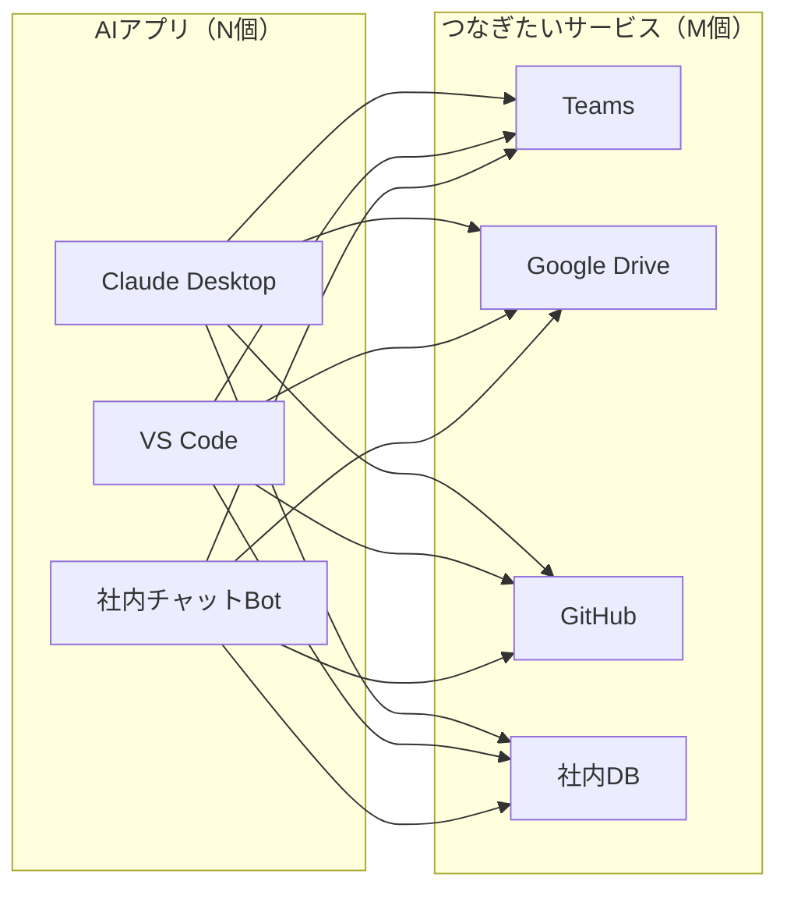
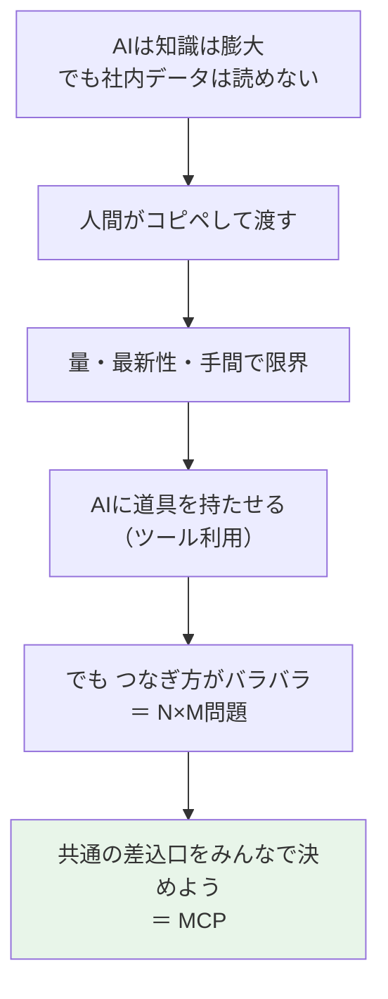

# 01. 前提知識：AIはなぜ社内データを見られないのか

### このファイルで分かること

- AIは知識は膨大なのに、**なぜあなたの会社のTeamsは読めない**のか
- 昔からやっていた解決策（コピペ）の限界
- 「**AIに道具を持たせる**」という発想
- そのやり方が抱えていた問題（＝MCPが生まれた理由）

MCPの話はまだ出てきません。ここは**土台**です。ここが分かると、02の「MCPとは何か」が「なるほど、そりゃ必要だ」に変わります。

---

## 1. AIは「電話しか使えない名探偵」

ChatGPTやClaudeのようなAIは、**とんでもない量の本や記事を読んだ人**だと思ってください。
歴史も数学もプログラミングも知っている。だから何を聞いてもそれっぽく答えます。

でも、決定的にできないことがあります。

```
     AIが知っていること              あなたの会社にあること
  ┌────────────────────────┐      ┌────────────────────────┐
  │ 世界中の本・記事・      │      │ Teamsのやりとり        │
  │ Wikipedia・公開コード   │      │ 社内のExcel・企画書    │
  │ 数学・歴史・法律…       │      │ 部長からのメール       │
  │                        │      │ 議事録・見積書         │
  │  ※ ある時点までの       │      │                        │
  │    「公開されたもの」   │      │  ※ 社外には出ていない  │
  └────────────────────────┘      └────────────────────────┘
             ↑                                 ↑
        ここは読んでいる               ここは 1文字も 読んでいない
                      （そもそも入る鍵がない）
```

理由は2つあります。

1. **学習していない**：社内データは公開されていないので、AIの勉強材料に入っていません
2. **アクセスできない**：仮に存在を知っていても、Teamsに入る鍵（アカウント）を持っていません

だからAIは、**知識は膨大なのに現場には行けない名探偵**です。
安楽椅子探偵。座ったまま推理はできるけれど、現場の指紋を自分で採りには行けない。

> **ポイント：AIが「社内のことを知らない」のは、頭が悪いからではなく、目と手がないから。**

---

## 2. 昔からの解決策 ＝ コピペ

じゃあどうしていたか。**人間が目と手の代わりをしていた**んです。

```
 ❌ コピペ方式

   あなた                                        AI
     │
     ├─ Teamsを開く
     ├─ 該当のやりとりを探す（5分）
     ├─ 選択してコピー
     ├─ Claudeに貼る  ─────────────────────────►  読める！
     ├─ 「これ要約して」                            │
     └─ 答えを受け取る  ◄────────────────────────┘

   → 動く。でも…
```

これで一応動きます。でも問題が3つ。

| 問題 | 具体的にどう困るか |
|---|---|
| **量** | 3か月分のチャットを貼れますか？ 貼りきれない |
| **最新性** | 貼った瞬間の情報で固定される。10分後に来た返信は反映されない |
| **手間** | 「探してコピーして貼る」が毎回発生。それ自体が仕事になってしまう |

`../ai_use/AI使い方_やさしい解説.md` に「机（コンテキスト）の広さには上限がある」という話がありました。
**コピペは、その限られた机を人力で埋める作業**でもあります。

---

## 3. 発想の転換：AIに「道具」を持たせる

ここで誰かが気づきました。

> **人間が取ってきてあげるのをやめて、AIに「取ってきて」と言わせればいいのでは？**

AIは自分の手でTeamsを開けません。でも、**「Teamsを検索して」という注文を出す**ことはできます。
注文を受けたプログラムが実際に検索して、結果をAIに渡す。これが「**道具（ツール）を持たせる**」という考え方です。

電話しか使えない名探偵の例えで言うと、こうです。

```
   ⭕ 道具方式（ツール利用）

   名探偵（AI）は現場に行けない。でも 電話 はかけられる。

        AI                            道具（プログラム）
         │
         ├─「Teamsで『請求書』を検索して」──────►  実際に検索する
         │                                              │
         │  ◄───── 検索結果はこれです ──────────────────┘
         │
         └─ 結果を読んで、日本語で答える
```

ここで超重要なことが2つあります。

**① AIは自分で実行していない。「注文」しかしていない。**

AIは「Teamsを検索して」と書いた紙を出すだけです。実際に手を動かすのは外側のプログラム。
これは「**AIが勝手に何でもできる**」わけではない、という安心材料でもあります。

**② AIは道具の中身を知らない。「説明書き」を読んで選んでいる。**

```
   AIに見えているのは、こういう「道具のメニュー表」だけ

   ┌──────────────────────────────────────────────────────┐
   │ 道具の名前 : teams_search                            │
   │ 説明       : Teamsのチャットやチャネルの投稿を検索する │
   │ 必要なもの : keyword（検索したい言葉）                 │
   ├──────────────────────────────────────────────────────┤
   │ 道具の名前 : weather                                 │
   │ 説明       : 指定した都市の今の天気を返す              │
   │ 必要なもの : city（都市名）                           │
   └──────────────────────────────────────────────────────┘

   AI「Teamsのこと聞かれたな… 上の道具が使えそうだ」
```

レストランのメニューと同じです。あなたは厨房の作り方を知らないけれど、
メニューの説明を読めば「これを頼めばいい」と分かる。AIも同じことをしています。

> **ポイント：AIは道具を「理解して」使っているのではなく、「説明文を読んで」選んでいる。**
> だから、道具の説明文が下手だとAIは間違った道具を選びます。これは後で効いてくる話です。

---

## 4. でも、ここで新しい問題が起きた

「道具を持たせればいい」と分かった。めでたし…とはいきませんでした。

**道具のつなぎ方に、決まりがなかったんです。**

AIアプリを作る会社はたくさんある。つなぎたいサービスもたくさんある。
そして**組み合わせごとに専用の配線を作る**しかなかった。



線が12本あります。AIアプリが3個 × サービスが4個 = 12。
これは **N×M問題** と呼ばれます。**片方が増えるたびに、掛け算で仕事が増える**という問題です。

```
   AIアプリ 3個 × サービス 4個 =  12本の配線
   AIアプリ 5個 × サービス 10個 =  50本の配線
   AIアプリ 10個 × サービス 50個 = 500本の配線 ← もう無理
```

しかも、それぞれの配線は**バラバラの作り方**でした。

```
 ❌ バラバラな世界

   Claude Desktop が Teams につなぐ方法  →  独自の作り方A
   VS Code が Teams につなぐ方法          →  独自の作り方B
   Claude Desktop が GitHub につなぐ方法  →  独自の作り方C

   → Teams用に作った配線を、VS Codeでは使えない。全部作り直し。
```

これは、**スマホの充電ケーブルが機種ごとに全部違った時代**とまったく同じ状況です。

```
   昔のケーブル地獄                 今
   ┌──────────────┐               ┌──────────────┐
   │ A社用ケーブル │               │              │
   │ B社用ケーブル │               │   USB-C 1本  │
   │ C社用ケーブル │      →        │              │
   │ D社用ケーブル │               │              │
   └──────────────┘               └──────────────┘
   カバンの中がぐちゃぐちゃ          どれでも刺せる
```

---

## 5. まとめ：ここまでの流れ



つまり、MCPが生まれた理由は**たった一言**でまとめられます。

> **「AIとデータのつなぎ方を、毎回作り直すのをやめたい」**

USB-Cを作った理由と、まったく同じです。技術的にすごいことをしたかったのではなく、
**面倒をなくしたかった**。ここを押さえておくと、次のファイルがすんなり入ります。

---

### この章の確認クイズ（自分用）

```
 □ AIが社内データを読めない理由を2つ言える？
 □ 「AIが道具を使う」とき、実際に手を動かしているのは誰？
 □ AIは道具を何を見て選んでいる？
 □ N×M問題を、ケーブルのたとえで説明できる？
```

---

→ 次は **[02_MCPとは何か_共通の差込口.md](02_MCPとは何か_共通の差込口.md)**
