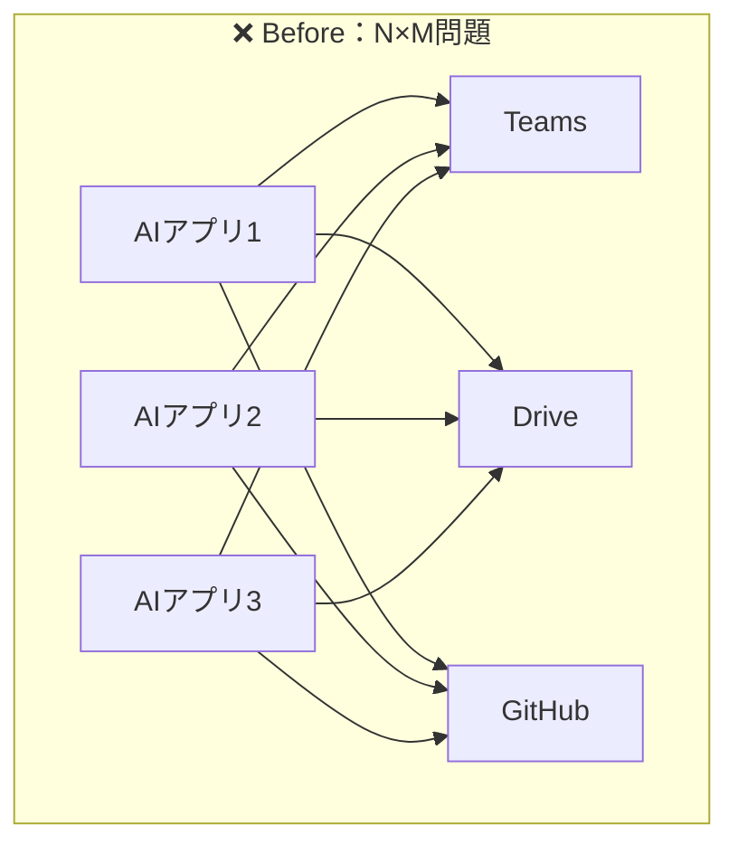
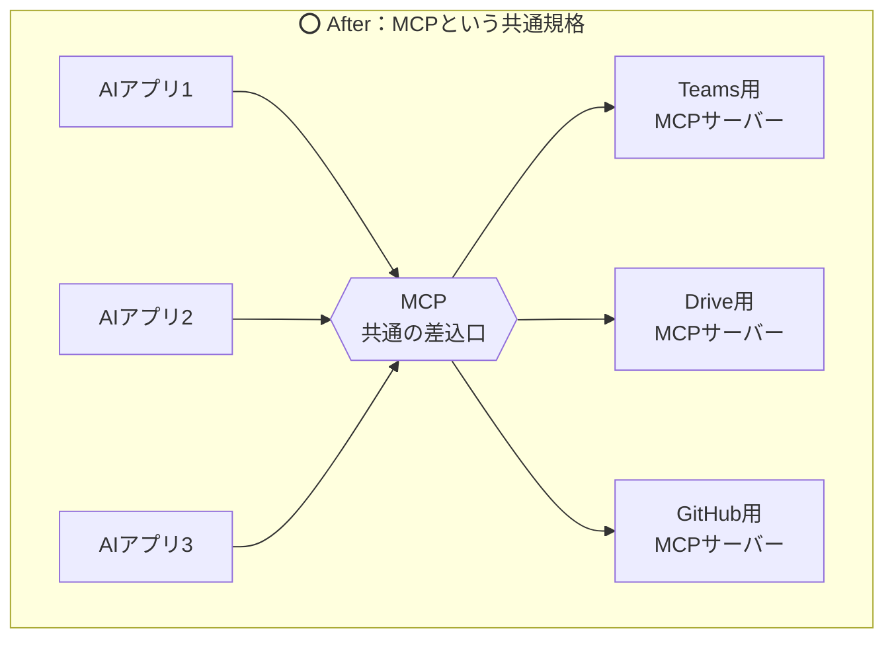
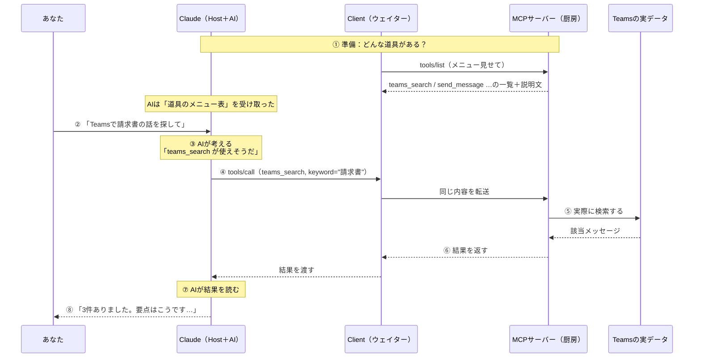

# 02. MCPとは何か：共通の差込口

### このファイルで分かること

- MCPを**一言で**言うと何か
- 登場人物3つ（**Host / Client / Server**）— ここで9割の人がつまずくので丁寧にやります
- サーバーが差し出せる**3種類のもの**（Tools / Resources / Prompts）
- つなぎ方の2種類（**stdio / Streamable HTTP**）
- 実際の**会話の流れ**を1ステップずつ

01で見た「N×M問題」の答えが、これです。

---

## 1. 一言でいうと

> **MCP（Model Context Protocol）＝ AIと、データや道具をつなぐための「共通の差込口」の規格。**

`Protocol（プロトコル）` という言葉が入っていますが、これは「**約束事**」という意味です。
「こういう形式で話しかけたら、こういう形式で返す」というルールを決めただけ。

日本語にすると「**モデル（AI）に文脈（データ）を渡すための約束事**」。名前のとおりです。

USB-Cの図で言うとこうなります。





線の数が **9本 → 6本** に減りました。数が増えるともっと効いてきます。

```
   ❌ 専用配線     : AIアプリ N個 × サービス M個 = N×M 本つくる
   ⭕ MCP          : AIアプリ N個 + サービス M個 = N＋M 本つくる
                     （掛け算が足し算になった！）
```

そして、もっと嬉しいのはこっちです。

> **誰かが「Teams用のMCPサーバー」を1個作れば、MCPに対応した全部のAIアプリがそれを使える。**

これがMCPの本当のうまみです。作る人は1回作れば全員が得をする。

---

## 2. 登場人物は3つ（ここが山場）

MCPには登場人物が3人います。名前が紛らわしいので、**レストラン**で覚えます。

| MCPの用語 | レストランだと | 実際の例 |
|---|---|---|
| **MCP Host**（ホスト） | **お客さん**（あなた＋AI本体） | Claude Desktop、Claude Code、VS Code |
| **MCP Client**（クライアント） | **ウェイター**（注文を運ぶ係） | ホストの中に自動で作られる。あなたは触らない |
| **MCP Server**（サーバー） | **厨房**（実際に作れる人） | Teams用サーバー、GitHub用サーバー |

```
   ┌──────────────────── MCP Host（お客さん＝AIアプリ）─────────────────────┐
   │                                                                        │
   │   あなた ＋ AI                                                          │
   │      │                                                                 │
   │      ├── Client①（ウェイター1号）──────► Server A（Teamsの厨房）        │
   │      │                                                                 │
   │      ├── Client②（ウェイター2号）──────► Server B（GitHubの厨房）       │
   │      │                                                                 │
   │      └── Client③（ウェイター3号）──────► Server C（社内DBの厨房）       │
   │                                                                        │
   └────────────────────────────────────────────────────────────────────────┘

   ポイント：つなぐ厨房が3つなら、ウェイターも3人。1対1で専属。
```

**つなぐサーバーの数だけClientが作られます。** 1サーバーにつき1クライアント、専属です。
ウェイターが複数のテーブルを掛け持ちして混乱する、みたいなことは起きない設計になっています。

### ⚠️ 最大の誤解：「サーバー」は遠くのコンピュータではない

ここ、絶対につまずくポイントなので独立させます。

「サーバー」と聞くと、**どこか遠くのデータセンターにある黒い箱**を想像しますよね。
MCPの「サーバー」は、**そういう意味ではありません**。

> **MCPでいう「サーバー」は、場所の話ではなく「役割」の名前です。**
> 「データや道具を差し出す側」がサーバー。**あなたのノートPCの中で動いていてもサーバー。**

```
 ❌ よくある誤解                      ⭕ 実際

 「MCPサーバー」                      「MCPサーバー」
   = クラウドにある                     = 差し出す役の プログラム
   = 契約して借りるもの                 = 置き場所は どこでもいい
   = 高そう
                                      あなたのPCの中     → ローカルMCPサーバー
                                      ネットの向こう側   → リモートMCPサーバー
                                      どっちも「サーバー」
```

たとえば「あなたのPCのファイルを読めるようにするMCPサーバー」は、**あなたのPCの中で動きます**。
それでもサーバーです。厨房が家の中にあっても厨房、というだけの話です。

---

## 3. サーバーが差し出せる3種類のもの

厨房（サーバー）は、何を差し出せるのか。公式には**3種類**が決まっています。
これを **primitives（プリミティブ＝基本の部品）** と呼びます。

| 種類 | 何ができる | たとえ | Teamsでの例 |
|---|---|---|---|
| **Tools**（ツール） | **実行できる操作**。AIが呼ぶと何かが起きる | メニューの料理（注文すると作られる） | 「チャットを検索する」「メッセージを送る」 |
| **Resources**（リソース） | **読めるデータ**。置いてあるので読むだけ | テーブルに置かれた資料・水 | 「このチャネルの投稿一覧」 |
| **Prompts**（プロンプト） | **定型の指示テンプレ**。よく使う頼み方の雛形 | 「おすすめセット」のメニュー | 「今週の議事録をまとめる」テンプレ |

**実際に一番よく使われるのは Tools です。** 最初は「MCP ≒ AIに道具を持たせる仕組み」と理解しても大きく外れません。

それぞれに決まった呼び方があります。

```
   一覧を見る      :  tools/list      「どんな料理があるの？」（メニューを見る）
   実行する        :  tools/call      「これください」（注文する）

   リソースも同じ  :  resources/list  →  resources/read
   プロンプトも同じ:  prompts/list    →  prompts/get
```

`/` の左が種類、右が動作です。`tools/list` は「ツールを、一覧して」。読めば分かる名前になっています。

### 逆向きもある：サーバーがあなたに聞き返せる

面白いことに、**サーバー側からユーザーに質問する**こともできます。これを **Elicitation（エリシテーション＝聞き出すこと）** と呼びます。

```
   サーバー「メッセージを送ります。本当にいいですか？」
                    ↓
   あなた「はい」 / 「いいえ」
```

危ない操作の前に確認を取る、といった使い方です。
`../ai_use/AI使い方_やさしい解説.md` に「確認画面はあなたを守る最後のブレーキ」という話がありましたが、
**そのブレーキを厨房側から踏める**イメージです。

---

## 4. つなぎ方は2種類（同じ部屋か、電話か）

ホストとサーバーがどうやって会話するか。経路（transport＝運び方）は2つだけです。

| 経路の名前 | たとえ | どんなとき |
|---|---|---|
| **stdio** | **同じ部屋で口頭で話す** | サーバーが自分のPC内で動いているとき |
| **Streamable HTTP** | **電話をかける** | サーバーがネットの向こうにあるとき |

```
  ① stdio（標準入出力）＝ 同じ部屋

     ┌─────────────────────────────┐
     │  あなたのPC                  │
     │                             │
     │  Claude ◄──口頭──► サーバー  │   速い。ネットを通らない。
     │                             │
     └─────────────────────────────┘


  ② Streamable HTTP ＝ 電話

     ┌──────────────┐                    ┌──────────────┐
     │ あなたのPC    │ ──── ネット ────► │ どこかのサーバー│
     │ Claude       │ ◄─────────────────  │              │
     └──────────────┘                    └──────────────┘

     ネット越し。だから「本人確認」が必要になる ← これが 03 の話です
```

`stdio` は `standard input/output`（標準入出力）の略で、**プログラム同士が同じPC内で文字をやりとりする一番基本的な方法**です。

> **重要：ローカルかリモートかは「距離」の違いだけで、「役割」は同じサーバーです。**
> そして **Microsoft 365 のコネクタは ② の電話タイプ**です。だから鍵の話（03）が必要になります。

---

## 5. 実際の会話を追いかける

ここまでの部品を全部つないで、「Teamsで請求書の話を検索して」と頼んだときの流れを見ます。



このうち、**AIが本当にやっているのは③と⑦だけ**です。

```
   ③ 「どの道具を使うか選ぶ」    ← 判断
   ⑦ 「返ってきた結果を読んで答える」 ← 読解

   ①②④⑤⑥⑧ は プログラムの仕事（決まった手順を実行しているだけ）
```

つまり、**MCPはAIを賢くする仕組みではありません**。
AIの判断力と読解力は前と同じ。**取ってこられるものが増えただけ**です。

> **AIが賢くなったのではなく、AIの手が長くなった。** これがMCPの本質です。

### ③をもう少し詳しく：AIは説明文だけで選んでいる

01でも触れましたが、ここが効いてきます。

```
   AIの頭の中（③の瞬間）

   質問:「Teamsで請求書の話を探して」

   手持ちのメニュー:
     ・teams_search  … 「Teamsのチャットやチャネル投稿を検索する」  ← これだ！
     ・weather       … 「都市の天気を返す」                        ← 関係ない
     ・send_mail     … 「メールを送信する」                        ← 関係ない
```

AIは中身のプログラムを読んでいません。**説明文を読んで、質問と照らし合わせているだけ**です。
人間がメニューの説明を読んで注文を決めるのと、本当に同じことをしています。

だから、説明文が「いい感じにやります」みたいな雑な道具だと、AIは選べません。
`../ai_use/AI使い方_やさしい解説.md` の「『いい感じにして』で丸投げするな」と同じ話が、**道具を作る側にも当てはまる**ということです。

---

## 6. コラム：教科書は書き換わり続けている

MCPは **2024年11月**に登場した、まだ新しい規格です。そして**今も改訂が続いています**。

| 版 | 主な変化 |
|---|---|
| 2024年11月（初版） | Host / Client / Server と Tools / Resources / Prompts を決めた |
| 2025-03-26 | **Streamable HTTP**（電話タイプ）と OAuth 2.1（鍵のしくみ）を追加 |
| 2025-06-18 | 構造化された出力、Elicitation（聞き返し）を追加 |
| 2025-11-25 | 権限まわりの整理 |
| 2026-07-28 | プロトコルを**ステートレス化**、`server/discover` で能力確認、MCP Apps など |

ここで知っておくと得することが2つ。

**① なくなった機能もある。**
昔は **Sampling**（サーバーがAIに文章生成を頼む）や **Logging**（サーバーがログを送る）という機能がありましたが、
**2026-07-28版で非推奨（deprecated＝これからは使わないでね）** になりました。

**② ネットの解説記事は古い可能性がある。**
「MCPには5つの機能がある」と書いてある記事を読んだら、それは古い版の話かもしれません。
**迷ったら公式（modelcontextprotocol.io）を見る**のが正解です。

```
   ⚠️ 新しい技術を勉強するときの落とし穴

   「わかりやすい解説記事」  ← 読みやすいが、半年前の情報だったりする
   「公式ドキュメント」      ← 固いが、常に最新

   → 概要は記事で、確認は公式で。
```

---

## 7. まとめ

```
   ┌──────────────────────────────────────────────────────────┐
   │ MCP = AIと外の世界をつなぐ「共通の差込口」の約束事         │
   ├──────────────────────────────────────────────────────────┤
   │ 登場人物 : Host（お客）/ Client（ウェイター）/ Server（厨房）│
   │ 差し出す : Tools（操作）/ Resources（データ）/ Prompts（雛形）│
   │ つなぎ方 : stdio（同室）/ Streamable HTTP（電話）          │
   │ 効果     : N×M の掛け算が、N＋M の足し算になる             │
   │ 本質     : AIが賢くなるのではなく、AIの手が長くなる        │
   └──────────────────────────────────────────────────────────┘
```

### この章の確認クイズ（自分用）

```
 □ MCPサーバーは、自分のPCの中で動くこともある？
 □ Host / Client / Server を、レストランのたとえで言える？
 □ Tools と Resources の違いは？
 □ AIは何を見てツールを選んでいる？
 □ MCPを入れるとAIは賢くなる？
```

---

ここで必ず出てくる疑問があります。

> **「差込口が共通なら、他の人も私のTeamsを読めてしまうんじゃないの？」**

まったく正しい疑問です。その答えが次のファイルです。

→ 次は **[03_鍵のしくみ_認証と権限.md](03_鍵のしくみ_認証と権限.md)**
