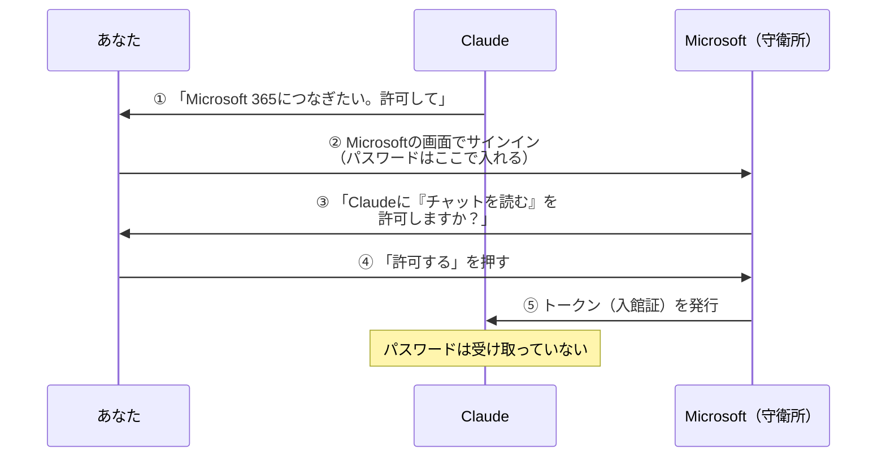
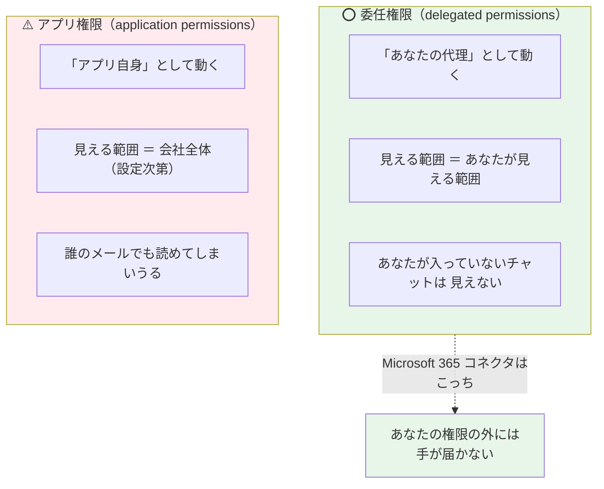
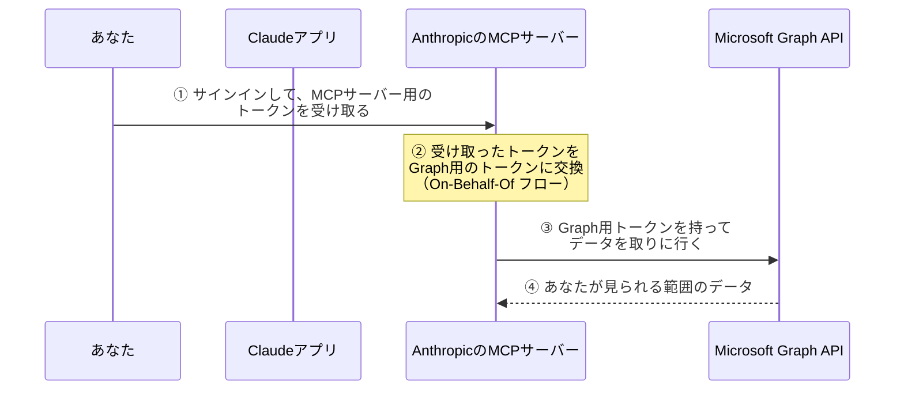

# 03. 鍵のしくみ：認証と権限

### このファイルで分かること

- 差込口が共通なのに、**なぜ他人のTeamsは読めない**のか
- Claudeに渡しているのは**パスワードではない**（**トークン**という入館証）
- **委任権限**とは何か ＝ 「あなたの権限を借りている」の意味
- `Chat.Read` みたいな**権限名の読み方**
- **管理者**が何を握っているのか

02の最後の疑問に答えるファイルです。**04を納得して読むには、ここが必須**です。

---

## 1. 素朴な疑問から始める

02で「MCPは共通の差込口だ」と学びました。そこでこう思ったはずです。

```
   ┌────────────────────────────────────────────────────┐
   │ 「差込口が共通なら…                                 │
   │   私も、隣の人のTeamsに刺せてしまうのでは？」        │
   └────────────────────────────────────────────────────┘
```

とても良い疑問です。そして答えはこうです。

> **差込口（形）は共通。でも、刺すには鍵が必要。そして鍵は一人ずつ違う。**

```
   MCP が決めたこと          MCP が決めていないこと
   ┌────────────────┐       ┌────────────────────────┐
   │ 差込口の形      │       │ 誰が入れるか           │
   │ 会話のしかた    │       │ 何を見られるか         │
   └────────────────┘       └────────────────────────┘
                                       ↑
                            これは Microsoft 側が決める
                            （＝ もともとのアクセス権）
```

**MCPは「配管」を標準化しただけで、「誰が水を使えるか」は各サービスのルールのまま**です。
ここが分かると、セキュリティの不安がだいぶ整理されます。

---

## 2. Claudeに渡しているのは、パスワードではない

いちばん誤解されるところです。

```
 ❌ よくある想像                      ⭕ 実際

  あなた                              あなた
    │                                   │
    ├─ パスワードをClaudeに教える        ├─ Microsoftのログイン画面で
    │                                   │   自分でサインインする
    ▼                                   ▼
  Claudeがあなたのパスワードを      Claudeが受け取るのは「トークン」
  持っている（こわい！）            パスワードは Claudeに届かない
```

### トークン ＝ 「あなたの名前で入れる入館証」

**トークン（token）** とは、「この人は本人だと確認済みです」という**紙の証明書**のようなものです。

```
   ┌─────────────────────────────────────┐
   │        ✦ 入 館 証 ✦                 │
   │                                     │
   │  だれの   : あなた                   │
   │  入れる所 : チャットを読む / メール読む│
   │  有効期限 : 1時間                    │
   │                                     │
   │  ※ この紙で入れるのは上の場所だけ     │
   └─────────────────────────────────────┘
```

合鍵とトークンの違いが、そのまま安全性の違いです。

| | 合鍵（パスワード） | 入館証（トークン） |
|---|---|---|
| 何ができる | **全部**できる | **書かれた範囲だけ** |
| いつまで | 変えるまで**ずっと** | **数十分〜数時間**で切れる |
| 取り消せる？ | パスワード変更が必要 | **管理画面から即はがせる** |
| 渡して平気？ | 絶対ダメ | 設計上そういうもの |

> **ポイント：トークンは「期限付き・範囲限定・取り消し可」。だから他人に預けられる。**

---

## 3. OAuth ＝ 入館証をもらう手続き

この入館証を発行してもらう手順に、世界共通の名前がついています。**OAuth（オーオース）** です。

難しそうですが、やっていることは3ステップです。



ここで注目すべきは**②の場所**です。

```
   ⭕ パスワードを入れる画面は「Microsoftの画面」

   ┌──────────────────────────────────┐
   │  Microsoft                       │  ← ここはMicrosoftが作った画面。
   │                                  │     Claudeは中身を見られない。
   │  メール: [                    ]  │
   │  パスワード: [                ]  │
   │                        [サインイン]│
   └──────────────────────────────────┘

   → Claudeは「サインインが終わった」という結果しか知らない
```

ホテルのチェックインと同じです。あなたはフロント（Microsoft）に身分証を見せる。
ベルボーイ（Claude）はそれを見ていない。ベルボーイが受け取るのは「この部屋に入れるカードキー」だけ。

---

## 4. 委任権限 ＝ 「あなたの権限を借りている」

ここが**この資料でいちばん大事な概念**です。04の「なんで他人のチャットは読めないの？」がここで解決します。

Microsoftの権限には、大きく2種類あります。



**Claude の Microsoft 365 コネクタは「委任権限」を使っています。**（公式のセキュリティガイドに明記されています）

つまり、こうなります。

```
   ┌────────────────────────────────────────────────────────────┐
   │  Claude が見られる範囲  ＝  あなたが自分で見られる範囲      │
   │                                                            │
   │  一文字も、はみ出さない。                                   │
   └────────────────────────────────────────────────────────────┘
```

図にするとこうです。

```
             会社のデータ全体
   ┌──────────────────────────────────────────┐
   │                                          │
   │   ┌───────────────────┐                  │
   │   │ あなたが見られる  │  ← Claudeもここまで
   │   │ 範囲              │     ぴったり同じ
   │   │                   │                  │
   │   │  ・自分のメール   │                  │
   │   │  ・参加中のチャット│                  │
   │   │  ・権限があるSite │                  │
   │   └───────────────────┘                  │
   │                                          │
   │   他人の個人チャット ← Claudeも見えない   │
   │   権限のないサイト   ← Claudeも見えない   │
   │                                          │
   └──────────────────────────────────────────┘
```

> **Claudeは「あなた以上」にはなれない。あなたの影として動いている。**

これは覚え方として強力です。何かで迷ったら、**「自分で開けるか？」を考えればいい**。
自分で開けないものは、Claudeにも開けません。

### 逆に言うと…（注意点）

この仕組みには裏返しの注意点があります。

```
   ⚠️ あなたが見られるものは、Claudeも見られる

   → 「自分がアクセス権を持っているが、実は見るべきでない資料」
      も対象に入る
   → コネクタを有効にするのは「自分の目の届く範囲を全部渡す」ことに近い
```

危ないという話ではなく、**範囲を正しく理解しておこう**という話です。

---

## 5. 実は鍵を2回交換している

もう一歩だけ踏み込みます。ここは「へぇ」で十分ですが、知ると図がきれいに閉じます。

Claude の M365 コネクタでは、トークンの交換が**2段階**で起きています。



なぜ2回かというと、**入館証が使える場所が違う**からです。

```
   ① の入館証 :「AnthropicのMCPサーバーに入れます」
   ③ の入館証 :「Microsoftのデータ置き場に入れます」

   → 建物が違うので、入館証も別。
     MCPサーバーが受付で「この人の代理で来ました」と言って
     Microsoft用の入館証に取り替えてもらっている
```

この「**本人の代理として別の入館証に取り替える**」手続きを **On-Behalf-Of フロー**（＝〜の代わりに、の意）と呼びます。
名前のとおり「あなたの代わりに」です。ここでも**主役はあなた**であることが保たれています。

なお、**MCPサーバー自身はあなたの認証情報を保管・管理していません**（公式ガイドの記載）。
トークンは短時間だけ手元にあって、使い終われば切れます。

---

## 6. 権限名の読み方（`Chat.Read` って何？）

Microsoftの権限には名前がついています。読み方を覚えると、設定画面が一気に怖くなくなります。

```
      Chat  .  Read
       ↑        ↑
     どこの   何をする
```

**`対象.動作`** の形です。これだけ。

| 権限名 | 読み方 | できること |
|---|---|---|
| `Chat.Read` | チャットを読む | Teamsのチャットを**読むだけ** |
| `Mail.Read` | メールを読む | Outlookのメールを**読むだけ** |
| `Sites.Read.All` | サイトを全部読む | SharePointのサイトを**読むだけ** |
| `Calendars.Read` | 予定表を読む | 予定を**読むだけ** |
| `Mail.Send` | メールを送る | メールを**実際に送信する** ⚠️ |
| `ChatMessage.Send` | チャットを送る | Teamsに**実際に投稿する** ⚠️ |
| `Files.ReadWrite.All` | ファイルを読み書き | ファイルを**変更・作成できる** ⚠️ |

**`Read` と `Send` / `ReadWrite` の間には、深い溝があります。**

```
   ┌─────────────────────┬─────────────────────┐
   │   読むだけ（Read）  │  書ける（Send/Write）│
   ├─────────────────────┼─────────────────────┤
   │ 最悪でも「見られた」│ 最悪だと「送られた」 │
   │ 取り返しはつく      │ 取り返しがつかない ⚠️│
   └─────────────────────┴─────────────────────┘
```

だからClaudeのM365コネクタでは、**書き込み系のツールは管理者が有効にしない限り使えません**。
初期状態は「読むだけ」。これは設計としてまともです。

---

## 7. 管理者が握っているもの

会社で使う場合、あなた一人では決められないことがあります。**IT管理者**の役割です。

```
   ┌──────────────────────────────────────────────────────────┐
   │ 管理者が決めること                                        │
   ├──────────────────────────────────────────────────────────┤
   │ ① そもそもこのコネクタを会社で使っていいか（テナントの同意）│
   │ ② 書き込みツールを有効にするか（メール送信・Teams投稿など） │
   │ ③ いつでも取り消せる（アクセスをはがす）                   │
   └──────────────────────────────────────────────────────────┘
```

`テナント` という言葉が出てきました。**テナント＝会社ごとに区切られた領域**のことです。
ビルの中の「○○社の区画」だと思ってください。あなたのデータはその区画の中にあります。

Microsoft側には、Claude用に2つのアプリが登録されます。

```
   ・M365 MCP Server for Claude  … 実際にGraphを叩く側（厨房）
   ・M365 MCP Client for Claude  … つなぎに行く側（ウェイター）
```

02で学んだ Client / Server が、**そのままの名前で実物として出てきます**。
「あ、02の話が現実に対応している」と分かる瞬間です。

---

## 8. できる／できない 早見表

| やりたいこと | できる？ | 理由 |
|---|---|---|
| 自分が入っているTeamsチャットを読む | ⭕ | あなたに閲覧権があるから |
| **自分が入っていない**他人のチャットを読む | ❌ | 委任権限＝あなたの権限の外は届かない |
| 権限のあるSharePointの資料を読む | ⭕ | あなたに閲覧権があるから |
| 権限のないSharePointサイトを読む | ❌ | あなた自身が開けないから |
| 自分のOutlookメールを読む | ⭕ | あなたのメールだから |
| 退職した人のメールを読む | ❌ | あなたのアカウントでは開けないから |
| OneNoteのノートを読む | ❌ | **対応していない**（公式に明記） |
| メールを送る・Teamsに投稿する | △ | **管理者が書き込みを有効にした場合のみ** |
| 書き込みで添付ファイルを付ける | ❌ | **非対応**（公式に明記） |

最後の3つのように、「権限の話ではなく、そもそも機能として無い」ものもあります。
**「権限の壁」と「機能の壁」は別物**だと分けて覚えると混乱しません。

---

## 9. まとめ

```
   ┌──────────────────────────────────────────────────────────────┐
   │ MCPは「配管の形」を決めただけ。「誰が使えるか」は各サービス   │
   ├──────────────────────────────────────────────────────────────┤
   │ Claudeに渡るのは パスワードではなく トークン（入館証）        │
   │  → 期限付き・範囲限定・いつでも取り消せる                    │
   ├──────────────────────────────────────────────────────────────┤
   │ Microsoft 365 コネクタは 委任権限                             │
   │  → Claudeが見える範囲 ＝ あなたが見える範囲（はみ出さない）  │
   ├──────────────────────────────────────────────────────────────┤
   │ 権限名は 対象.動作。Read と Send の間には深い溝がある         │
   │  → 書き込み系は管理者が有効にしないと使えない                │
   └──────────────────────────────────────────────────────────────┘
```

### この章の確認クイズ（自分用）

```
 □ Claudeはあなたのパスワードを持っている？
 □ トークンと合鍵の違いを3つ言える？
 □ 「委任権限」を一言で言うと？
 □ 自分が入っていないTeamsチャットは読める？ その理由は？
 □ `Chat.Read` と `ChatMessage.Send` の違いは？ どっちが管理者の許可が必要？
```

---

これで部品が全部そろいました。**01（なぜ必要か）＋ 02（MCPの仕組み）＋ 03（鍵）**。
次のファイルで、この3つを全部使って先輩の話を分解します。

→ 次は **[04_本題_MS365コネクタとTeamsリンクの話.md](04_本題_MS365コネクタとTeamsリンクの話.md)**
