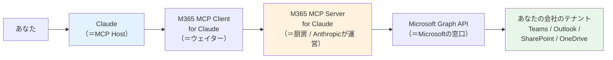
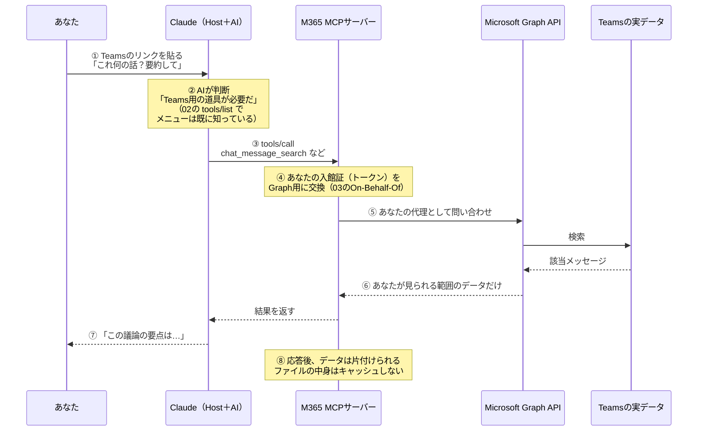
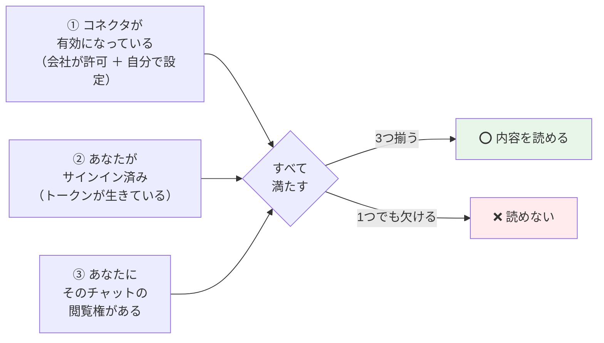

# 04. 本題：MS365コネクタと「Teamsのリンクを貼るだけ」の話

### このファイルで分かること

- **★このシリーズのゴール。** 先輩の話が「なぜ成り立つのか」を1ステップずつ分解する
- 全体の構成図（あなた → Claude → MCPサーバー → Microsoft Graph → Teams）
- 「リンクを貼るだけ」の**正確な理解**（ここが一番おいしい）
- 何ができて、何ができないか
- 結局、何が嬉しいのか

01〜03の部品を全部使います。分からない語が出てきたら、その番号のファイルに戻ってください。

---

## 1. 出発点：先輩の話

> **「MS365にMCPサーバーが追加されたから、TeamsのリンクをClaudeに貼るだけで内容を見てくれるらしい」**

結論から言うと、**この話はだいたい合っています。** 実際にそういう体験ができます。

ただし「なぜそうなるのか」を分解すると、**1か所だけ言葉が縮まっている**部分があります。
そこを最後に直します。まずは全体像から。

---

## 2. 全体の構成図

登場人物を、02と03で習った言葉で並べます。



新しい言葉が1つだけ出てきました。

> **Microsoft Graph API ＝ Microsoft 365 のデータを取り出すための公式の窓口。**

`API` は「プログラムから使うための入口」という意味です。
Teams も Outlook も SharePoint も、**全部この1つの窓口**から取り出せるようになっています。
役所の総合窓口みたいなものです。

そして重要なのは、この窓口は**MCPのために作られたものではない**ということ。
Graph API は前からありました。MCPが新しくやったのは、ここです。

```
   従来                            MCPが追加したもの

   Graph API は前からあった        ┌──────────────────────┐
        ↓                         │ AIが使える形に         │
   でもAIは呼び方を知らない        │ 包み直した             │
   （プログラマーが書くもの）       │ ＝ MCPサーバー         │
                                  └──────────────────────┘
```

**つまり「MS365にMCPサーバーが追加された」＝「前からあったGraph APIに、AI用の差込口がついた」**ということです。
ここが分かると、先輩の話の1行目が完全に理解できます。

---

## 3. リンクを貼ってから答えが返るまで（山場）

ここがこの資料の心臓部です。**6ステップ**で追いかけます。



1つずつ、どのファイルの知識が効いているかを確認します。

### ① リンクを貼る ＝「どこを見ればいいか」の手がかりを渡す

これは、**`../ai_use/AI使い方_やさしい解説.md` の「`@ファイル名` でファイルを手渡す」とまったく同じ発想**です。

```
 ❌ 手がかりなし                      ⭕ 手がかりあり

 「先週の請求書の話ってどうなった？」   「これ何の話？ https://teams.microsoft.com/...」
   → AIは広い範囲を探し回る            → どのチャットか絞れている
   → 見つからないこともある            → 一発で当たる
```

リンクには、**どのチームの・どのチャネルの・どのメッセージか**という情報が含まれています。
AIにとっては「地図の座標」を渡されたのと同じです。

### ② AIが「Teamsの道具が必要だ」と判断する

02でやった `tools/list` の話です。コネクタをつないだ時点で、Claudeは
「`chat_message_search` という道具がある」というメニューを**すでに知っています**。

```
   AIの頭の中
   ┌────────────────────────────────────────────────┐
   │ 質問: Teamsのリンク ＋「これ何の話？」          │
   │                                                │
   │ 手持ちの道具:                                   │
   │   chat_message_search  ← Teamsのチャット検索  ✓ │
   │   mail_search          ← メール検索             │
   │   file_search          ← SharePoint検索         │
   │                                                │
   │ → 1番目を使おう                                │
   └────────────────────────────────────────────────┘
```

### ③ 道具を呼ぶ（tools/call）

02の `tools/call` です。AIは「この道具を、この条件で実行して」という注文を出すだけ。
**自分でTeamsを開いているわけではありません。**

### ④ 入館証を交換する

03でやった **On-Behalf-Of フロー**です。MCPサーバーが「この人の代理で来ました」と言って、
Graph API用のトークンに取り替えてもらいます。

### ⑤⑥ Graph が「あなたが見られる範囲だけ」返す

**ここが最重要ポイント**です。03の委任権限が効いています。

```
   ┌────────────────────────────────────────────────────────────┐
   │  Graph API は「誰の代理か」を見て、範囲を切る                │
   │                                                            │
   │   あなたが参加しているチャット      → 返す ⭕               │
   │   あなたが参加していないチャット    → 返さない ❌            │
   │                                                            │
   │  ※ Claudeが遠慮しているのではない。                        │
   │    Microsoft側が そもそも渡さない。                         │
   └────────────────────────────────────────────────────────────┘
```

「Claudeが気を使って隠している」のではなく、**そもそもデータが渡ってこない**。
これは安心材料としてかなり大きいです。守っているのはMicrosoft側の壁です。

### ⑦⑧ 答えを作って、片付ける

AIは返ってきた本文を読んで、日本語でまとめます。そして公式ガイドによると、

```
   ・応答を返した後、データは片付けられる
   ・ファイルの中身は キャッシュしない（＝溜め込まない）
   ・アクセストークンは 60〜90分でキャッシュ切れ
   ・保存されたチャットに含まれるツール結果だけが残る
```

つまり、**「社内データが全部Claude側にコピーされる」わけではありません**。
**聞かれたときだけ、その場で取りに行って、使い終わったら手放す**方式です。

図にするとこうです。

```
 ❌ よくある想像：全部コピーされる          ⭕ 実際：そのとき取りに行くだけ

  ┌──────────┐    ぜんぶ    ┌────────┐     ┌──────────┐  聞かれた時 ┌────────┐
  │ 社内データ │ ═══════════► │ Claude │     │ 社内データ │ ◄─ だけ ──  │ Claude │
  └──────────┘   まるごと    │ に保存 │     └──────────┘  取りに行く  └────────┘
                             └────────┘        データは会社の中に置いたまま
```

---

## 4. ここで正確さを1段上げる：「リンクを貼るだけ」の話

さて、先輩の話で**言葉が縮まっている1か所**です。ここを直すと理解が完成します。

### 公式ドキュメントには「リンクを貼ると読む」という機能としては書かれていない

Claudeの公式ヘルプで説明されているのは、こういう機能です。

```
   公式が説明している機能

   ・Teams  : 自分が参加しているチャットやチャネルの投稿を 検索 できる
   ・Outlook: 日付・送信者・件名などで メールを検索 できる
   ・SharePoint / OneDrive : 文書を 検索 して分析できる
```

**全部「検索」です。** 「URLを貼ると、そのURLを開いて読む」という専用機能としては説明されていません。

### じゃあ先輩の話は間違い？ → いいえ、結果は起きる

体験としては「リンクを貼ったら読んでくれた」になります。なぜなら、

```
   リンクを貼る
        ↓
   リンクの中に「どのチーム・どのチャネル・どの時刻」の情報が入っている
        ↓
   AIがそれを 手がかり にして 検索ツール を呼ぶ
        ↓
   該当のやりとりが見つかる
        ↓
   体験としては「リンクを貼ったら読んでくれた」⭕
```

**リンクは魔法のスイッチではなく、検索のための手がかり**なんです。
これが「だいたい合っているが、言葉が縮まっている」の正体です。

```
 △ 縮まった言い方                    ⭕ 正確な言い方

 「リンクを貼ると読んでくれる」       「リンクを手がかりに、あなたの権限で
                                       Teamsを検索して、見つけた内容を読む」
```

### 本質は「リンク」ではなく、3つの条件

そして、ここがこのファイルの結論です。

**リンクを貼っても読めないことがあります。** 条件が3つ揃っていないときです。



1つでも欠けたらアウト。**AND条件**です。だから、こういうことが起きます。

```
   ケース1: 先輩は読めたのに、自分は読めない
     → ②か③が違う可能性。自分のサインイン状態と、そのチャットに
       自分が参加しているかを確認する

   ケース2: 昨日は読めたのに、今日は読めない
     → ②の可能性。トークンの期限が切れて 再サインインが必要

   ケース3: SharePointは読めるのに、Teamsは読めない
     → ③の可能性。そのチャットに自分が入っていない
```

> **覚え方：リンクを貼るのは「近道」であって「権限の抜け道」ではない。**
> あなたが自分の目で開けないTeamsのリンクは、Claudeにも開けません。

これで先輩の話が、ふわっとした噂ではなく**条件つきの仕組み**として説明できるようになりました。
これがこのシリーズのゴールです。

---

## 5. 何ができて、何ができないか

| サービス | 読む | 書く | 具体的にできること |
|---|---|---|---|
| **Teams** | ⭕ | △ | 自分が参加しているチャット・チャネル投稿を検索。会議の要約なども対象 |
| **SharePoint** | ⭕ | △ | サイトやライブラリを横断して文書を検索・分析 |
| **OneDrive** | ⭕ | △ | 自分のファイルを検索・分析 |
| **Outlook メール** | ⭕ | △ | 日付・送信者・件名などでスレッドを検索、内容を要約 |
| **Outlook 予定表** | ⭕ | △ | 会議の概要や参加者を確認、予定の傾向を分析 |

- **△（書く）は、管理者が書き込みツールを有効にした場合のみ**
- 読める形式：Word / Excel / PowerPoint / PDF / テキスト系（`.txt` `.md` `.csv` `.json` `.xml` `.html` `.log`）
- **読めないもの：OneNote のノートブック**
- 書き込みツールでは**添付ファイルは非対応**
- 利用できるプラン：Free / Pro / Max / Team / Enterprise（全プラン）

書き込みができると、こういうことまで可能になります（管理者が許可した場合）。

```
   ⚠️ 書き込みツールで できてしまうこと

   ・メールの下書き・送信・整理
   ・予定の作成・更新・削除
   ・OneDrive / SharePoint のファイル作成・更新
   ・Teams へのメッセージ送信・チャネル投稿

   → 「送信」は取り消せない。ここは本当に気をつけるところ
```

03で言った「`Read` と `Send` の間の深い溝」が、実物として現れています。

---

## 6. 結局、何が嬉しいのか

01で挙げた「コピペ方式の3つの問題」に戻ります。円を閉じます。

| 01で挙げた問題 | MCPコネクタでどうなったか |
|---|---|
| **量**：3か月分のチャットは貼りきれない | AIが検索して必要な部分だけ取ってくる。貼る必要がない |
| **最新性**：貼った瞬間で固定される | 聞いた瞬間に取りに行くので、常に最新 |
| **手間**：探してコピーして貼るのが毎回 | リンクを貼るか、質問するだけ |

```
 ❌ Before                                ⭕ After

 Teamsを開く（探す5分）                    「このリンクの議論を要約して」
   → コピー                                   → 終わり
   → Claudeに貼る
   → 「要約して」
   → 古い情報だったと気づく
   → もう一度Teamsを開く…
```

一言でまとめると、

> **コピペという作業が、消えた。**

01で「AIは電話しか使えない名探偵」と言いました。その続きで言えば、

```
   01: 名探偵は現場に行けない。人間が証拠を運んでいた（コピペ）
   02: 名探偵に「電話」を持たせる共通規格ができた（MCP）
   03: 電話で名乗るための入館証のしくみができた（トークン・委任権限）
   04: Microsoft 365 の現場に電話がつながった（M365コネクタ）

   → 名探偵が、座ったまま現場に問い合わせられるようになった
      ただし、聞けるのは あなたが聞ける相手だけ
```

---

## 7. まとめ

```
   ┌────────────────────────────────────────────────────────────────┐
   │ 先輩の話の正体                                                  │
   ├────────────────────────────────────────────────────────────────┤
   │ 「MS365にMCPサーバーが追加された」                              │
   │   ＝ 前からあった Microsoft Graph API に、AI用の差込口がついた   │
   │                                                                │
   │ 「Teamsのリンクを貼るだけで内容を見てくれる」                    │
   │   ＝ リンクを手がかりに、あなたの権限で Teams を検索して読む      │
   │                                                                │
   │ 成立条件（全部必要）                                            │
   │   ① コネクタが有効  ② サインイン済み  ③ 自分に閲覧権がある      │
   │                                                                │
   │ 見える範囲                                                      │
   │   ＝ あなたが自分で見られる範囲と 完全に同じ                     │
   └────────────────────────────────────────────────────────────────┘
```

### この章の確認クイズ（自分用）

```
 □ Microsoft Graph API とは何？ MCPのために作られた？
 □ リンクを貼ってから答えが返るまでの6ステップを、人に説明できる？
 □ 「リンクを貼ると読む」という専用機能は公式に存在する？
 □ 読めるための3条件を言える？
 □ 「先輩は読めたのに自分は読めない」とき、どこを疑う？
 □ 社内データはClaude側に全部コピーされる？
```

---

→ 次は **[05_まとめ_用語集と注意点.md](05_まとめ_用語集と注意点.md)**（用語集・よくある誤解・出典）
