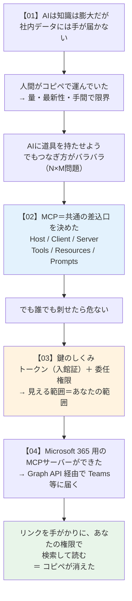

# 05. まとめ：用語集と注意点

### このファイルで分かること

- シリーズ全体を1枚で振り返る
- **用語集**（人に説明するとき用のカンペ）
- **よくある誤解**の❌⭕リスト
- 自分が気をつけること（セキュリティ）
- **出典**（一次情報に戻れるように）

---

## 1. 全体を1枚で



**縦に読むと、そのまま人に説明できる順番になっています。**

---

## 2. 用語集（人に説明するとき用）

| 用語 | 一言でいうと | たとえ |
|---|---|---|
| **MCP**（Model Context Protocol） | AIと外のデータをつなぐ共通の約束事 | USB-C |
| **プロトコル** | 「こう話しかけたらこう返す」という決まり | 電話の話し方のマナー |
| **MCP Host** | MCPを使うAIアプリ本体 | お客さん（Claude Desktop など） |
| **MCP Client** | サーバー1つにつき1つ作られる接続係 | ウェイター |
| **MCP Server** | データや道具を差し出すプログラム。**場所ではなく役割** | 厨房（家の中にあってもいい） |
| **Tools** | AIが呼ぶと何かが起きる操作 | メニューの料理 |
| **Resources** | 読めるデータ | テーブルに置かれた資料 |
| **Prompts** | よく使う頼み方のテンプレ | おすすめセット |
| **Elicitation** | サーバーがユーザーに聞き返すしくみ | 「本当に送る？」の確認 |
| **JSON-RPC 2.0** | やりとりの文章フォーマットの規格 | 決まった書式の注文票 |
| **stdio** | 同じPC内でやりとりする経路 | 同じ部屋で口頭 |
| **Streamable HTTP** | ネット越しにやりとりする経路 | 電話をかける |
| **OAuth** | パスワードを渡さずに入館証をもらう手続き | ホテルのチェックイン |
| **トークン** | 期限付き・範囲限定の本人確認の証 | カードキー／入館証 |
| **委任権限**（delegated） | 「あなたの代理」として動く権限。**あなたの範囲を超えない** | あなたの影 |
| **アプリ権限**（application） | アプリ自身として動く権限。範囲が広くなりうる | マスターキー |
| **On-Behalf-Of フロー** | 入館証を別の建物用に取り替える手続き | 受付で取り替えてもらう |
| **Microsoft Graph API** | Microsoft 365 のデータを取り出す公式の窓口 | 役所の総合窓口 |
| **コネクタ** | Claudeを外部サービスにつなぐ設定。中身はMCPサーバー | 延長コード |
| **テナント** | 会社ごとに区切られたデータの領域 | ビル内の「○○社の区画」 |
| **Entra ID** | Microsoftのアカウント・認証のしくみ | 会社の受付・社員名簿 |
| **deprecated（非推奨）** | 「これからは使わないでね」という宣告 | 販売終了予定の部品 |

---

## 3. よくある誤解

### ❌ MCPサーバーは、どこか遠くのコンピュータのこと

```
 ⭕ 「サーバー」は 役割 の名前。「差し出す側」がサーバー。
    あなたのノートPCの中で動いていても、それはMCPサーバー。
```

### ❌ MCPを入れるとAIが賢くなる

```
 ⭕ 賢さは 1ミリも変わらない。変わるのは「手が届く範囲」。

    ┌──────────────┐        ┌──────────────┐
    │ 頭の良さ     │        │ 手の長さ      │
    │ → 変わらない │        │ → 伸びる ⭕   │
    └──────────────┘        └──────────────┘

    だから「答えの質が悪い」問題はMCPでは解決しません
    （それは ../ai_use/AI使い方_やさしい解説.md の話）
```

### ❌ コネクタをつなぐと、社内データが全部Claude側にコピーされる

```
 ⭕ 聞かれたときだけ その場で取りに行く方式。
    ・応答後にデータは片付けられる
    ・ファイルの中身は キャッシュしない
    ・保存されたチャットに含まれるツール結果だけが残る
```

### ❌ Claudeなら他人のチャットも読めてしまう

```
 ⭕ 委任権限なので、あなたの権限の外には届かない。
    Claudeが遠慮しているのではなく、Microsoft側がそもそも渡さない。

    → 迷ったら「自分で開けるか？」を考える。開けないならClaudeも無理。
```

### ❌ Claudeにパスワードを預けている

```
 ⭕ パスワードは Microsoftの画面に入れている。
    Claudeが受け取るのは 期限付きのトークンだけ。
```

### ❌ つなげば Microsoft 365 のものは全部読める

```
 ⭕ 読めないものがある。OneNote のノートブックは非対応。
    書き込みツールでは添付ファイルも非対応。

    ⚠️ 「権限の壁」と「機能の壁」は別物。
       権限があっても、機能として無いものは読めない。
```

### ❌ MCPの解説記事を読めば最新の仕様が分かる

```
 ⭕ 仕様は改訂が続いている（2024年11月初版 → 2026-07-28版）。
    Sampling や Logging のように 非推奨になった機能もある。
    → 概要は記事で、確認は公式（modelcontextprotocol.io）で。
```

---

## 4. 自分が気をつけること

```
   ┌────────────────────────────────────────────────────────────────┐
   │ ① 何をつなぐかは、自分で選ぶ                                    │
   │    つないだ瞬間、「自分が見られる範囲」がAIの作業範囲になる       │
   │    → 必要なものだけつなぐ。使わないコネクタは切る                │
   ├────────────────────────────────────────────────────────────────┤
   │ ② 書き込みツールは本当に書く                                    │
   │    ChatMessage.Send は Teamsに 実際に投稿する。                 │
   │    Mail.Send は 実際に送る。送信は取り消せない ⚠️               │
   │    → 確認画面を読まずにEnter連打しない                          │
   ├────────────────────────────────────────────────────────────────┤
   │ ③ 共有したチャットでは、ツールの結果は他人に見えない            │
   │    見えるのは Claudeの最終的な回答だけ。                        │
   │    → 逆に言うと、回答の中に社内情報を書いたまま共有すると        │
   │      その部分は相手に見える。共有前に中身を確認する              │
   ├────────────────────────────────────────────────────────────────┤
   │ ④ 「読めない」ときは3条件を疑う                                 │
   │    ① コネクタ有効  ② サインイン済み  ③ 自分に閲覧権            │
   ├────────────────────────────────────────────────────────────────┤
   │ ⑤ 取り消せることを知っておく                                    │
   │    トークンは管理画面からはがせる。管理者は会社単位で切れる。     │
   │    → 「一度つないだら後戻りできない」ものではない               │
   └────────────────────────────────────────────────────────────────┘
```

②について、03で出した図を再掲します。ここだけは何度も確認する価値があります。

```
   ┌─────────────────────┬─────────────────────┐
   │   読むだけ（Read）  │  書ける（Send/Write）│
   ├─────────────────────┼─────────────────────┤
   │ 最悪でも「見られた」│ 最悪だと「送られた」 │
   │ 取り返しはつく      │ 取り返しがつかない ⚠️│
   └─────────────────────┴─────────────────────┘
```

---

## 5. チェックリスト

```
 【MCP を理解できたかの確認】
   □ MCPを一言で説明できる（USB-Cのたとえ）
   □ Host / Client / Server を区別できる
   □ 「MCPサーバー」が場所の話ではないと言える
   □ Tools / Resources / Prompts の違いを言える
   □ AIは何を見てツールを選んでいるか言える
   □ 「MCPでAIが賢くなるわけではない」と言える

 【鍵のしくみを理解できたかの確認】
   □ Claudeにパスワードは渡っていないと説明できる
   □ トークンの3つの性質（期限付き・範囲限定・取り消し可）を言える
   □ 「委任権限」を一言で説明できる
   □ 権限名の読み方（対象.動作）が分かる

 【先輩の話を説明できるかの確認】★ゴール
   □ 「MS365にMCPサーバーが追加された」の意味を説明できる
   □ リンクを貼ってから答えが返るまでを6ステップで言える
   □ 「リンクを貼るだけ」の正確な言い方に直せる
   □ 読めるための3条件を言える
   □ 「自分は読めない」ときにどこを疑うか分かる

 【使うときに毎回】
   □ 必要なコネクタだけつないでいるか
   □ 書き込みツールを使うとき、確認画面を読んだか
   □ 会話を共有する前に、中身の社内情報を確認したか
```

---

## 6. 出典（一次情報）

この資料は、以下の公式情報をもとに書いています（**2026年9月時点**）。
仕様は改訂されるので、**迷ったら必ずここに戻ってください**。

| # | 内容 | どこ |
|---|---|---|
| 1 | MCPのアーキテクチャ（Host/Client/Server、primitives、transport） | `modelcontextprotocol.io/docs/learn/architecture` |
| 2 | MCP仕様（最新版） | `modelcontextprotocol.io/specification/latest` |
| 3 | Microsoft 365 コネクタのセキュリティ（委任権限、トークン交換、キャッシュ方針） | `support.claude.com` の「Microsoft 365 connector security guide」 |
| 4 | Microsoft 365 コネクタの設定方法 | `support.claude.com` の「Set up the Microsoft 365 connector」 |
| 5 | Microsoft 365 への接続（できること一覧・対応形式） | `support.claude.com` の「Connect to Microsoft 365」 |

**この資料で「公式には書かれていない」と明記した点**（再掲・重要）：

```
   「URLを貼り付けると、そのURLの内容を読む」という 専用機能 としては、
   公式ドキュメントに記載がない。
   公式が説明しているのは 検索ツール（chat_message_search など）＋ Graph API。

   → 体験としては起きるが、「リンク専用機能がある」と人に言うのは避ける。
     「リンクを手がかりに検索している」と言うのが正確。
```

---

## 7. 次に何を学ぶか（自分用メモ）

ここまでで「理解」は完了です。次の一歩の候補。

| やること | 得られるもの |
|---|---|
| 実際にM365コネクタをつないで、Teamsのリンクで試す | 3条件が本当に効いているかを体感できる |
| Claude Code に自作のMCPサーバーをつないでみる | 02のTools/`tools/call`が実物として分かる |
| `tools/list` の実際のJSONを見る | AIに「メニュー表」がどう見えているか分かる |
| 公式の MCP Inspector を触る | サーバーの中身を覗くデバッグ道具 |

> **理解の最後の確認方法は、「先輩に説明し返せるか」です。**
> 04の6ステップと3条件を、図なしで口で言えたら完了。

---

← 最初に戻る：**[README.md](README.md)**
