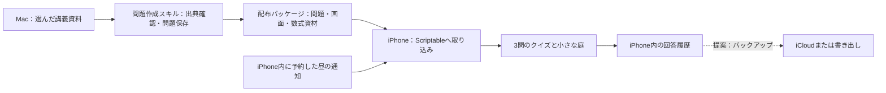

# 1問1答クイズの設計・スマホ利用調査

調査日：2026年11月12日。対象：Kyoto_Univ、最初の科目は微分積分学続論II。

この文書は、対話で決まった条件と、公式資料・ローカル構成の調査に基づく設計案を保存したものです。アプリ、スキル、通知、外部配信はまだ実装・設定していません。「推奨」「提案」は未承認の設計判断であり、実機検証済みという意味ではありません。料金・提供条件は調査時点のものです。

## 1. 現時点の推奨

**最初は、iPhoneのScriptableで「ローカル教材＋クイズ画面＋昼の通知」を動かす小さな試作を第一候補にします。** Macは教材から問題を作るときに使い、毎日の学習時は起動不要にする方針です。通知から起動し、3問で終われることと、回答直後に記録が残ることを先に検証します。

ScriptableはJavaScriptでiPhoneの機能を使えるアプリです。今回必要な通知予約、通知タップ時のURL起動、HTML表示、ファイル保存を公式APIが提供しています。ただし、それらを組み合わせたクイズの動作は未実装・未検証です。通知・起動・保存を通した試作が成立した段階で採用を確定します。[通知API](https://docs.scriptable.app/notification/)、[画面API](https://docs.scriptable.app/webview/)、[保存API](https://docs.scriptable.app/filemanager/)

この案が実機で合わなければ、次の候補は「クイズだけを認証付きHTTPSで配信し、Pushcutの端末内通知からSafariで開く」です。今のMacを昼も確実に稼働させる運用でよければ、Tailscale Serveで私用アクセスする案もあります。

**TermiusやIDEの変更は、外出先で開発・管理をしたいときの選択肢です。毎日クイズをするための必須操作にはしません。**

## 2. 対話で合意済みの条件

| 項目 | 合意内容 |
|---|---|
| 優先する成果 | まず試験の点数。定義、公式、適用条件、解法の第一手を思い出せるようにする。 |
| 最初の対象 | 微分積分学続論II、第1回「常微分方程式の導入・変数分離」。 |
| 最初の量 | 15問以内。全教材の一括問題化はせず、小さく試す。 |
| 回答方式 | 選択式ではなく、頭の中で答え、入力しない。 |
| 答え合わせ | すぐ解答を表示でき、「思い出せた／出なかった」を押す。 |
| 問題の粒度 | 原則として短い問いと1行の答え。式から解法や注意点を答える問題も含む。 |
| 利用端末 | まずiPhone1台。 |
| 区切り | 3問で終了。「今日はここまで／あと3問」を選べる。1問で終了してもよい。 |
| 通知 | 昼に1日1回。無視しても追撃しない。夜のバイト中には送らない。 |
| 報酬 | 想起を試みて答え合わせをすれば、誤答でもコインを獲得。 |
| ゲーム | コインで小さな庭の植物や飾りを増やす。失敗や休みによる没収なし。 |
| 誤答 | ワンタップで自動記録。数問挟んだ後と別の日に再出題する候補にする。 |
| 継続 | 休み明けに復習をすべて片づける義務を課さない。短時間で再開できる。 |
| 作成の効率 | 出典付き問題を保存し、追加・変更部分だけ処理する。 |

ホーム画面Webアプリを第一候補にすることも一度合意しましたが、その後「通知ありでとりあえずスマホから使えること」を優先して広く再調査する依頼がありました。Scriptableへの変更は、ここで提示する新しい候補であり、まだ確定ではありません。

継続を妨げてきた要因は「開くのが面倒」「量が多い」「飽きる」です。通知から1分以内ならコイン3倍という案は保留し、まず期限のない報酬を試す方針です。

## 3. 既存リポジトリで確認できたこと

### 教材とクイズ

- Kyoto_UnivのPDFは調査時点で157件、約850.5 MiB。講義資料、演習、過去問、レポートなどが混在します。すべてを出題対象にする理由はありません。
- HTMLは63件。既存の想起クイズはコーポレートファイナンス第1回に70個、公共政策論II第2回に5個あります。問い、任意の入力欄、開閉式の答えという構成です。
- 独立したクイズアプリ、クイズの正誤履歴、誤答の復習スケジュールは見つかりませんでした。
- 微分積分学続論IIは授業資料1〜5が計59ページ、要綱1ページ、演習2が4ページ。第1回・第2回の既存解説があります。科目フォルダ内に過去問は見つかっていません。
- 第1回は10ページ。変数分離、一般解と初期条件、検算、割り算で失う解などを扱い、演習2の問1(3)や問2と接続できます。試験への関連性は現段階では講義と演習を根拠にし、過去問頻出とは表示しません。

### 今のLIFEをそのまま外へ出す際の制約

| 確認箇所 | 事実 | 設計への影響 |
|---|---|---|
| `Kyoto_Univ/README.md:15` | 起動は `python3 Kyoto_Univ/serve_portal.py`。 | 現行の学習ページ閲覧はPython中心で、IDE移行は必須ではない。 |
| `Kyoto_Univ/serve_portal.py:323` | bindは127.0.0.1。 | そのままiPhoneから接続できない。 |
| `Kyoto_Univ/serve_portal.py:166` | HostとOriginをlocalhost系に限定。 | HTTPSプロキシを追加する場合も、想定する接続先の許可が必要。 |
| `Kyoto_Univ/serve_portal.py:209` | ローカル接続を前提に書込トークンを取得する構成。 | 一般公開用のユーザー認証としては扱わない。 |
| `Kyoto_Univ/serve_portal.py:164`、`:222` | 静的配信のrootはKyoto_Univ全体。 | クイズだけを配信する場合は専用の出力先に限定する。 |
| `Kyoto_Univ/serve_portal.py:207` | 家計APIなどへの橋渡しもある。 | 学習だけの用途で現行サーバー全体を一般公開する案は選ばない。 |
| `Kyoto_Univ/ui/life.js:11` | localStorageと同一originのAPIで学習状態を扱う。 | 資料の進捗保存は参考になるが、クイズ履歴は追加設計が必要。 |
| `Kyoto_Univ/ui/life.css:6` | スマホ幅のレイアウトがある。 | 表示基盤は参考にできるが、iPhone実機での使用感は未検証。 |

第1回の既存HTMLはMathJaxをCDNから読み込みます。既存HTMLをコピーするだけでは、完全なオフライン数式表示を保証できません。オフラインを採用するなら、必要な数式表示資材も端末へ同梱して確認します。

調査では既存のPWA、Web Push、ホスティング設定は見つかりませんでした。TailscaleやTermiusがPATHや標準的なアプリ配置先に存在する証拠もありませんでしたが、別の場所へのインストールやiPhoneの状態は未確認です。

## 4. スマホ利用方法の比較

「開発環境をスマホから操作する」「学習画面を配信する」「通知を届ける」は別々に選べます。全部を一つの遠隔開発環境に移す必要はありません。

| 構成 | 学習時のMac | 通知 | 日常の操作 | 主な制約 | 今回の位置付け |
|---|---|---|---|---|---|
| Scriptable内で完結 | 不要 | iPhone内で予約 | 通知→クイズ画面 | 保存の橋渡し、数式、更新手順を実機検証する。 | 第一候補の試作。 |
| 認証付きHTTPS配信＋Pushcut | 不要 | iPhone内で予約 | 通知→Safari→クイズ | 初期のホスティングと認証設定。履歴保存方式の選択。 | Web版を育てる場合の本命。 |
| Mac＋Tailscale Serve＋Pushcut | 必要 | iPhone内で予約 | 通知→Safari→クイズ | Macのスリープ・電源・回線に依存。現行サーバーの接続先設定が必要。 | 今の環境を使う試作。 |
| Mac＋TermiusのSSH転送 | 必要 | 別途必要 | SSH接続後にSafari | iOSのバックグラウンド停止で転送が切れる。 | 一時的な確認、管理用。 |
| VS Code Remote Tunnels | 必要 | 別途必要 | ブラウザで遠隔開発 | Mac側のプロセスが必要。通知や常時配信は別問題。 | スマホから開発もしたい場合。 |
| GitHub Codespaces | 不要 | 別途必要 | クラウド開発環境を起動 | 無操作停止、実行枠・課金、開発用URL。 | 開発場所の移行候補。学習用の常時ホストにはしない。 |
| AnkiMobile | 不要 | アプリ内に機能あり | 通知→アプリで復習 | 庭や3問の区切りを含む独自体験とは異なる。 | 最短で学習を始める比較対象・退避先。 |

### Termius、Tailscale、IDEについて

Termius公式は、iOSでバックグラウンドになると通常20〜30秒ほどで活動が止まり、SSHやポート転送が中断すると説明しています。tmuxは接続先のプロセスを保てても、iPhone側の転送停止は防げません。したがって、Termiusを毎回のクイズの入口にする案は採りません。[Termius公式FAQ](https://docs.termius.com/help-center/faq/how-can-i-keep-termius-sessions-alive-in-the-background-on-ios-ipados.md)

Tailscale Serveはtailnet内に限定したHTTPSで、Macの127.0.0.1のサーバーへ転送できます。Funnelによる一般公開とは別機能です。iPhoneのVPN On Demandは毎回の手動接続を減らす候補です。ただしMacが配信元なら、Macの起動と到達性が必要です。Personalは現行の公式料金で非商用利用無料です。[Serve](https://tailscale.com/docs/features/tailscale-serve)、[iOSの自動接続](https://tailscale.com/docs/features/client/ios-vpn-on-demand)、[料金](https://tailscale.com/pricing)

VS Code Remote TunnelsならMacのコードやターミナルをブラウザから利用できます。Codespacesなら実行環境ごとクラウドへ移せますが、既定では30分の無操作で停止します。Free個人アカウントの含有量は月120 core-hours、15 GB-monthで、2コアなら実時間約60時間に相当します。スマホでの編集しやすさは未検証です。[Remote Tunnels](https://code.visualstudio.com/docs/remote/tunnels)、[Codespaces料金](https://docs.github.com/en/billing/concepts/product-billing/github-codespaces)、[停止条件](https://docs.github.com/en/codespaces/setting-your-user-preferences/setting-your-timeout-period-for-github-codespaces)

Termiusの無料StarterにはSSH・SFTP・ポート転送が含まれます。学生向けのGitHub Student Developer Pack特典もありますが、適用できるかは本人のアカウント次第です。[Termius料金](https://www.termius.com/pricing)、[GitHub Education](https://education.github.com/pack)

## 5. 第一候補：Scriptableで端末内に完結させる

### 公式仕様から成立すると判断できる範囲

- 日本App Storeでは無料で、掲載されているアプリ内購入はチップです。教材配布用に専用のサーバーを契約することは初期案の前提にしません。[日本App Store](https://apps.apple.com/jp/app/scriptable/id1405459188)
- 通知はScriptableが実行されていないときにも配信でき、毎日の繰り返しとタップ先を設定できます。
- WebViewでHTMLやローカルファイルを表示し、JavaScriptの評価結果をScriptable側へ返すAPIがあります。
- ローカルとiCloudのファイル操作ができます。HTML内のlocalStorageだけに依存せず、回答結果をネイティブ側のファイルへ保存する設計が可能です。

ここまでは[通知](https://docs.scriptable.app/notification/)、[WebView](https://docs.scriptable.app/webview/)、[FileManager](https://docs.scriptable.app/filemanager/)の仕様を組み合わせた設計上の判断です。APIの存在だけで、完成品の使い心地や保存の耐久性が検証できたとは扱いません。

通知の起動先は、`openURL`に`URLScheme.forRunningScript()`で取得した実行URLを設定する案です。通知を長押しして内部で実行する`scriptName`の機能とは区別します。教材や画面資材をiCloudから取り込む場合は、必要なファイルを初回にダウンロードしてからローカルコピーを保持します。長期保存する履歴は一時・キャッシュ用の領域に置きません。[起動URL](https://docs.scriptable.app/urlscheme/)、[ファイル管理](https://docs.scriptable.app/filemanager/)

### 採用前に必ず確かめること

1. ロック中に通知が届き、タップするとスクリプト一覧やエディタを経由せずクイズが開くか。
2. 問題の数式がスマホ幅で読め、ネット接続なしでも表示できるか。
3. 正誤ボタンからScriptable側へ結果を渡し、保存完了後に次の問題へ進めるか。
4. 回答直後にアプリを終了しても、保存済み回答とコインが残るか。未保存の回答を保存済みと表示しないか。
5. 連打、通知の二度押し、画面の開き直しでコインや履歴が二重加算されないか。
6. 教材更新で既存の履歴を消さず、通信やiCloudが使えなくても保存済みの教材で始められるか。
7. 初期設定や教材更新を繰り返しても昼の通知が重複せず、時刻変更で古い予約を置き換えられるか。通知をOFFにできるか。
8. 問題表示中、解答表示後、保存中にホームへ戻る・ロックする操作を行い、復帰時に固まらず、保存済みの状態から再開できるか。

Scriptableはアプリ内の実行基盤であり、今のPythonサーバーやMacの開発環境をそのまま移す仕組みではありません。教材から問題を作る作業はMacに残し、出題に必要な小さいデータと画面だけを持ち込みます。

履歴はまずiPhone内を正本にする案を推奨します。iCloudはバックアップ候補で、即時同期や複数端末で同時に書き込む同期は初期案の対象外です。教材の受け渡し方法、バックアップ先、iCloud利用可否は未決定です。

## 6. Web配信する場合の候補

### 通知はPushcutで先に実現する

Pushcutは端末内のLocal Triggerで日次通知を予約でき、通知のDefault ActionにクイズのURLを指定できます。通常のHTTPS URLはSafariで開きます。無料版は通知3件、各1アクション、Local Triggerの利用が認められており、固定の昼通知1件は枠内に収まる構成です。実際の無料版UIでの設定と起動動作は未検証です。[通知仕様](https://www.pushcut.io/support/notifications)、[日本App Storeの無料版条件](https://apps.apple.com/jp/app/pushcut-shortcuts-automation/id1450936447)

専用iOS端末を常時前面で動かすPushcut Automation Serverとは別の機能です。今回そのサーバーは使いません。

**Safariとホーム画面PWAの保存領域を混同しません。** WebKitはホーム画面WebアプリのデータをSafariと分離すると説明しています。PushcutからSafariで開く場合、通常起動も同じ保存先に統一するか、サーバーで履歴を共有する必要があります。通知から既存のホーム画面PWAが必ず起動するとは約束しません。[WebKitの説明](https://webkit.org/tracking-prevention/)

### 外部配信はクイズ用の出力物だけに限定する

Cloudflare Workers Static AssetsとAccessは、認証付きでクイズの画面・問題データだけを置く候補です。現行公式資料では、Workersの本番とプレビュー双方をAccessで保護でき、静的資材にも保護が適用されます。独自ドメイン購入を前提にせず、workers.devで始められる構成を調べます。[静的配信](https://developers.cloudflare.com/workers/static-assets/)、[Access](https://developers.cloudflare.com/workers/configuration/cloudflare-access/)

静的資材のリクエストは無料・無制限ですが、APIや保存、定期実行を追加する場合は別の利用枠を確認します。Accessのログインは毎回要求する構成を避け、必要な間隔で再認証する案です。無料枠だけで最終構成が成立するかは、保存・通知の方式を決めた段階で再確認します。[静的資材の料金](https://developers.cloudflare.com/workers/static-assets/billing-and-limitations/)、[Accessのセッション](https://developers.cloudflare.com/cloudflare-one/access-controls/access-settings/session-management/)

GitHub Pagesは一般的な個人利用では、元リポジトリがprivateでもサイトは公開されます。私用教材の認証付き配信先として、そのまま採用しません。[GitHub公式説明](https://docs.github.com/en/pages/getting-started-with-github-pages/creating-a-github-pages-site)

### その他の通知候補

| 候補 | 確認した機能・制約 | 判断 |
|---|---|---|
| Appleリマインダー | URL、時刻、繰り返しを設定できる。通知タップから直接クイズへ入るタップ数は未確認。 | 追加アプリを避ける退避案。 |
| ショートカット | 時刻起点の自動実行ができる。ただし「通知を表示→URLを開く」を並べても、通知タップまで待つ意味にはならない。 | 通知からの直接起動を未検証のまま約束しない。 |
| Pushover | 補助URL付き通知を送れる。送信元が別途必要。 | 今回は構成が増えるため第一候補にしない。 |
| ntfy | URL付き通知を送れる。iOSで自前配信を即時に行うにはAPNs対応の上流など追加条件がある。 | 最初の個人用クイズには運用が増える。 |
| 自作PWA Web Push | iOS 16.4以降のホーム画面Webアプリで利用可能。通知許可と外部の定期送信元が必要。 | Web版が定着してから統合する候補。 |

根拠：[Appleリマインダー](https://support.apple.com/en-euro/guide/iphone/iphec7a1de82/ios)、[ショートカットの通知](https://support.apple.com/en-bh/guide/shortcuts/apd2175adcab/ios)、[Pushover API](https://pushover.net/api#urls)、[ntfyのiOS配信条件](https://docs.ntfy.sh/config/#ios-instant-notifications)、[Web Push](https://webkit.org/blog/13878/web-push-for-web-apps-on-ios-and-ipados/)

通知の許可、集中モード、通知要約はiPhone側の設定にも依存します。昼の通知を設定しても、指定時刻に必ず音付きで表示されるとは保証しません。夜のバイト中の集中モードを通知のために弱める運用は採りません。[Appleの通知設計](https://developer.apple.com/design/human-interface-guidelines/managing-notifications)

## 7. 既存アプリを使う案も比較に残す

**最短で「通知付きの想起学習」を始めるだけなら、AnkiMobileも有力です。** 日本App Storeでは調査時点で4,000円の買い切りで、オフライン、数式、学習履歴、同期に対応します。独自の庭やコインの体験を作る目的とは分けて比較します。[日本App Store](https://apps.apple.com/jp/app/ankimobile-flashcards/id373493387)

公式設定には、時刻指定の通知、残り枚数の非表示、入力不要の回答、タップ操作があります。したがって、「AIスキルは教材から良い問題を作ることに集中し、出題と復習はAnkiに任せる」という分担も成立します。モバイルではデスクトップ用アドオンを使えないため、庭ゲームを既存アドオンでそのまま移せるとは考えません。[AnkiMobile設定](https://docs.ankiweb.net/ankimobile/preferences)

問題データをアプリに依存しない形式で保管し、将来Ankiへ出せるようにしておけば、自作アプリの開発に時間を使いすぎても学習を始められます。テキストのインポートは公式に対応しています。[インポート仕様](https://docs.ankiweb.net/importing/text-files.html)

## 8. 学習方法としての評価

### 根拠がある部分

概念の短答を繰り返し、別の学習日に再び想起する方法には、長期保持と学習時間を調べた実験があります。最初の1回で正解したかだけで終わらず、時間を空けて正解できることを確認する設計はこの方向に合います。ただし、特定の復習間隔がこの科目・本人に最適とまでは判断できません。[Rawson・Dunloskyの実験](https://pubmed.ncbi.nlm.nih.gov/21707204/)

想起練習の利益が、練習した設問以外の推論問題へ及ぶ実験もあります。ただし文章中の事実・概念を用いた研究であり、常微分方程式の計算試験に同じ効果量が出る証拠ではありません。[Butlerの実験](https://pubmed.ncbi.nlm.nih.gov/20804289/)

### 過大に期待しない部分

数学の問題解決では、例題の再学習に対する想起練習の優位が確認されなかった実験もあります。短答クイズの正答率だけで、長い計算や証明ができるとは判定しません。[Huangらの実験](https://pmc.ncbi.nlm.nih.gov/articles/PMC9987560/)

したがって、今回のクイズは「何を使うか、どの条件が必要か、次に何をするか」を思い出す補助として設計します。試験の点数への接続は、別途既存演習を解いて確認します。15問の正答率を試験範囲全体の習得率と表示しません。

「1問につき何秒考えれば最適か」「3問なら三日坊主にならないか」「庭ゲームで継続率が上がるか」は、この個人・科目で未検証です。3問、昼の通知、コイン、庭は継続しやすさを確かめる製品仮説として扱います。

### 最初の出題方針案

- 定義・公式だけでなく、式の型、最初の操作、適用条件、割り算で失う解、検算を含める。
- 1問で問う判断は原則1つ。必要な条件を省いて短くすることはしない。
- 解答は原則1行、補足は折りたたむ。「これが言えれば正解」という基準を短く示す。
- わからなければすぐ表示できる。強制の待ち時間や速度報酬は置かない。
- 答えを読んで納得しただけの場合は「出なかった」にする。曖昧な自己判定を減らす。
- 同日内の再出題は上限を設け、1問を何度も回してコインを稼ぐ体験にはしない。
- 3問で止めたとき、再出題待ちの誤答を片づける義務を作らない。次の機会へ回せる。

## 9. 誤答記録と出題順の設計案

これは未確定の提案です。利用中の操作は「答えを開く」「思い出せた／出なかった」に絞り、入力欄は設けません。

| 保存する情報 | 目的 |
|---|---|
| 固定の問題ID、問題の版 | 問いの表現や教材を更新しても履歴を追う。 |
| 回答イベントID、日時、自己判定 | 二重加算を防ぎ、復習を決める。 |
| 解答表示・評価までの経過時間 | 使いにくい問題の候補を探す。想起の成否そのものとは扱わない。 |
| 次の復習候補日時、別日での成功状況 | 正解した問題も戻し、当日だけの成功と区別する。 |
| セッションID、獲得コインの根拠 | 途中終了からの復帰と報酬の整合性。 |

外部解析サービスは初期案に含めません。通知を実際に見た時刻や、頭の中で想起を試みたかをアプリが確実に測れるとは扱いません。報酬条件は「解答を表示して自己判定した」という観測可能な操作で実装します。

保存は1問ごとに行い、保存完了後に次へ進む案です。連打で重複しないこと、更新しても履歴が消えないこと、保存失敗時にコインだけ増えないことを確認します。取り消し操作も検討します。

出題順は、誤答と復習候補を優先しつつ、同じ問題が続かないようにします。正解した問題を永久に外さず、未学習問題だけ増え続けることも避けます。単純な間隔から始めるか、既存のFSRS実装を使うかは未決定です。どちらを選んでも、履歴をアプリから書き出せることを要件にします。

復習を3問で切ることには、負担を抑えられる一方で、問題を増やしすぎると必要な復習が追いつかない限界があります。「残数を見せない」だけで解決したことにはしません。内部では出題機会と対象数を把握し、復習が回らなければ新規追加を抑える方針を提案します。

## 10. 問題作成スキルの責務とPDF処理

スキルと毎日の出題アプリを分けます。学習を始めるたびにAIへPDFを渡したり、問題を生成し直したりする必要はありません。

### スキルの入力・出力案

入力は科目フォルダ、対象の授業回または資料、習った範囲、問題数の上限。最初は微分積分学続論IIの第1回、15問以内です。

出力は次のまとまりを想定します。

- 出典付きの問題データ。短い問い、答え、正解の判定基準、任意の補足。
- 問題と演習の対応、出題対象にした範囲、まだ対象にしていない範囲。
- 原資料の識別情報と変更検出用の記録。
- Scriptable向けの取り込み用パッケージ。将来のWeb版・Anki出力に依存しない元データも保存。

### 作成の順序案

1. 科目と範囲を絞り、講義PDF、演習、既存解説の対応を確認する。
2. 既存HTMLは候補や構造把握に使い、問題と答えの正しさは原資料で照合する。
3. 対象PDFの抽出・ページ対応を一度保存する。数式や図が崩れる箇所はページ画像で確認する。
4. 演習で必要な判断を優先し、少数の問題を作る。教材にない頻出度や配点を捏造しない。
5. 答えの一意性、条件の欠落、重複、長すぎる問題、答えが問いに漏れていないかを点検する。
6. 問題を固定IDで保存し、アプリへ渡す。
7. 次回は原資料の内容変更を検出し、影響する問題だけ再確認する。

最初にすべてのPDFをOCRする処理は設けません。ページ単位のキャッシュを追加する場合も、最初は選んだ教材だけを対象にします。作成時間は文字抽出の可否、数式、画像、原資料照合に左右されるため、実測前に分数を約束しません。

問題文の微修正ならIDと履歴を保ち、問う内容を変える場合は版や別IDで区別する案です。古い問題を削除して履歴ごと失う更新は避けます。

## 11. 小さく試す順序と評価

### 段階A：接続・通知・保存だけを確認する

実装へ進む合意後、仮の数問でScriptableの通知、起動、画面、保存を通して確認します。ここで成立しなければ、ゲームや大量の問題作成に進まず、Web配信＋Pushcut案へ切り替えます。

### 段階B：第1回を15問以内で試す

問題生成、原資料照合、取り込み、3問の区切り、最小のコイン・庭を実装します。最初から複雑な店、ランダム抽選、ランキング、連続日数の競争は追加しません。

### 段階C：1週間程度、使い心地を観察する提案

以下は成功を保証する指標ではなく、改善箇所を見つけるための観察です。

- 通知後に、SSHやIDEを開かず1問目まで到達できるか。
- 3問の区切りが実際に1〜3分程度へ収まるか。超えるなら問いや補足を見直す。
- 休んだ後にも負担なく再開できるか。
- 別の日の初回提示で思い出せる問題が増えるか。
- 「出なかった」が続く問題は、前提理解不足なのか、問いが曖昧なのかを点検する。
- 対応する既存演習で、使う解法や最初の操作が自力で出てくるか。

短い単一ユーザー試行だけで、通知やゲームの因果効果、最短の学習法、試験得点の向上までは結論づけません。まず「開ける、続けられる、翌日にも思い出せる」を確認し、教材の追加はその後にします。

## 12. 次の対話で決めること

決定の依存関係は次のとおりです。

1. **実行基盤**：第一候補をScriptableの実機試作へ変更するか。別案はWeb配信＋Pushcut、Mac＋Tailscale、Anki。
2. **保存と配布**：基盤が決まったら、教材をiPhoneへ渡す方法、履歴の正本、iCloudバックアップ可否を決める。
3. **通知の具体時刻**：昼の何時がよいか。初期設定で本人が変更できる形を推奨する。
4. **問題の品質基準と出題順**：短さ、正解基準、復習間隔、誤答の同日再提示上限を決める。
5. **ゲームの最小仕様**：コイン量、植物や飾りの交換、演出を決める。報酬のためだけの連打を増やさない。
6. **試行の評価**：最初の1週間で何を観察し、どの条件なら教材を増やすかを決める。
7. **設計の共有理解を確認した後に実装**：問題作成スキルと出題アプリを作る。外部配信が必要な案を選ぶ場合は、配信対象と認証設定を具体化してから公開する。

現時点で不明なのは、iPhoneのiOSバージョン、iCloud Driveの利用可否、既存のアプリ・アカウント、正確な通知時刻、試験日・形式です。これらを推測して確定事項にはしません。ユーザーが休んでいる間は、回答に依存する設定・契約・公開へ進めず、調査と設計案の作成までを行いました。
