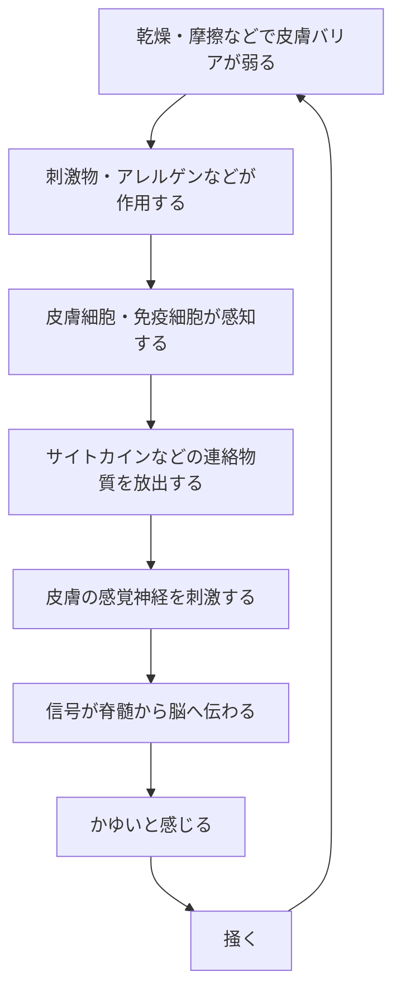
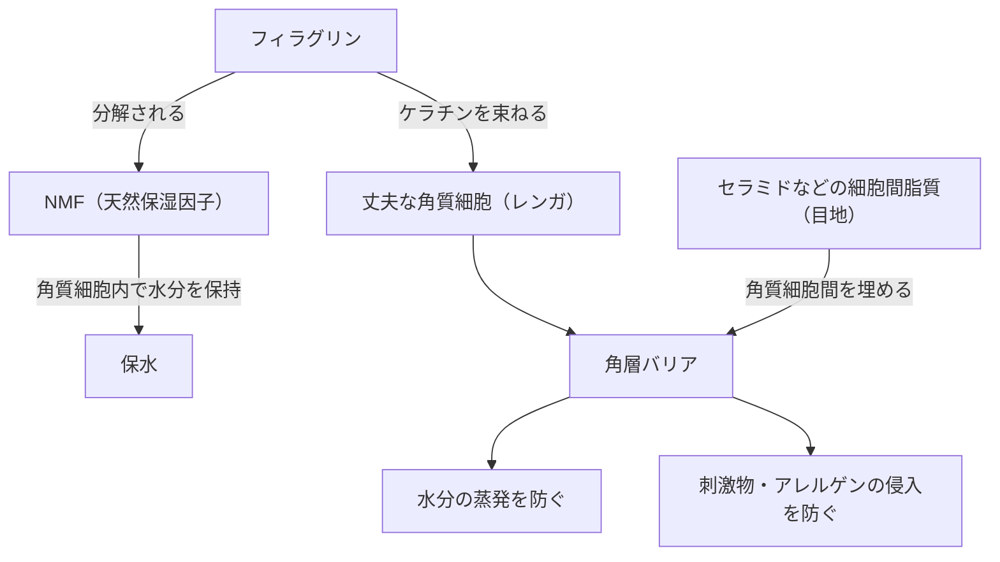
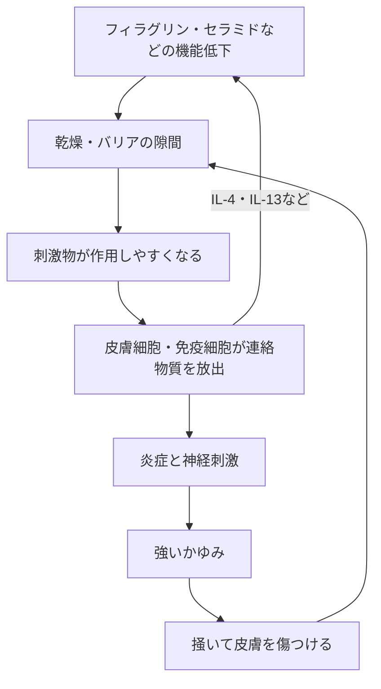
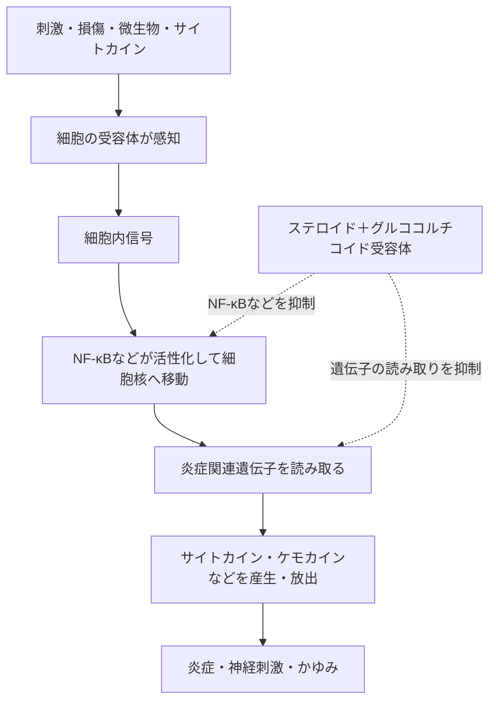

# かゆみの原理

https://chatgpt.com/c/6ab2a58d-b1ac-83ee-a419-9d10f13c8970

## 1. かゆみとは

かゆみは、皮膚への刺激や皮膚内部の炎症を**感覚神経が検知し、その信号を脊髄から脳へ伝えることで生じる感覚**である。

基本的な流れは、次のとおりである。

かゆみを起こす連絡物質にはヒスタミンのほか、IL-31などのサイトカインがある。特にアトピー性皮膚炎のかゆみはヒスタミンだけで起こるものではないため、抗ヒスタミン薬だけでは十分に抑えられないことがある。

## 2. 皮膚バリアの構造

皮膚表面の角層は、主に**角質細胞**と、その間を埋める**細胞間脂質**からできている。

- **角質細胞**：平たくなった細胞で、バリアの「レンガ」に相当する
- **セラミド**：細胞間脂質の主成分の一つで、角質細胞間を埋める「目地」に相当する
- **フィラグリン**：ケラチンを束ねて丈夫な角質細胞の形成を助け、後に分解されてNMF（天然保湿因子）の材料になる
- **NMF（天然保湿因子）**：角質細胞内で水分を抱える

したがって、乾燥とは単なる水分不足ではなく、**角層の構造が乱れ、水分が逃げやすく刺激を受けやすい状態**でもある。

## 3. 「炎症が起こる」とは

皮膚細胞や免疫細胞が刺激、損傷、微生物などを危険として感知すると、サイトカインやケモカインなどの**連絡物質**を作って放出する。

その結果、次の変化が起こる。

- 血管が広がり、血管から水分が漏れやすくなる → 赤み・腫れ
- 免疫細胞が集まり、活性化する → 湿疹・皮膚組織の損傷
- IL-31などが感覚神経に作用する → かゆみ
- IL-4・IL-13などが炎症を維持し、バリア関連物質を減らす → さらにバリアが弱くなる

つまり炎症とは、単なる赤みではなく、**皮膚細胞・免疫細胞・血管・神経が、連絡物質を介して防御反応を起こしている状態**である。

## 4. 普通のかゆみとアトピー性皮膚炎のかゆみの違い

刺激の感知、連絡物質の放出、神経刺激という基本経路は、誰の皮膚にも存在する。アトピー性皮膚炎では、同じ経路の各段階が**起こりやすく、強く、長く続く**。

| 段階 | 普通の皮膚 | アトピー性皮膚炎 |
| --- | --- | --- |
| バリア | 強い乾燥などで一時的に弱る | もともと弱い、または炎症によって弱くなりやすい |
| 刺激の侵入 | 比較的強い刺激で起こる | 汗・摩擦などの弱い刺激でも起こりやすい |
| 免疫反応 | 刺激に応じた範囲で起こり、刺激がなくなると収まりやすい | 2型炎症に偏りやすく、IL-4・IL-13などの作用が続きやすい |
| 神経反応 | 十分な刺激があるとかゆい | 神経が過敏になり、通常なら気にならない刺激でもかゆくなりやすい |
| 反応後 | バリアが回復して終了しやすい | 掻破でバリアが壊れ、反応が再開・持続しやすい |

アトピー性皮膚炎は単に「免疫全体が強い」状態ではない。**弱い皮膚バリア、起こりやすい局所免疫反応、過敏なかゆみ神経が互いに増幅し合う状態**である。

アトピー性皮膚炎は、**かゆみを伴う湿疹が、良くなったり悪くなったりを繰り返す慢性の皮膚疾患**である。アレルギー体質の人に多いが、アレルギー検査の陽性は診断の必須条件ではない。食事や生活習慣だけが原因となる病気でもなく、人にはうつらない。

## 5. ステロイド外用薬は、かゆみの流れのどこに作用するか

ステロイド外用薬は、神経を直接麻痺させる薬ではない。**かゆみの原因となる皮膚の炎症を抑える薬**である。

塗った場所の過剰な免疫反応を抑えることで、赤み、腫れ、湿疹、かゆみを減らし、**かゆい → 掻く → さらに炎症が悪化する**という悪循環を止める。

保湿剤とは作用する段階が異なる。

- **保湿剤**：角層の水分保持とバリア機能を補い、刺激を受けにくくする
- **ステロイド外用薬**：すでに始まった炎症と、それに伴うかゆみを抑える

ステロイド自体が角層を直接補修するわけではないが、炎症によるバリア破壊を止めることで、結果的に皮膚が回復しやすくなる。

## 6. ステロイドが炎症を抑える仕組み

ステロイドは皮膚細胞内に入り、**グルココルチコイド受容体**に結合する。結合した複合体は細胞核に作用し、NF-κBやAP-1などが進める炎症関連遺伝子の読み取りを抑える。また、抗炎症方向に働く遺伝子の発現も促す。

その結果、次の反応がまとめて弱まる。

- サイトカイン、ケモカインなどの炎症性連絡物質の産生
- 免疫細胞の活性化と患部への集合
- 炎症部位での血管拡張や血管透過性の上昇
- 炎症に伴う赤み、腫れ、湿疹、かゆみ

ステロイドは、一つの連絡物質だけを直接止めるのではなく、**炎症を作り、広げる仕組み全体を塗った部分で一時的に弱める**。

## 7. 「炎症遺伝子」とNF-κB

「炎症遺伝子」は説明上の呼び方であり、サイトカイン、ケモカイン、炎症に関係する酵素や接着分子などを作るための遺伝子を指す。

遺伝子は、もともとDNA上に存在する**設計図**である。炎症時に新しい遺伝子が発生するのではなく、細胞がその設計図を読み取り、mRNAを経て炎症関連タンパク質を作る量が増える。

NF-κB（エヌエフ・カッパー・ビー）は、その読み取りを調節する**転写因子というタンパク質群**である。NF-κB自身がサイトカインなどの連絡物質なのではない。「スイッチ」とは、炎症関連遺伝子を読み取るかどうかを調節する役割を表した比喩である。

## 8. かゆみの悪循環を止める考え方

かゆみの流れの異なる段階に、それぞれ別の対策が働く。

1. **バリアを補う**：保湿剤で水分保持を助け、刺激を受けにくくする
2. **炎症を抑える**：ステロイド外用薬などで連絡物質の産生と免疫反応を弱める
3. **悪化要因を減らす**：乾燥、汗、摩擦、刺激物など、本人に関係する要因を減らす
4. **掻破を減らす**：バリアの再損傷を防ぎ、悪循環を断つ

保湿だけでは、すでに起きている強い炎症を十分に抑えられないことがある。一方、炎症だけを抑えても、乾燥やバリア低下へのケアが不十分だと再び刺激を受けやすい。そのため、原因となる段階に合わせて対策を組み合わせる。

## 参考資料

- [日本皮膚科学会・日本アレルギー学会「アトピー性皮膚炎診療ガイドライン2024」](https://www.dermatol.or.jp/dermatol/wp-content/uploads/xoops/files/guideline/ADGL2024.pdf)
- [日本アレルギー学会「アトピー性皮膚炎／Q&A」](https://www.jsaweb.jp/modules/citizen_qa/index.php?content_id=4)
- [理化学研究所「アトピー性皮膚炎のかゆみ伝達機序を解明」](https://www.riken.jp/press/2023/20231129_1/index.html)
- [Uva L, et al. Mechanisms of Action of Topical Corticosteroids in Psoriasis](https://pmc.ncbi.nlm.nih.gov/articles/PMC3508578/)
- [Auphan N, et al. Immunosuppression by glucocorticoids: inhibition of NF-kappa B activity through induction of I kappa B synthesis](https://pubmed.ncbi.nlm.nih.gov/7569976/)
